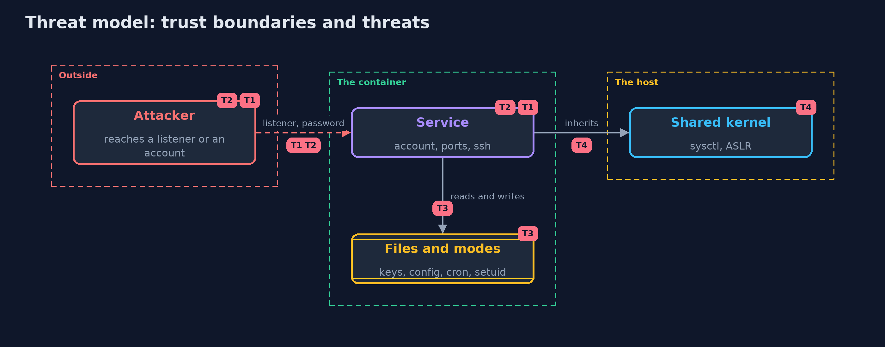

# Threat Model — Linux Hardening with Docker

A threat model answers four questions: what are we protecting, who or what could harm it, how, and what do we do about it. This one covers this project's own demo system, not a production deployment. Domain: an online store.

## Scope

The server image of an online store and a container started from it: its accounts, files, SSH settings, listeners and namespaced kernel settings. It does not cover the packages inside or the host.

## What we protect (assets)

- The shop's data and keys inside the container.
- The host that runs the container.

## Who and what acts on the system

- An attacker who reaches a listener or logs in.
- An operator who fixes things with docker exec.

## Trust boundaries

A trust boundary is a line that data or a request crosses between parts that trust each other differently. Threats cluster where those lines are.

- The container and the host's kernel.
- The image, which is built once, and the container, which is a copy.

Each dashed box is a trust boundary. A rose tag such as T1 shows where the threat of that number, in the table below, applies.

## Threats, using STRIDE

STRIDE is a checklist of six kinds of threat: **Spoofing** (S), **Tampering** (T), **Repudiation** (R), **Information disclosure** (I), **Denial of service** (D), **Elevation of privilege** (E).

| Id | Kind | Threat | Where it shows up | Control in this project | What is left |
| --- | --- | --- | --- | --- | --- |
| T1 | Spoofing | An account with no password or a second root | /etc/passwd and /etc/shadow | A rule for accounts, a recipe with a locked service account | Accounts added at run time |
| T2 | Elevation of privilege | A service that listens where it should not | listeners, sshd_config | An allow-list of ports and SSH settings in the recipe | Listeners started later by a process |
| T3 | Tampering | Files that anyone can change, or a shell with the set-user-id bit | modes in the image | Private modes in the recipe, a rule for set-user-id files | Files created at run time |
| T4 | Information disclosure | Kernel settings that the container cannot control | the shared kernel | Namespaced settings at start-up; the host's settings are the host's to fix | Everything the host has not hardened |

## Assumptions

- The image is built from a recipe under review.
- Containers are replaced rather than patched.

## Out of scope

- Vulnerabilities in installed packages.
- Escapes from the container.

## How the tests check this

- `ScannerTest` runs the rules on text: modes, accounts, sshd settings, listeners and kernel settings.
- `ContainerScanTest` builds the images and starts real containers for the counts, the fixes and where they live, the hardened image, the kernel options and the drift.
- `DemoRunsTest` compares the whole demo with the golden output.

## Where this model goes next

The next project in this module, container-hardening, looks at how the container is started: user, capabilities, mounts and filesystem mode.
