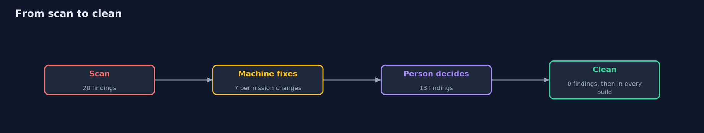
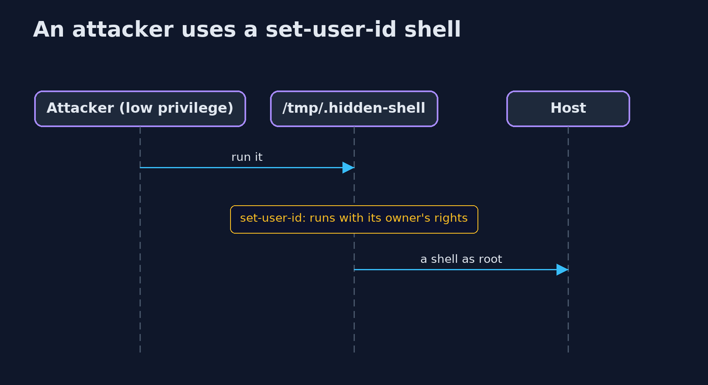

# Linux Hardening Checker

```
src/main/java/com/jk/explore/security/linuxhard/
├── Finding.java             One thing the checker found
├── Fixture.java             A prepared file system with the usual mistakes, made in a temporary directory: stands in for a container image mounted at a path
├── LinuxHardeningDemo.java  Runs the host-checking story in four numbered acts and prints exact, repeatable results
├── Modes.java               Reads and sets the Unix permission bits of a file, including the set-user-id, set-group-id and sticky bits that the POSIX permission set leaves out
├── Policy.java              What this host is allowed to have
├── Scanner.java             A host checker
└── Severity.java            How bad a finding is
```

**A Linux host or container image is secure only if its file permissions, accounts, SSH settings, kernel options and listening ports are what they should be; a checker reads them all with the JDK, separates the permission fixes a machine can make safely from the decisions a person must make, and runs again in every build.**

A server image is built once and runs for years. Over time it collects the settings that nobody chose: a file that was made world-writable to get a deployment working, a test account with no password, a root login over SSH left on from the install, a database port that listens on every interface,
a copy of a shell with the set-user-id bit. Each is small. Together they are the usual first step of an intrusion and the usual finding of an audit.

This project is a **host checker**. It reads a root directory (a live system's `/`, a mounted container image, or the prepared test tree used here) and checks, in five groups:
- **File permissions:** unexpected **set-user-id** or set-group-id files, world-writable files and directories without the sticky bit, secrets and keys that are not private enough, cron scripts a group can write.
- **Accounts:** a second UID 0 account, logins with an empty password, well-known default account names with a shell.
- **SSH daemon:** root login, password authentication, empty passwords, X11 forwarding.
- **Kernel settings:** address space randomization, SYN cookies, ICMP redirects.
- **Listening ports:** services that listen on every interface and are not on the allow-list.

Then it separates what a machine can fix (a permission change is mechanical and safe) from what needs a person (removing an account, changing a service, deciding a policy), applies the first group, and shows that the report shrinks to the decisions.

**Maps to:** OWASP Top 10 (2025) A02 Security Misconfiguration · CIS Benchmarks for Linux (sections on file permissions, user accounts, SSH and network parameters) · CWE-732 · CWE-250 · NIST SP 800-123 · NIST CSF Protect.

## The idea in everyday terms

A building inspector with a checklist who also carries a screwdriver: they tighten the loose handrail on the spot, and write a note for the owner about the missing fire exit. A re-inspection every month catches the handrail that someone loosens again.

## The scenario

A server image for a small web shop, built from a base image plus the shop's application. The demo builds a prepared copy of such an image in a temporary directory, with real Unix permission bits (including set-user-id), account files, an SSH configuration, kernel settings and a table of listening ports,
and scans it before and after the fixes.

## Run

```bash
./gradlew run
```

The demo tells the story in 4 acts, each printing exact numbers that the tests check:

| Act | What it shows |
| --- | --- |
| 1. What the checker finds on a typical image | 20 findings: 7 critical, 8 high, 3 medium and 2 low, of which 7 can be fixed mechanically. |
| 2. The fixes a machine can make | Seven permission changes are applied and 13 findings are left, none of them permissions: accounts, SSH, kernel settings and ports. |
| 3. The decisions a person makes | After removing the second root account and the test account, switching off passwords and root login for SSH, setting the kernel options and closing the extra ports, the scan reports 0 findings. |
| 4. Running it again | A second scan of the hardened tree reports 0 findings, and the same scan in the build makes a regression fail it. |

## Test

```bash
./gradlew test
```

16 tests in `DemoRunsTest`, `LinuxHardeningTest`. The temporary directory's name is never printed, and the tests are skipped on systems without Unix file modes.

## What the simulation got right, and what it left out

The file permissions are real Unix mode bits set and read through the JDK (the `unix` file attribute view, so the tests need Linux or macOS and are skipped elsewhere). The account, SSH, kernel and port files are small text files in the formats of the real ones, including a `/proc/net/tcp` style table. The fixture is built in a temporary directory that is removed afterwards.

## Technologies and versions

Every version below is pinned in the project's build files and was the latest stable release when the project was built.

| Technology | Version | Used for |
| --- | --- | --- |
| Java | 25 | the language and runtime; a Gradle toolchain finds or downloads the JDK |
| Gradle | 9.8.1 (wrapper) | build and run; nothing to install, the wrapper downloads it |
| org.junit.jupiter:junit-jupiter | 6.1.3, set by junit-bom | JUnit 5: the tests (tests only) |
| org.junit.platform:junit-platform-launcher | 6.1.3, set by junit-bom | JUnit platform launcher, which Gradle needs to run the tests (tests only) |
| videokit | repository tool (`tools/videokit`) | the narrated video and animation: Piper `en_US-amy-medium`, speed 0.8, longer pauses (the amy-slow voice) |

## Learning Material

| Document | What it is for |
| --- | --- |
| [Problem statement](docs/problem-statement.md) | the situation and what the project must show |
| [Prerequisites](docs/prerequisites.md) | what you need to know first |
| [Linux Hardening Checker, explained](docs/linux-hardening-explained.md) | the acts in prose |
| [Session guide](docs/session.md) | a one-hour lesson with exercises |
| [Animated walkthrough](docs/animation.html) | the acts step by step, narrated |
| [Threat model](docs/threat-model.md) | what is protected, who could harm it, and how, using STRIDE |
| [Spec](docs/spec.md) | what this project must be true of |
| [Expected output](docs/expected-output.txt) | the golden demo output every test and every port checks against |

### The idea in one picture

It reads a root directory; it changes only file modes.


### Where each piece sits

A scanner uses a policy to turn files into findings; the fixture builds a test tree.


### How the data moves

Each round removes a kind of finding.



### Who calls whom, in order




### Video

`video/linux-hardening-explained.mp4` (with `.m4a` audio and `.srt` subtitles) is built by `video/build_video.sh`. Rendered media is not committed.

## What it costs

- **Automatic fixes can break things.** Removing the set-user-id bit from a tool that needs it, or tightening a file that another service reads, stops that service. Fix mechanically only what is on a reviewed list and run the tests after.
- **The allow-lists are the work.** Which set-user-id programs, ports and file modes are right depends on the host; the policy must be written, versioned and reviewed.
- **A scan is a snapshot.** The same scan belongs in the image build and on running hosts, or the next change undoes the work.
- **Containers change the picture.** Many host checks (kernel settings, ports) belong to the host, not the image; the container-hardening project covers the container side.
- **Benchmarks are long.** The CIS benchmarks have hundreds of checks; start with the ones that stop the common attacks and grow from there.

## When this is too much

For production, use maintained tools (OpenSCAP, Lynis, CIS-CAT, the distribution's hardening guides, or your configuration management with tested roles) and their reports. Writing your own checker is for understanding what they check and for adding the few rules that are specific to your platform.

## Where you have already met this

- `find / -perm -4000` in privilege escalation guides.
- `PermitRootLogin no` and `PasswordAuthentication no` in every SSH hardening list.
- Lynis, OpenSCAP and CIS-CAT reports.
- `chmod 600` on private keys, and "unprotected private key file" errors from ssh.

## Where this sits

This project is in [platform-hardening](..) and is followed by [container-hardening](../container-hardening), which looks at the same ideas from inside a container. The Docker version (linux-hardening-with-docker) runs these checks against a hardened image.
