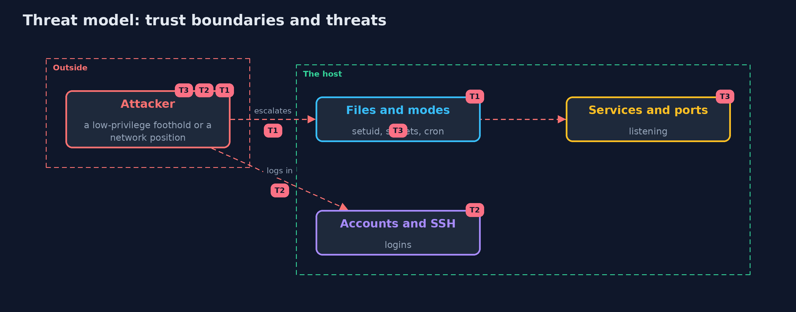

# Threat Model — Linux Hardening Checker

A threat model answers four questions: what are we protecting, who or what could harm it, how, and what do we do about it. This one covers this project's own demo system, not a production deployment. Domain: a Linux server image.

## Scope

The configuration of a Linux server image: file permissions, accounts, the SSH daemon, kernel parameters and listening ports.
It does not cover software vulnerabilities, application code, or the hypervisor and network around the host.

## What we protect (assets)

- Root on the host and the secrets stored on it.
- The application and its data.

## Who and what acts on the system

- An attacker with a low-privilege foothold (for example through an application bug).
- An attacker on the network.
- An administrator who changes settings for convenience.

## Trust boundaries

A trust boundary is a line that data or a request crosses between parts that trust each other differently. Threats cluster where those lines are.

- The network to the host: listening ports and the SSH daemon.
- Low privilege to root: set-user-id files, writable scripts and sudo.

Each dashed box is a trust boundary. A rose tag such as T1 shows where the threat of that number, in the table below, applies.

## Threats, using STRIDE

STRIDE is a checklist of six kinds of threat: **Spoofing** (S), **Tampering** (T), **Repudiation** (R), **Information disclosure** (I), **Denial of service** (D), **Elevation of privilege** (E).

| Id | Kind | Threat | Where it shows up | Control in this project | What is left |
| --- | --- | --- | --- | --- | --- |
| T1 | Elevation of privilege | A low-privilege user escalates through a set-user-id file, a writable cron script or a readable secret | `Scanner.permissions` | Allow-listed set-user-id files, maximum modes for secrets, no group or world write on scripts | Vulnerabilities in the allowed set-user-id programs themselves |
| T2 | Spoofing | An attacker logs in as an account with no password, a default name, or root over SSH | `Scanner.accounts`, `Scanner.ssh` | Remove default accounts, keys only, no root login, no empty passwords | Stolen keys; add multi-factor and monitoring |
| T3 | Elevation of privilege | A service that should not be reachable listens on every interface | `Scanner.ports` | An allow-list of ports; bind other services to localhost; host firewall | A service on an allowed port with its own flaws |

## Assumptions

- The policy is right for this host.
- The scan reads the same tree that runs.

## Out of scope

- Vulnerable packages: the sbom-and-provenance and scanning projects.
- Containers' own isolation: container-hardening.

## How the tests check this

- `LinuxHardeningTest` checks every rule on the prepared tree, the allow-lists, the order of the report, the mechanical fixes (and what they leave alone), the hardened tree, missing files and links; the tests are skipped without Unix file modes.
- `DemoRunsTest` compares the whole demo with the golden output.

## Where this model goes next

The next project, container-hardening, asks what a compromised process can reach from inside a container and removes it, layer by layer.
