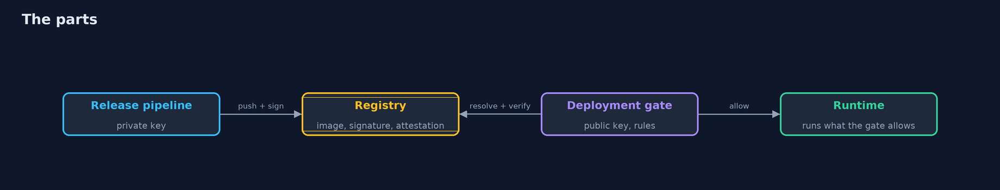
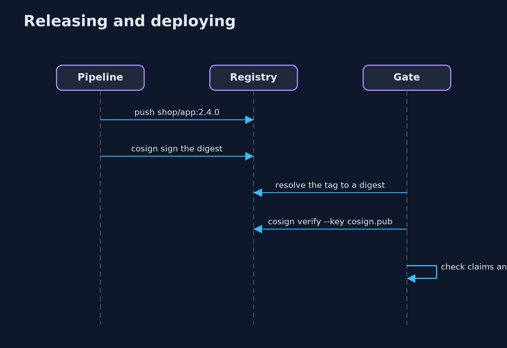

# Artifact Signing with cosign

```
src/main/java/com/jk/explore/security/cosignsigning/
├── Cosign.java             The cosign command, run as a program, with a key pair per signer kept in the lab's folder
├── CosignSigningDemo.java  Runs the store's release-signing story in five numbered acts with the real cosign command and a real container registry on the loopback interface
└── Lab.java                A container registry on a free loopback port, a folder for key pairs, and the real images of the lesson
```

**A container image tag can be moved to a different image, so a gate must resolve the tag to a digest and verify a signature that a pinned key made over exactly that digest, with the signed claims it requires and, where it matters, a signed statement of how the image was built; a signature carries no time and no revocation without a log, the gate protects only the paths that pass through it, and the key is the crown jewel.**

The plain [artifact-signing](../artifact-signing) project signs a jar with Ed25519 and builds a transparency log from scratch, and ends with "keyless signing ... the -with-cosign version". This one uses the real tool, **cosign 3**, to sign and verify real container images in a real registry (**registry:3** in Docker, on a free low loopback port). It needs Docker and the `cosign` command (`brew install cosign`); its tests are tagged `integration`: `./gradlew integrationTest`.

What it shows:
- **A tag is a name, not a checksum.** The release is pushed as `shop/app:2.4.0` (nginx 1.31.7). A different image (nginx 1.31.6) is pushed under the same tag and the deployment, pulling by tag, gets it.
- **A signed release, checked before it runs.** The release key signs the **digest**; the signature is stored in the same registry as one more tag. The gate resolves the tag to a digest and verifies with the pinned public key. A moved tag has no signature (refused); an image signed by the attacker's key is refused (the key is not trusted); the tag put back is accepted.
- **Signed claims and rotating keys.** `-a channel=stable` is signed with the image and checked by the gate; a beta build signed by the same key is refused by the stable gate. A gate trusts `[release, next]` while a build moves over. A thief with a retired key signs a new image today and a gate that still trusts it accepts it: **a signature carries no time**, and without a log there is no revocation day.
- **Attestations.** The CI system signs a SLSA provenance statement; the gate verifies it and applies a rule of its own (the builder must be the CI system). An image built on a laptop and attested by the same key **verifies, and fails the rule**. A statement signed only by the attacker's key, or offered for another digest, is refused.
- **The bill.** The gate refuses an unsigned image, but a pull straight from the registry never meets the gate. The key is protected by a passphrase. Keyless signing needs the public Fulcio and Rekor services, which a local lab does not have, so the transparency log is left out here.

**Maps to:** OWASP Top 10 (2025) A08 Software or Data Integrity Failures · SLSA · CWE-494 (download of code without integrity check), CWE-345 · Sigstore.

## The idea in everyday terms

A shipment with a wax seal. The tag on the crate is a label anyone can reprint; the seal is a stamp that only the shipper holds, pressed over the exact contents. The customs gate checks the seal against the shipper's known stamp, and ignores the label.

## The scenario

An online store ships its application as a container image. The demo starts a real registry, pushes real images, signs and attests them with cosign, and tries every move an attacker or an accident could make before a deployment gate.

## Run

```bash
./gradlew run
```

The demo tells the story in 5 acts, each printing exact numbers that the tests check:

| Act | What it shows |
| --- | --- |
| 1. A deployment that runs whatever a tag points at | A different image is pushed under the same tag, and a deployment that pulls by tag gets it. |
| 2. A signed release, checked before it runs | The release key signs the digest, the gate verifies it with the pinned public key, and a moved tag or an unknown key is refused. |
| 3. Signed claims, and keys that rotate | Claims such as channel=stable are signed with the image; a beta build is refused by the stable gate; a retired key still signs for any gate that trusts it. |
| 4. Signed statements about how the image was built | A provenance attestation names the builder; the gate verifies it and applies its own rule, so a laptop build signed by the same key verifies and still fails. |
| 5. The bill | The gate refuses an unsigned image, but a pull straight from the registry never meets it; the key needs a passphrase and a plan, and keyless signing needs public services. |

## Test

```bash
./gradlew test
```

9 tests in `CosignSigningTest`, `DemoRunsTest`. The tests start one registry for the whole class and remove it (./gradlew integrationTest). They need Docker and the cosign command.

## What the simulation got right, and what it left out

The registry is a real container on a free loopback port. The images are real images that are already on this machine. cosign is run as a program, with key pairs generated in a temporary folder that is removed at the end. Digests, keys and ports are never printed; the demo takes about twenty seconds.

## Technologies and versions

Every version below is pinned in the project's build files and was the latest stable release when the project was built.

| Technology | Version | Used for |
| --- | --- | --- |
| Java | 25 | the language and runtime; a Gradle toolchain finds or downloads the JDK |
| Gradle | 9.8.1 (wrapper) | build and run; nothing to install, the wrapper downloads it |
| tools.jackson.core:jackson-databind | 3.1.5 | library the code uses |
| org.junit.jupiter:junit-jupiter | 6.1.3, set by junit-bom | JUnit 5: the tests (tests only) |
| org.junit.platform:junit-platform-launcher | 6.1.3, set by junit-bom | JUnit platform launcher, which Gradle needs to run the tests (tests only) |
| videokit | repository tool (`tools/videokit`) | the narrated video and animation: Piper `en_US-amy-medium`, speed 0.8, longer pauses (the amy-slow voice) |

## Learning Material

| Document | What it is for |
| --- | --- |
| [Problem statement](docs/problem-statement.md) | the situation and what the project must show |
| [Prerequisites](docs/prerequisites.md) | what you need to know first |
| [Artifact Signing with cosign, explained](docs/artifact-signing-with-cosign-explained.md) | the acts in prose |
| [Session guide](docs/session.md) | a one-hour lesson with exercises |
| [Animated walkthrough](docs/animation.html) | the acts step by step, narrated |
| [Threat model](docs/threat-model.md) | what is protected, who could harm it, and how, using STRIDE |
| [Spec](docs/spec.md) | what this project must be true of |
| [Expected output](docs/expected-output.txt) | the golden demo output every test and every port checks against |

### The idea in one picture

The signature lives in the registry beside the image; the gate holds the public key.



### Where each piece sits

The lab runs the registry, the wrapper runs cosign, the demo is the gate.


### How the data moves

Name, digest, signature, claims, then the gate's own rule.


### Who calls whom, in order




### Video

`video/artifact-signing-with-cosign-explained.mp4` (with `.m4a` audio and `.srt` subtitles) is built by `video/build_video.sh`. Rendered media is not committed.

## What it costs

- **The key is the crown jewel:** here a passphrase-protected file; in practice a hardware module, with each use approved and logged.
- **A signature carries no time,** so without a transparency log nothing says when a retired key was last honest.
- **Every gate must be told the new key before the old one goes,** which is a project in itself.
- **The gate protects only paths that pass through it,** and every other way to start an image is a gap.
- **Keyless signing needs public services** (Fulcio, Rekor) or your own deployments of them, and cosign 3 is still moving its offline flags.

## When this is too much

A team that builds and runs its images in one trusted place and pulls only by digest from its own registry gets much of the benefit from the digest alone. Add signatures when images cross a boundary, to another team, another environment or a customer.

## Where you have already met this

- `image: shop/app:latest` in a deployment file.
- `cosign verify` in a pipeline or an admission policy.
- A `.sig` tag next to an image in a registry.
- A provenance file named `provenance.intoto.jsonl`.

## Where this sits

This is the tools version of [artifact-signing](../artifact-signing), in the [secrets-and-supply-chain](..) module. It follows the same questions, which key, which artifact and which claims, with a real tool and a real registry.
