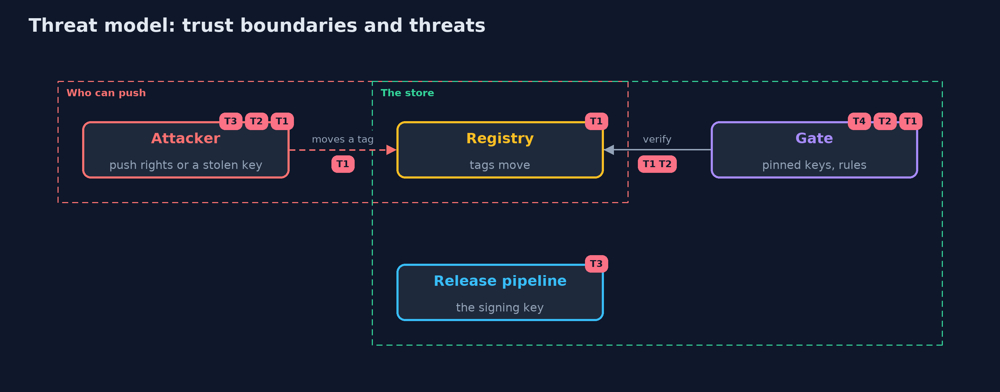

# Threat Model — Artifact Signing with cosign

A threat model answers four questions: what are we protecting, who or what could harm it, how, and what do we do about it. This one covers this project's own demo system, not a production deployment. Domain: an online store.

## Scope

Container images pushed to a registry and deployed through a gate that verifies cosign signatures and attestations. It covers moved tags, untrusted and retired keys, claims and provenance. It does not cover the registry's own storage or the images' contents.

## What we protect (assets)

- The images the store runs.
- The release signing key.

## Who and what acts on the system

- The release pipeline.
- An attacker with push rights.
- A thief with an old signing key.

## Trust boundaries

A trust boundary is a line that data or a request crosses between parts that trust each other differently. Threats cluster where those lines are.

- The registry: anyone with push rights can change a tag.
- The gate: the only place that decides what may run.

Each dashed box is a trust boundary. A rose tag such as T1 shows where the threat of that number, in the table below, applies.

## Threats, using STRIDE

STRIDE is a checklist of six kinds of threat: **Spoofing** (S), **Tampering** (T), **Repudiation** (R), **Information disclosure** (I), **Denial of service** (D), **Elevation of privilege** (E).

| Id | Kind | Threat | Where it shows up | Control in this project | What is left |
| --- | --- | --- | --- | --- | --- |
| T1 | Tampering | A tag is moved to an image the pipeline did not build | the registry, the gate | Resolve to a digest and verify a signature over it with a pinned key | A gate that is skipped |
| T2 | Spoofing | An image signed by an untrusted or retired key is accepted | the gate's list of keys | Pin keys, rotate with an overlap and drop old keys | No revocation time without a transparency log |
| T3 | Elevation of privilege | The signing key is stolen | the release pipeline | A passphrase now, a hardware module and approvals in practice | Anything signed before the theft is noticed |
| T4 | Repudiation | A verified signature is mistaken for a verified build | attestations | Rules of the gate's own over the signed claims | Rules that nobody reviews |

## Assumptions

- The gate's public keys come from a place that attackers cannot change.
- Every deployment passes through the gate.

## Out of scope

- Vulnerabilities inside the images.
- Compromise of the build itself.

## How the tests check this

- `CosignSigningTest` starts a real registry and runs cosign for a moved tag, a pinned key, an unsigned digest, signed claims, the stored signature, an attestation and a wrong passphrase.
- `DemoRunsTest` compares the whole demo with the golden output.

## Where this model goes next

The next project in this module, sbom-and-provenance-with-syft-and-grype, adds what the image contains to what is known about who built it.
