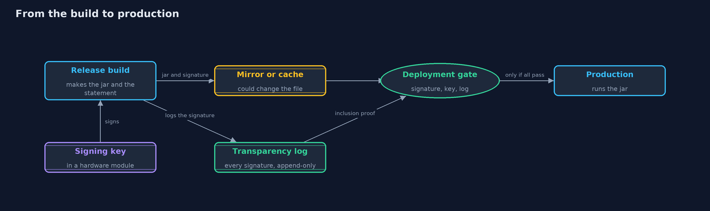

# Artifact Signing: Signed Releases, Key Rotation and Transparency Logs

```
src/main/java/com/jk/explore/security/signing/
├── Artifact.java         A release file: its name and its exact bytes
├── DeployGate.java       The point of use: the step that decides whether an artifact runs
├── Digests.java          SHA-256 digests, written as hex, and compared in constant time
├── Ed25519.java          Ed25519 with the JDK
├── KeyRing.java          The public keys a deployment trusts, each pinned to one channel, with the days it is valid from and, once revoked, valid until
├── MerkleTree.java       The Merkle tree of a transparency log, as RFC 9162 (Certificate Transparency 2.0) defines it
├── Monitor.java          The store's own watcher of the public log
├── SignedRelease.java    A detached signature: the statement's bytes, the id of the key that signed them, and the Ed25519 signature
├── SigningDemo.java      Runs the online store's release story in five numbered acts and prints exact, repeatable results
├── SigningKey.java       A signing key with an id and the release channel it may sign for
├── Statement.java        What a release signature vouches for: the artifact's name, version and channel, the SHA-256 of its exact bytes, and the day the signer says it signed
├── TransparencyLog.java  An append-only public log of release signatures
├── Verdict.java          The answer to "may this artifact be deployed?", with the reason
└── Verifier.java         Checks a release before it is deployed, in this order: the statement is well formed; it is signed by a known key for this channel, valid on the day it says it was signed; the signature matches; and the artifact's bytes match the signed digest and the expected name
```

**A deployment should run only an artifact whose exact bytes match a statement signed by a key it trusts for that channel, and only if that signature is in a public, append-only log, so that a stolen or misused key cannot sign in secret.**

A store's deployment step downloads the release jar and runs it. If that step trusts whatever arrives, anyone who can change the file on the way, on a mirror,
a cache or a build server, decides what runs in production. A checksum published next to the file does not help, because whoever can change one can change the other.

The defences, in the order this project builds them:
- A **signed release statement**: the artifact's name, version, channel and the **SHA-256 of its exact bytes**, signed with **Ed25519**, and verified against a
  **pinned public key** before anything runs.
- **Signing keys per channel**, with **key ids**, **rotation with an overlap**, and **revocation**.
- A **transparency log**: an append-only **Merkle tree** of every signature, with **inclusion proofs** and **consistency proofs** as Certificate Transparency
  uses them, so a signature made in secret, or a log that shows different people different histories, is found.

**Maps to:** OWASP Top 10 (2025) A08 Software or Data Integrity Failures and A03 Software Supply Chain Failures · CWE-494 Download of Code Without Integrity
Check · CWE-347 Improper Verification of Cryptographic Signature · CWE-345 · SLSA · OWASP ASVS 5.0, the chapter on software integrity and secure deployment.

## The idea in everyday terms

Think of a shop that receives sealed crates from its own warehouse. A crate is opened only if the seal is the warehouse's, unbroken, and matches the packing list.
The seals are cut per product line and replaced every year. And every seal the warehouse ever stamps is written in a public ledger that no one can erase, so a
seal stamped in secret, even by someone holding the real stamp, shows up as a line the warehouse never wrote.

## The scenario

An online store builds its release jar, shop-app, and deploys it to production. The demo builds the jar with fixed bytes, signs it with Ed25519 keys made from
fixed demo seeds, keeps a key ring with a stable and a beta key, rotates and revokes keys on a numbered day, and runs a small transparency log with a signed tree head.

## Run

```bash
./gradlew run
```

The demo tells the story in 5 acts, each printing exact numbers that the tests check:

| Act | What it shows |
| --- | --- |
| 1. A deployment that runs whatever arrives | The release team builds a 2440-byte jar; a mirror changes one byte; the trusting deployment step runs the altered jar. |
| 2. A signed release, checked before it runs | A statement with the jar's SHA-256 is signed with Ed25519 and checked against a pinned key: the real jar passes; a changed jar, an edited statement, a forged key, an unknown key and no signature are refused. |
| 3. Signing keys: per channel, rotated, revoked | A beta key cannot sign for stable; two stable keys overlap from day 100; after revocation on day 130 a day 140 signature is refused, but a thief can backdate to day 120. |
| 4. A public log that every signature must be in | Releases go into an append-only Merkle log with signed heads and proofs; the backdated jar is refused unlogged and refused when logged by the log's day; the monitor reports it; a forked log is caught. |
| 5. The bill | The gate refuses an unsigned jar but protects only the paths through it; the signing key needs a hardware module; rotation needs an overlap; keyless signing is the modern alternative. |

## Test

```bash
./gradlew test
```

21 tests in `DemoRunsTest`, `Ed25519Test`, `LogAndGateTest`, `MerkleTreeTest`, `VerifierTest`. Ed25519 is checked against RFC 8032 test 1, the Merkle tree against the values its definition gives for the empty tree and the empty leaf, and every inclusion and consistency proof is checked for logs of up to seventeen entries, with wrong indexes and rewritten histories refused.

## What the simulation got right, and what it left out

The jar is a fixed block of bytes, the keys come from fixed demo seeds, and Ed25519 signatures are deterministic, so every digest, signature and tree root is the
same on every run. Days are numbers, not dates. The log lives in memory, and the forked view is a copy of it that grows differently. Nothing is fetched from a network.

## Technologies and versions

Every version below is pinned in the project's build files and was the latest stable release when the project was built.

| Technology | Version | Used for |
| --- | --- | --- |
| Java | 25 | the language and runtime; a Gradle toolchain finds or downloads the JDK |
| Gradle | 9.8.1 (wrapper) | build and run; nothing to install, the wrapper downloads it |
| org.junit.jupiter:junit-jupiter | 6.1.3, set by junit-bom | JUnit 5: the tests (tests only) |
| org.junit.platform:junit-platform-launcher | 6.1.3, set by junit-bom | JUnit platform launcher, which Gradle needs to run the tests (tests only) |
| videokit | repository tool (`tools/videokit`) | the narrated video and animation: Piper `en_US-amy-medium`, speed 0.8, longer pauses (the amy-slow voice) |

## Learning Material

| Document | What it is for |
| --- | --- |
| [Problem statement](docs/problem-statement.md) | the situation and what the project must show |
| [Prerequisites](docs/prerequisites.md) | what you need to know first |
| [Artifact Signing: Signed Releases, Key Rotation and Transparency Logs, explained](docs/artifact-signing-explained.md) | the acts in prose |
| [Session guide](docs/session.md) | a one-hour lesson with exercises |
| [Animated walkthrough](docs/animation.html) | the acts step by step, narrated |
| [Threat model](docs/threat-model.md) | what is protected, who could harm it, and how, using STRIDE |
| [Spec](docs/spec.md) | what this project must be true of |
| [Expected output](docs/expected-output.txt) | the golden demo output every test and every port checks against |

### The idea in one picture

The jar can be changed anywhere on the way; only the signature, the pinned key and the log decide whether it runs.



### Where each piece sits

Verifier checks a signed statement against the KeyRing; DeployGate adds the log; Monitor reads the log for the store.


### How the data moves

The signature covers the statement; the statement covers the exact bytes through their digest.


### Who calls whom, in order


### Video

`video/artifact-signing-explained.mp4` (with `.m4a` audio and `.srt` subtitles) is built by `video/build_video.sh`. Rendered media is not committed.

## What it costs

- **Verification protects only the paths that run it.** A jar copied straight onto a server, or a pipeline step that skips the gate, runs unchecked.
- **The signing key is the most valuable secret in the pipeline.** Whoever holds it can sign anything, so it belongs in a hardware module, and each signing is approved and logged.
- **Rotation is a project.** Every deployment must trust the new key before the old one is revoked, which needs an overlap and a way to reach every verifier.
- **The signer's date cannot be trusted.** A stolen key can date its signature before the revocation; only an independent time, such as the log's, settles it.
- **A transparency log helps only if someone reads it.** The store must monitor the log for signatures with its keys that match no release it made.

## When this is too much

Every artifact that runs in production should be signed and verified at the point of use; there is no small version of that. A transparency log and monitoring matter most
when the key could be stolen or misused without anyone noticing, which is true for any key that lives longer than a day, and are what keyless signing builds on.

## Where you have already met this

- Signed jars, signed container images and signed operating system packages that a package manager checks before installing.
- `.sig` and `.asc` files next to downloads, and a published public key or fingerprint.
- Certificate Transparency, which logs every web certificate in public Merkle logs.
- Supply chain incidents where a build server or a mirror served a changed release.

## Where this sits

This project is in [secrets-and-supply-chain](..), after [secrets-management](../secrets-management). It builds on
[digital-signatures](../../../beginner/cryptography/digital-signatures), which introduced Ed25519, and on
[patching-and-dependency-hygiene](../../../beginner/safe-habits/patching-and-dependency-hygiene), which pinned digests of dependencies.
