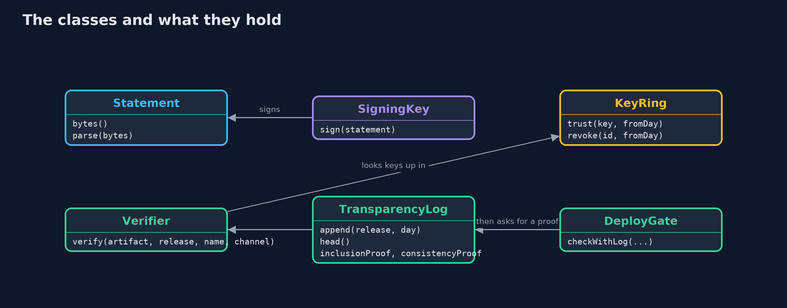

# Artifact Signing: Signed Releases, Key Rotation and Transparency Logs — Class Diagram

Verifier checks a signed statement against the KeyRing; DeployGate adds the log; Monitor reads the log for the store.

