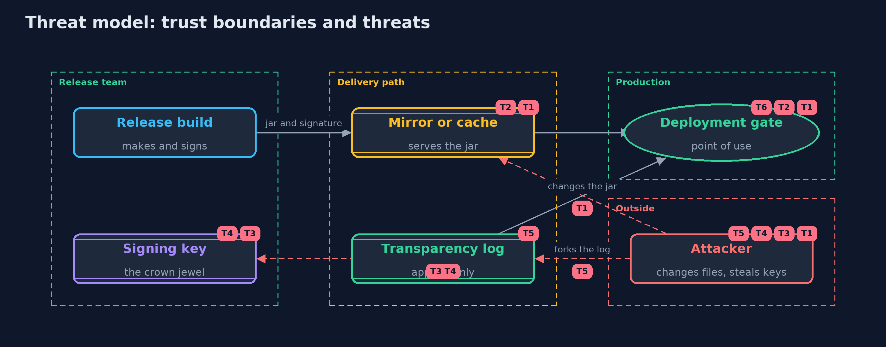

# Threat Model — Artifact Signing: Signed Releases, Key Rotation and Transparency Logs

A threat model answers four questions: what are we protecting, who or what could harm it, how, and what do we do about it. This one covers this project's own demo system, not a production deployment. Domain: an online store.

## Scope

How an online store's release jar gets from its build to production: signing a release statement, trusting and rotating signing keys, a transparency log of signatures, and
the deployment gate. It does not cover the build's own integrity, dependency risks, or the hardware module that should hold the keys.

## What we protect (assets)

- The release jar that runs in production.
- The signing keys, and the key ring that deployments trust.
- The transparency log and its signed heads.
- The record of releases the store really made.

## Who and what acts on the system

- The release team, who build and sign releases.
- Anyone who can change files on mirrors, caches or build servers.
- A thief or an insider holding a signing key.
- A dishonest or compromised log operator.

## Trust boundaries

A trust boundary is a line that data or a request crosses between parts that trust each other differently. Threats cluster where those lines are.

- Release build to the delivery path: the jar leaves the release team's control.
- Delivery path to the deployment gate: nothing is trusted until verified.
- Signing key to everything else: whoever holds it can vouch for anything.

Each dashed box is a trust boundary. A rose tag such as T1 shows where the threat of that number, in the table below, applies.

## Threats, using STRIDE

STRIDE is a checklist of six kinds of threat: **Spoofing** (S), **Tampering** (T), **Repudiation** (R), **Information disclosure** (I), **Denial of service** (D), **Elevation of privilege** (E).

| Id | Kind | Threat | Where it shows up | Control in this project | What is left |
| --- | --- | --- | --- | --- | --- |
| T1 | Tampering | The jar is changed on a mirror, a cache or a build server | `Verifier.verify` | A signed statement over the SHA-256 of the exact bytes, compared in constant time before anything runs | A path to production that skips the gate runs unchecked |
| T2 | Spoofing | A forged statement or key claims to be the store's | `Verifier.verify`, `KeyRing` | Keys are pinned by id and channel; the signature must verify under the pinned public key | The pinned keys themselves must reach every deployment through a trusted channel |
| T3 | Elevation of privilege | A stolen or misused signing key signs a release the store never made | the signing key | Signatures must be in the public log, and the store's monitor reports releases it did not make | Between the signing and the monitor's alert, a deployment that trusts the log may run the release; keep keys in hardware |
| T4 | Repudiation | A stolen key backdates its signature to before the revocation | `KeyRing.revoke`, `DeployGate.checkWithLog` | Revocation is judged by the day the log recorded the signature, not the day the signer wrote | Without a log, a backdated signature passes, so verifiers that skip the log stay exposed |
| T5 | Tampering | The log operator shows different histories to different readers | `TransparencyLog` | Signed heads, consistency proofs, and comparing heads: two heads of one size with different roots prove a fork | Readers must actually exchange heads; a reader who never compares cannot see a fork |
| T6 | Denial of service | A deployment cannot verify because a key was revoked before it learned the new one | `KeyRing` | Rotation with an overlap in which both keys are trusted | Deployments that are not updated during the overlap stop accepting releases |

## Assumptions

- The deployment's pinned keys and the log's key were installed through a trusted channel.
- The gate is on every path to production.
- In the demo, keys come from fixed demo seeds and days are numbers.

## Out of scope

- Build provenance and SBOMs: the sbom-and-provenance project.
- Container images and keyless signing: the -with-cosign version.
- Rollback to an older signed release: an exercise.

## How the tests check this

- `Ed25519Test` checks RFC 8032 test 1 and determinism.
- `MerkleTreeTest` checks known values and every inclusion and consistency proof up to seventeen entries, with wrong indexes and rewritten histories refused.
- `VerifierTest` checks the canonical statement, every refusal and its reason, channels, rotation and revocation.
- `LogAndGateTest` checks the gate with and without a log entry, revocation by the log's day, signed heads, the monitor and a forked log.
- `DemoRunsTest` compares the whole demo with the golden output.

## Where this model goes next

The next project, sbom-and-provenance, records what went into the build and how it was made, so a signature vouches not only for the bytes but for their origin.
