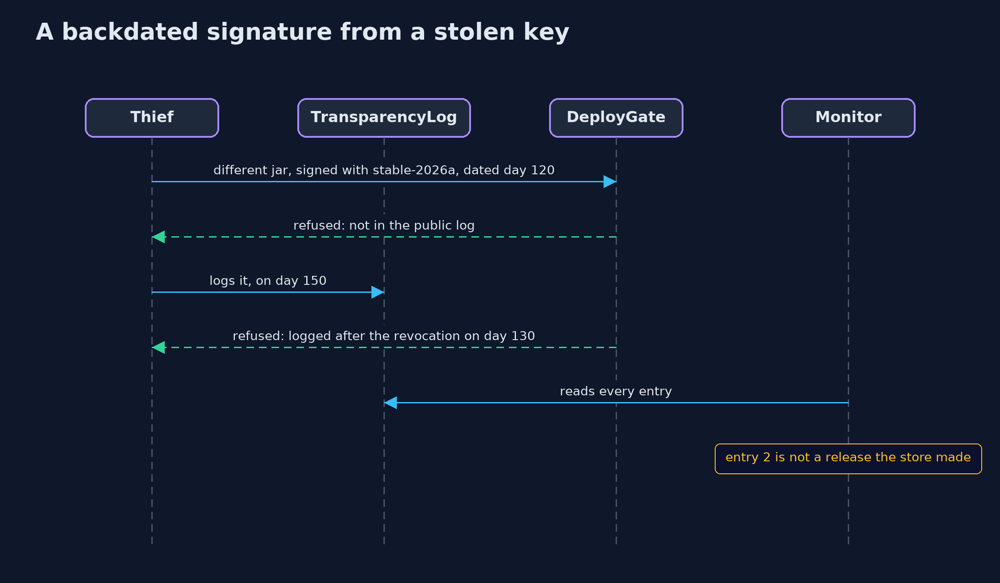
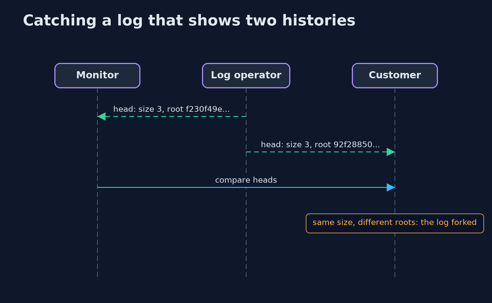

# Artifact Signing: Signed Releases, Key Rotation and Transparency Logs — UML Sequence Diagrams

## 1. A backdated signature from a stolen key

The statement's date is the signer's; the log's day is not.

## 2. Catching a log that shows two histories

Each view is consistent with the old head, but not with each other.

