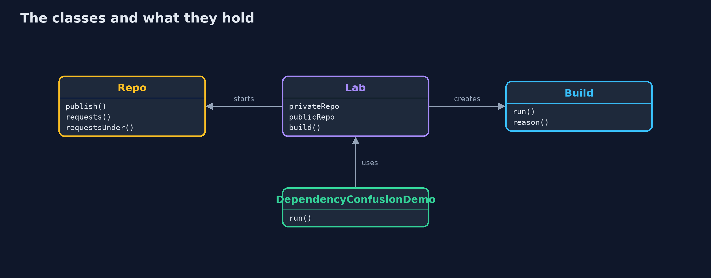

# Dependency Confusion with Gradle

```
src/main/java/com/jk/explore/security/depconfusion/
├── Build.java                    One real Gradle build of a small consumer project, in a folder of its own, using this project's Gradle wrapper
├── DependencyConfusionDemo.java  Real Gradle builds against a private and a public repository: who answers for a name, what a filter and a checksum refuse, and what they do not
├── Lab.java                      The two repositories of the lesson and the folders of the builds that use them
└── Repo.java                     A Maven repository on a loopback port that remembers every path it was asked for
```

**A Gradle build that lists a private and a public repository will take the highest version of an internal name from whichever one has it, and the first copy of an exact version in declaration order; repository content filters tell each repository which groups it may answer for, so an internal name is never even asked for in the public repository, and dependency verification checks the sha256 of every artifact against a file in the repository; but a filter is only as good as its list of groups, and checksums written from a build that was already compromised record the attacker's package.**

The plain [dependency-confusion](../dependency-confusion) project simulates resolvers in Java. This one runs **real Gradle 9 builds** (this project's own wrapper) against two real Maven repositories, a private one and a public one, that the demo serves on loopback ports and that remember every request. No Docker and no network are needed; the tests are tagged `integration` because each build takes a few seconds: `./gradlew integrationTest`.

What it shows:
- **A build that works.** `com.shop:pricing` and `com.shop:audit` come from the private repository, `org.acme:json-lib` from the public one.
- **The attacker registers an internal name in the public repository.** A version range `[1.4,)` takes the highest version of any repository: `pricing 99.0.0`, the attacker's. An exact version is safer, but the first repository in declaration order that has it wins, so a public repository declared first serves the attacker's `audit 3.1.0`.
- **Content filters.** The private repository includes group `com.shop` and its subgroups, the public one excludes them. The build resolves the right packages, and the public repository received **zero requests** for `com.shop`. An internal library that is not published yet fails without leaking its name; without the filter, the name is asked for in the public repository.
- **Dependency verification.** `--write-verification-metadata sha256` records the checksums in `gradle/verification-metadata.xml`. A version that is not listed and the same version with other bytes are both refused.
- **The bill.** A filter for the exact group `com.shop` does not cover `com.shop.tools`; checksums written while the attacker's package was already being resolved are the attacker's; plugin repositories are a separate list.

**Maps to:** OWASP Top 10 (2025) A03 Software Supply Chain Failures · CWE-427 (uncontrolled search path element), CWE-494 · the 2021 dependency confusion research.

## The idea in everyday terms

A shop that phones every supplier in the city for a part number and takes the highest revision number it hears. Telling each supplier which part numbers it may answer for, and checking the part against the drawing, are two different protections.

## The scenario

An online store builds with Gradle. Its pricing and audit libraries live in the company's repository and its JSON library in a public one. The demo plays the store's build and an attacker who can publish in the public repository.

## Run

```bash
./gradlew run
```

The demo tells the story in 5 acts, each printing exact numbers that the tests check:

| Act | What it shows |
| --- | --- |
| 1. A build that works | The internal libraries come from the private repository and the public library from the public one. |
| 2. Somebody registers the company's name in the public repository | A version range takes the highest version of any repository, and an exact version comes from the first repository that has it. |
| 3. The repository says which names it may answer for | Content filters keep the internal group out of the public repository, and the public repository receives no request for it. |
| 4. Checksums that the build checks | Dependency verification records the sha256 of what was resolved and refuses an unlisted version and the same version with other bytes. |
| 5. The bill | A filter is only as good as its list, checksums can be written from a compromised build, and plugins have their own repositories. |

## Test

```bash
./gradlew test
```

11 tests in `DemoRunsTest`, `DependencyConfusionTest`. The tests start their own repositories and run real Gradle builds (./gradlew integrationTest); they need no Docker and no network.

## What the simulation got right, and what it left out

The repositories are small HTTP servers started by the demo on loopback ports, with jars that carry a file saying who published them. Gradle is the real Gradle; ports and temporary folders are never printed. The demo takes about a minute.

## Technologies and versions

Every version below is pinned in the project's build files and was the latest stable release when the project was built.

| Technology | Version | Used for |
| --- | --- | --- |
| Java | 25 | the language and runtime; a Gradle toolchain finds or downloads the JDK |
| Gradle | 9.8.1 (wrapper) | build and run; nothing to install, the wrapper downloads it |
| org.junit.jupiter:junit-jupiter | 6.1.3, set by junit-bom | JUnit 5: the tests (tests only) |
| org.junit.platform:junit-platform-launcher | 6.1.3, set by junit-bom | JUnit platform launcher, which Gradle needs to run the tests (tests only) |
| videokit | repository tool (`tools/videokit`) | the narrated video and animation: Piper `en_US-amy-medium`, speed 0.8, longer pauses (the amy-slow voice) |

## Learning Material

| Document | What it is for |
| --- | --- |
| [Problem statement](docs/problem-statement.md) | the situation and what the project must show |
| [Prerequisites](docs/prerequisites.md) | what you need to know first |
| [Dependency Confusion with Gradle, explained](docs/dependency-confusion-with-gradle-explained.md) | the acts in prose |
| [Session guide](docs/session.md) | a one-hour lesson with exercises |
| [Animated walkthrough](docs/animation.html) | the acts step by step, narrated |
| [Threat model](docs/threat-model.md) | what is protected, who could harm it, and how, using STRIDE |
| [Spec](docs/spec.md) | what this project must be true of |
| [Expected output](docs/expected-output.txt) | the golden demo output every test and every port checks against |

### The idea in one picture

The build asks both repositories; the filters and the checksum file sit in the build.


### Where each piece sits

The lab holds two repositories, a build runs Gradle, the demo tells the story.



### How the data moves

The filter decides who is asked; the checksum decides what is accepted.


### Who calls whom, in order


### Video

`video/dependency-confusion-with-gradle-explained.mp4` (with `.m4a` audio and `.srt` subtitles) is built by `video/build_video.sh`. Rendered media is not committed.

## What it costs

- **Every internal group must be listed,** in every build and every settings file, and a new group that nobody adds is unprotected.
- **Checksums are one more file to review** every time a dependency changes, and people approve changes without looking.
- **Plugins and the build script have their own repositories** and need the same rules.
- **Exact versions and lockfiles help,** but a lockfile written from a compromised build locks the attacker in.

## When this is too much

A build that uses a single repository, which you control, with exact versions, has nothing to confuse. Add filters and verification when more than one repository is involved or when versions are ranges.

## Where you have already met this

- `mavenCentral()` and a company repository in the same `repositories` block.
- `content { includeGroup ... }` or `exclusiveContent` in a build file.
- A `verification-metadata.xml` in the `gradle` folder.
- A version such as `1.+` or `[1.4,)` in a dependency.

## Where this sits

This is the tools version of [dependency-confusion](../dependency-confusion), in the [secrets-and-supply-chain](..) module. What the shipped image contains, and what is known broken in it, is in [sbom-and-provenance-with-syft-and-grype](../sbom-and-provenance-with-syft-and-grype).
