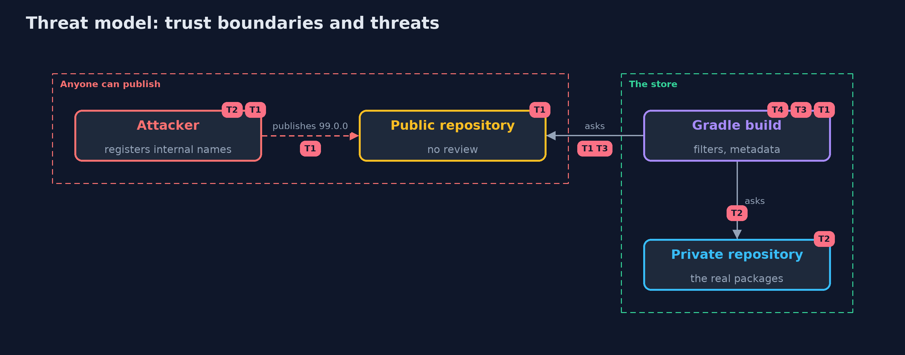

# Threat Model — Dependency Confusion with Gradle

A threat model answers four questions: what are we protecting, who or what could harm it, how, and what do we do about it. This one covers this project's own demo system, not a production deployment. Domain: an online store.

## Scope

A Gradle build that resolves dependencies from a private and a public repository. It covers version ranges, repository order, content filters and dependency verification. It does not cover the contents of the packages or the repositories' own security.

## What we protect (assets)

- The build machine and the secrets it can reach.
- The libraries that end up in the store's release.

## Who and what acts on the system

- The team that maintains the build.
- An attacker who can publish in the public repository.
- Someone who can replace a file in the private repository.

## Trust boundaries

A trust boundary is a line that data or a request crosses between parts that trust each other differently. Threats cluster where those lines are.

- The public repository: anyone can publish under any name that is free.
- The build file: the only place that says which repository may answer for which group.

Each dashed box is a trust boundary. A rose tag such as T1 shows where the threat of that number, in the table below, applies.

## Threats, using STRIDE

STRIDE is a checklist of six kinds of threat: **Spoofing** (S), **Tampering** (T), **Repudiation** (R), **Information disclosure** (I), **Denial of service** (D), **Elevation of privilege** (E).

| Id | Kind | Threat | Where it shows up | Control in this project | What is left |
| --- | --- | --- | --- | --- | --- |
| T1 | Spoofing | An internal name is resolved from the public repository | the build file | Content filters per repository, exact versions or locks | Groups that are not listed |
| T2 | Tampering | The same version number is served with other bytes | any repository | Dependency verification with sha256 checksums | Metadata approved without a review |
| T3 | Information disclosure | An unpublished internal name is asked for in the public repository | the build | The filter keeps the name out of every request to the public repository | Plugin and build script repositories |
| T4 | Repudiation | Checksums are written from a build that was already compromised | gradle/verification-metadata.xml | Write them from a build you trust and review every change | Approving changes without looking |

## Assumptions

- The build file and the verification metadata are reviewed like code.
- The repositories are served over https.

## Out of scope

- Malicious code in a library that is on the allow list.
- Compromise of the private repository's storage.

## How the tests check this

- `DependencyConfusionTest` runs real Gradle builds for the range, the order, the filters and the request count, the verification metadata and the subgroup.
- `DemoRunsTest` compares the whole demo with the golden output.

## Where this model goes next

The next module, tls, starts with local-certificate-authority-with-step-ca.
