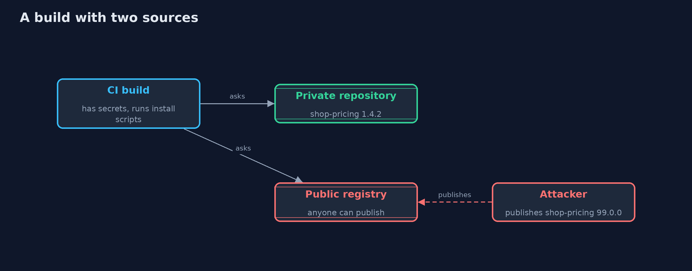
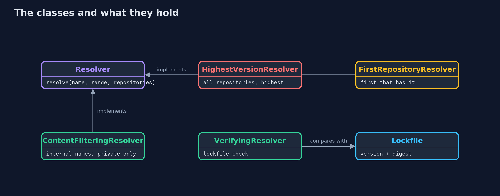
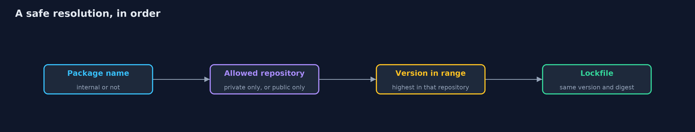
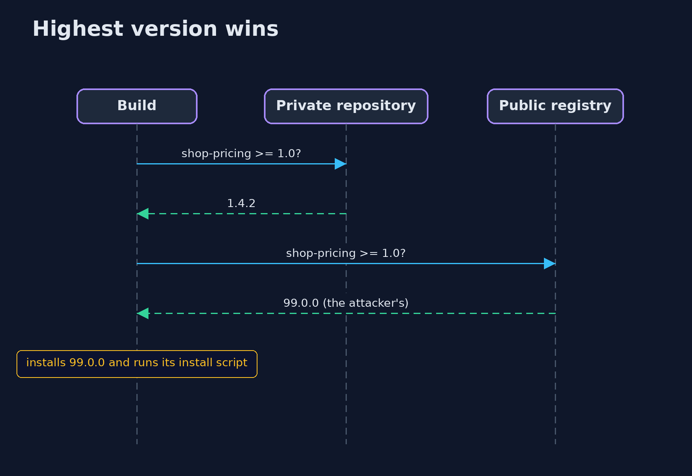

# Dependency Confusion

```
src/main/java/com/jk/explore/security/depconf/
├── Artifact.java                  A published package: a name, a version, its contents, and an optional install script that the build runs when it installs the package (npm {@code postinstall}, Python {@code setup.py})
├── Build.java                     A CI build: it resolves each dependency, installs it, and runs the package's install script, which has the build machine's secrets in its environment
├── ContentFilteringResolver.java  The fix for the names: each repository declares which package names it may supply
├── DepConfusionDemo.java          Runs the build story in five numbered acts and prints exact, repeatable results
├── FirstRepositoryResolver.java   Goes through the repositories in order and takes the highest matching version from the first one that has the package: how Maven and Gradle behave by default
├── HighestVersionResolver.java    Asks every repository and takes the highest version in range: how pip with {@code --extra-index-url} and several other tools behave
├── Lockfile.java                  The exact version and digest of every dependency, recorded from a build someone trusted
├── NameWatch.java                 Detection: for each internal package name, does a public repository also have it?
├── Repository.java                A place packages are published to
├── ResolutionException.java       The build refused to resolve a dependency
├── Resolved.java                  Which artifact a build picked, and from which repository
├── Resolver.java                  Chooses an artifact for a dependency from the configured repositories
├── VerifyingResolver.java         Wraps another resolver and refuses anything whose version or digest differs from the lockfile, or that is not in it (dependency verification)
├── Version.java                   A version like 1.4.2, compared number by number (so 1.10.0 is higher than 1.9.0)
└── VersionRange.java              An allowed range of versions: {@code [from, below)}
```

**A build that asks several repositories for a package, takes the highest version, or falls through to a public repository when the private one lacks a name, will run an attacker's package registered under the company's internal name; let names decide which repository may supply them, lock exact digests, and watch for your names in public.**

A company writes internal libraries (`shop-pricing`, `shop-audit`) and publishes them to its **private repository**. Its builds also fetch open-source libraries from a **public registry**. Both are configured as sources. Now somebody who has never seen the company's code, only the *names* (in a leaked
`package.json`, a public repository, a job posting), registers `shop-pricing` version 99.0.0 in the public registry, with an **install script** that sends the build machine's environment, including its secrets, to the attacker's server.

Whether the company's next build installs it depends on how its tool chooses between repositories. That is **dependency confusion** (or *namespace confusion*, a supply chain attack disclosed in 2021 that hit dozens of large companies). This project simulates the tools' rules and the fixes:

- **Highest version wins** across all repositories: the attacker's 99.0.0 beats the real 1.4.2. (Several tools behave like this; pip with an extra index is the famous one.)
- **Repository order:** the private repository first protects names it has, but a **new internal library** that has not been published yet, or a misconfigured order, falls through to the public registry. And an attacker can copy an **exact version number**.
- **Content filtering by name** (Gradle `exclusiveContent`, Maven repository managers' routing rules, npm scopes): internal names come only from the private repository and fail **closed** if it lacks them; public names never go to the private repository.
- **A lockfile with digests** (Gradle dependency verification, `package-lock.json` integrity, `pip --require-hashes`): the build gets the same bytes it recorded, or it stops.
- **Watching your names:** a check that the public registry has none of your internal names.

**Maps to:** OWASP Top 10 (2025) A03 Software Supply Chain Failures · CWE-427 · CWE-829 · SLSA · NIST SSDF PS.1, PW.4 · OWASP Software Component Verification Standard.

## The idea in everyday terms

A company mailroom is told "get the pricing binder" and asks every supplier in town; the supplier with the highest edition number wins. A prankster prints a binder titled Pricing with edition 99, and the mailroom puts it on the CEO's desk. The fix is a rule that names starting with the company's name
are only ever fetched from the company's own shelves, and a record of the exact binder that was approved.

## The scenario

A company's build needs `json-lib` (public), `shop-pricing` and `shop-audit` (internal). The demo has a private and a public repository, five resolvers that behave like real tools, a lockfile, and a build that runs install scripts. The attacker's script is only a line of text; nothing is run.

## Run

```bash
./gradlew run
```

The demo tells the story in 5 acts, each printing exact numbers that the tests check:

| Act | What it shows |
| --- | --- |
| 1. A build that works | The build gets json-lib from the public registry and the two internal libraries from the private repository, and records their digests in a lockfile. |
| 2. Somebody registers the company's package name in the public registry | With highest-version-wins across repositories, shop-pricing 99.0.0 from the public registry is installed and its install script runs on the build machine. |
| 3. Repository order helps only until a name is missing | With the private repository first, existing names are safe; but a new internal library falls through to the public registry, and with the public registry first an attacker's copy of an exact version number wins. |
| 4. Names decide where a package may come from | With content filtering, internal names come only from the private repository and the missing library is a build error, not an install; public names never go to the private repository. |
| 5. Locked digests, and watching the names | The lockfile rejects the squatted shop-pricing even under highest-version-wins, and rejects a changed artifact with the same version number; a name watch lists the shadowed internal names. |

## Test

```bash
./gradlew test
```

12 tests in `DemoRunsTest`, `DepConfusionTest`. Nothing is random and no script is run, so the demo prints the same text on every run.

## What the simulation got right, and what it left out

Repositories, artifacts and builds are plain Java classes: no network and no real packages. Each resolver implements a rule that a real tool uses, so the outcomes match what the tools do with the same configuration. Digests are real SHA-256 values.

## Technologies and versions

Every version below is pinned in the project's build files and was the latest stable release when the project was built.

| Technology | Version | Used for |
| --- | --- | --- |
| Java | 25 | the language and runtime; a Gradle toolchain finds or downloads the JDK |
| Gradle | 9.8.1 (wrapper) | build and run; nothing to install, the wrapper downloads it |
| org.junit.jupiter:junit-jupiter | 6.1.3, set by junit-bom | JUnit 5: the tests (tests only) |
| org.junit.platform:junit-platform-launcher | 6.1.3, set by junit-bom | JUnit platform launcher, which Gradle needs to run the tests (tests only) |

## Learning Material

| Document | What it is for |
| --- | --- |
| [Problem statement](docs/problem-statement.md) | the situation and what the project must show |
| [Prerequisites](docs/prerequisites.md) | what you need to know first |
| [Dependency Confusion, explained](docs/dependency-confusion-explained.md) | the acts in prose |
| [Session guide](docs/session.md) | a one-hour lesson with exercises |
| [Animated walkthrough](docs/animation.html) | the acts step by step |
| [Threat model](docs/threat-model.md) | what is protected, who could harm it, and how, using STRIDE |
| [Spec](docs/spec.md) | what this project must be true of |
| [Expected output](docs/expected-output.txt) | the golden demo output every test and every port checks against |

### The idea in one picture

The attacker can publish to one of them.



### Where each piece sits

Resolvers differ in how they choose; the verifying resolver wraps any of them.



### How the data moves

The name picks the repository; the lockfile checks the bytes.



### Who calls whom, in order




## What it costs

- **Content filters must be kept in sync with naming.** If internal names do not follow a pattern, list them; a naming convention (a group id, a scope, a prefix) makes this easy.
- **Failing closed means builds break** when a new internal library has not been published yet. That is the right failure, and the fix is to publish it.
- **Lockfiles need updating** whenever a dependency changes, and the update is a review step: who looks at a digest that changed?
- **Reserving your names in the public registry** (claiming them with an empty package) costs little and stops the easy case, but you cannot reserve every name.
- **Install scripts are the dangerous part.** Disabling them (`--ignore-scripts`) in CI removes one of the biggest risks, at the cost of packages that need them.

## When this is too much

A single private registry that proxies the public one, with routing rules by name and no direct access to the public registry from CI, is both simpler and stronger than configuring each build tool. Do that if you can.

## Where you have already met this

- `--extra-index-url` in a `pip` command or `requirements.txt`.
- `repositories { mavenCentral(); maven { url ... } }` in a Gradle build.
- Scoped npm packages such as `@company/pricing`.
- The 2021 write-up by Alex Birsan, which popularised the name "dependency confusion".

## Where this sits

This project is in [secrets-and-supply-chain](..) and follows [sbom-and-provenance](../sbom-and-provenance), which lists what is in a release; this one decides what may go in. The with-Gradle version applies repository content filtering and dependency verification in a real build.
