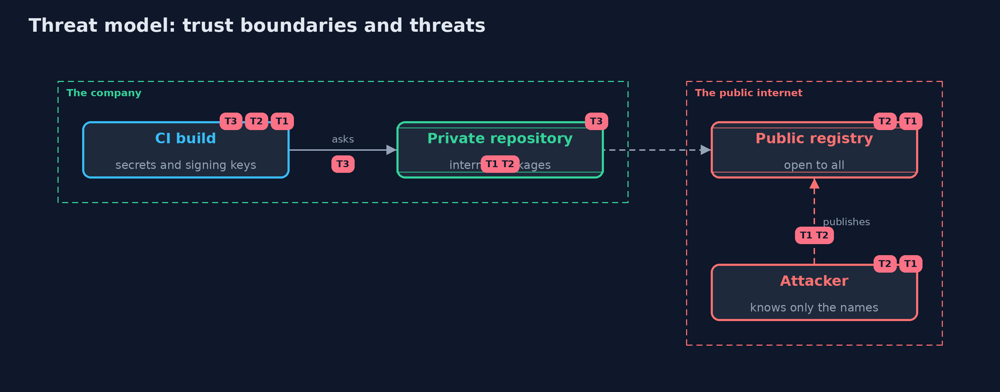

# Threat Model — Dependency Confusion

A threat model answers four questions: what are we protecting, who or what could harm it, how, and what do we do about it. This one covers this project's own demo system, not a production deployment. Domain: an online store's build pipeline.

## Scope

How a build chooses between a private repository and a public registry, and what it runs after installing. It covers internal package names and the integrity of what is installed.
It does not cover typosquatting of public names, or a compromised maintainer of a legitimate public package.

## What we protect (assets)

- The build machine's secrets, signing keys and deployment credentials.
- The integrity of the software that is built and released.

## Who and what acts on the system

- The online store's developers and CI.
- An attacker who can publish to the public registry and knows the names of internal packages.

## Trust boundaries

A trust boundary is a line that data or a request crosses between parts that trust each other differently. Threats cluster where those lines are.

- The public registry to the build: anyone can publish there.
- The build's dependency list: names and ranges that decide which repository answers.

Each dashed box is a trust boundary. A rose tag such as T1 shows where the threat of that number, in the table below, applies.

## Threats, using STRIDE

STRIDE is a checklist of six kinds of threat: **Spoofing** (S), **Tampering** (T), **Repudiation** (R), **Information disclosure** (I), **Denial of service** (D), **Elevation of privilege** (E).

| Id | Kind | Threat | Where it shows up | Control in this project | What is left |
| --- | --- | --- | --- | --- | --- |
| T1 | Spoofing | A public package with an internal name and a higher version is installed | `HighestVersionResolver` | Route internal names to the private repository only (`ContentFilteringResolver`) | Internal names that do not follow a convention |
| T2 | Spoofing | A name missing from the private repository, or an exact version copied to the public one, falls through | `FirstRepositoryResolver` | Fail closed for internal names; keep CI from reaching the public registry directly; reserve names | Developers' machines that are configured differently from CI |
| T3 | Tampering | A package's contents change while the version number stays the same | `Repository`, `Artifact` | A lockfile with SHA-256 digests (`VerifyingResolver`), reviewed when it changes | A lockfile regenerated without review |

## Assumptions

- Internal package names can be learned by outsiders.
- Install scripts run with the build's privileges.

## Out of scope

- Compromise of the private repository's own storage (the lockfile helps against it).
- Malicious but correctly named public packages.

## How the tests check this

- `DepConfusionTest` checks versions and ranges, digests, each resolver against the squatted names, exact-version copies, fail-closed behaviour, the lockfile and the name watch.
- `DemoRunsTest` compares the whole demo with the golden output.

## Where this model goes next

The next module, platform-hardening, moves from the code and the build to the machines and containers they run on.
