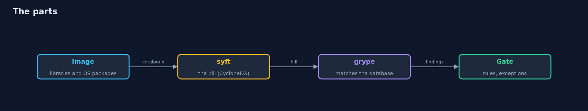
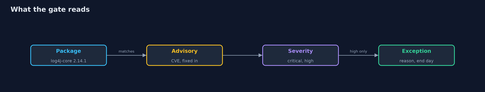
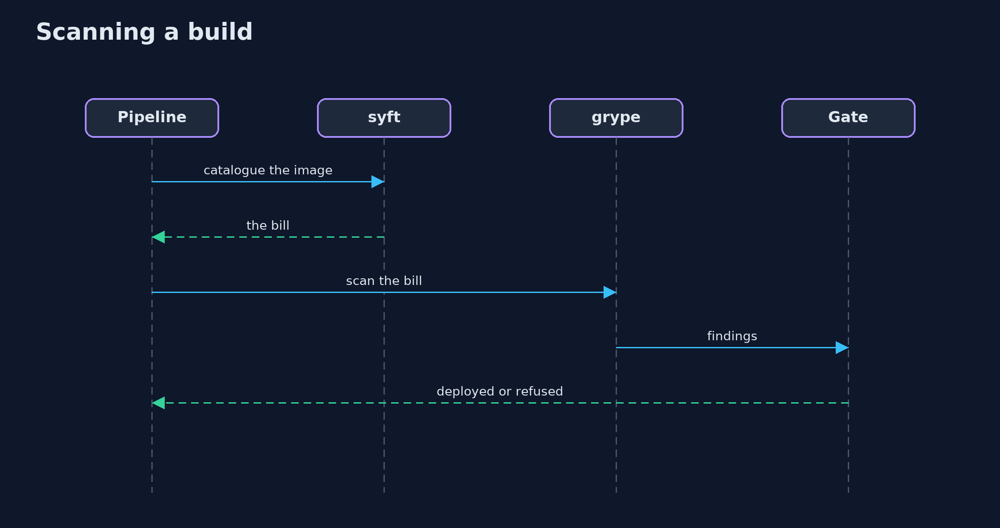

# SBOMs and Scanning with syft and grype

```
src/main/java/com/jk/explore/security/sbomscan/
├── Lab.java           The images of the lesson, built on the machine from a base image that is already here and a few library jars from Maven Central, and catalogued and scanned with the real syft and grype commands
├── Sbom.java          A CycloneDX bill of materials written by syft, read back
├── SbomScanDemo.java  Runs the store's bill-of-materials story in five numbered acts with the real syft and grype commands on images built on this machine
└── Scan.java          What grype found in an image or in a bill of materials
```

**A bill of materials written by syft lists every library an image contains by package URL, grype matches those packages against a vulnerability database, and a deployment gate can refuse critical and high advisories except where a written exception with an end date covers a high one; but a scanner finds only what the cataloguer recognises, a bill describes exactly one image, the database is data that ages, and a finding is a question, not a verdict.**

The plain [sbom-and-provenance](../sbom-and-provenance) project writes a bill of materials and signed build provenance by hand. This one uses the real tools: **syft 1** catalogues a container image into a CycloneDX bill of materials and **grype 0.12x** matches it against a vulnerability database. It needs Docker, the `syft` and `grype` commands (`brew install syft grype`) and, the first time, a network for the database and for three log4j jars from Maven Central; its tests are tagged `integration`: `./gradlew integrationTest`.

What it shows:
- **What a bill answers.** Images are built here from a base image already on the machine with log4j 2.14.1, 2.16.0 or 2.25.5. syft lists the libraries by package URL, with hashes and licences. It names the image, and not the repository, the commit or the builder: that is what provenance is for.
- **Scanning it.** grype finds log4j-shell (critical) and its follow-ups, with the versions that fix them, in the image and in the bill alone. The rest of the findings come from the operating system packages of the base image and change every day, so they are never printed.
- **Fixing it and checking.** The new bill differs from the old in exactly the libraries that changed, and the new scan is clean.
- **A gate.** No critical or high advisory in the store's own libraries, except an exception that names the advisory, the reason and the day it ends. An exception cannot cover a critical advisory and it runs out.
- **The bill.** A log4j jar renamed `blob.dat` is found by no scanner; a bill describes one image only; the vulnerability database is data with an age; a finding is a question, not a verdict.

**Maps to:** OWASP Top 10 (2025) A03 Software Supply Chain Failures and A06 Vulnerable and Outdated Components · CWE-1395 (dependency on a vulnerable third-party component) · CycloneDX · NTIA minimum elements for an SBOM.

## The idea in everyday terms

The ingredients list on a food package, checked against the recall notices. The list is only as good as the person who wrote it, a recall tomorrow still applies to a package made today, and an ingredient that was relabelled is not on the list at all.

## The scenario

An online store ships its application as a container image that carries log4j. The demo builds the images, writes and reads the bills of materials, scans them, upgrades, and puts a deployment gate in front of the result.

## Run

```bash
./gradlew run
```

The demo tells the story in 5 acts, each printing exact numbers that the tests check:

| Act | What it shows |
| --- | --- |
| 1. What a bill of materials answers | syft lists the libraries of an image by package URL, with hashes and licences, and says nothing about who built it. |
| 2. Scanning it against known advisories | grype finds log4j-shell and its follow-ups in the image and in the bill alone, and says which versions fix them. |
| 3. Fixing it, and checking that it is fixed | The new bill differs from the old in exactly the libraries that changed, and the new scan has no critical or high advisory in log4j. |
| 4. A gate that reads the scan | No critical or high advisory in the store's own libraries; a high one may have a written exception with an end date, a critical one may not. |
| 5. The bill | A renamed jar is found by no scanner, a bill describes one image only, the database ages, and a finding is a question, not a verdict. |

## Test

```bash
./gradlew test
```

12 tests in `DemoRunsTest`, `SbomScanTest`. The tests build the four images once for the whole class and need Docker, syft and grype (./gradlew integrationTest).

## What the simulation got right, and what it left out

The images are real images built on this machine with docker build, and the commands are the real syft and grype. Digests, image ids and the number of operating system findings are never printed; the demo takes about a minute.

## Technologies and versions

Every version below is pinned in the project's build files and was the latest stable release when the project was built.

| Technology | Version | Used for |
| --- | --- | --- |
| Java | 25 | the language and runtime; a Gradle toolchain finds or downloads the JDK |
| Gradle | 9.8.1 (wrapper) | build and run; nothing to install, the wrapper downloads it |
| tools.jackson.core:jackson-databind | 3.1.5 | library the code uses |
| org.junit.jupiter:junit-jupiter | 6.1.3, set by junit-bom | JUnit 5: the tests (tests only) |
| org.junit.platform:junit-platform-launcher | 6.1.3, set by junit-bom | JUnit platform launcher, which Gradle needs to run the tests (tests only) |
| videokit | repository tool (`tools/videokit`) | the narrated video and animation: Piper `en_US-amy-medium`, speed 0.8, longer pauses (the amy-slow voice) |

## Learning Material

| Document | What it is for |
| --- | --- |
| [Problem statement](docs/problem-statement.md) | the situation and what the project must show |
| [Prerequisites](docs/prerequisites.md) | what you need to know first |
| [SBOMs and Scanning with syft and grype, explained](docs/sbom-and-provenance-with-syft-and-grype-explained.md) | the acts in prose |
| [Session guide](docs/session.md) | a one-hour lesson with exercises |
| [Animated walkthrough](docs/animation.html) | the acts step by step, narrated |
| [Threat model](docs/threat-model.md) | what is protected, who could harm it, and how, using STRIDE |
| [Spec](docs/spec.md) | what this project must be true of |
| [Expected output](docs/expected-output.txt) | the golden demo output every test and every port checks against |

### The idea in one picture

syft writes the bill, grype matches it, the gate decides.



### Where each piece sits

The lab builds images and runs commands, two records read the tools' JSON, the demo is the gate.


### How the data moves

Package, advisory, severity, then the exception that has not run out.



### Who calls whom, in order




### Video

`video/sbom-and-provenance-with-syft-and-grype-explained.mp4` (with `.m4a` audio and `.srt` subtitles) is built by `video/build_video.sh`. Rendered media is not committed.

## What it costs

- **A scanner finds only what the cataloguer recognises:** a renamed or shaded jar, or a library copied in as source, is invisible.
- **The bill must be written at every build,** because it describes exactly one image.
- **The database is data that ages,** and a scan with an old database is a scan of last month's world.
- **Findings are many and mostly not exploitable,** so someone must triage them and record the answer, for example as a VEX statement.
- **Exceptions need an owner and an end date** or they become permanent.

## When this is too much

A small team with one application and a handful of libraries can read its dependency list by hand. Add scanning when the list is longer than anyone reads, or when a customer or a regulator asks for the bill.

## Where you have already met this

- `syft` or `grype` as a step in a pipeline.
- A `bom.json` or `sbom.cdx.json` attached to a release.
- A scanner report with hundreds of findings, most of them in the base image.
- A `.grype.yaml` file with ignore rules.

## Where this sits

This is the tools version of [sbom-and-provenance](../sbom-and-provenance), in the [secrets-and-supply-chain](..) module. The signed provenance of how an image was built is in that project and in [artifact-signing-with-cosign](../artifact-signing-with-cosign).
