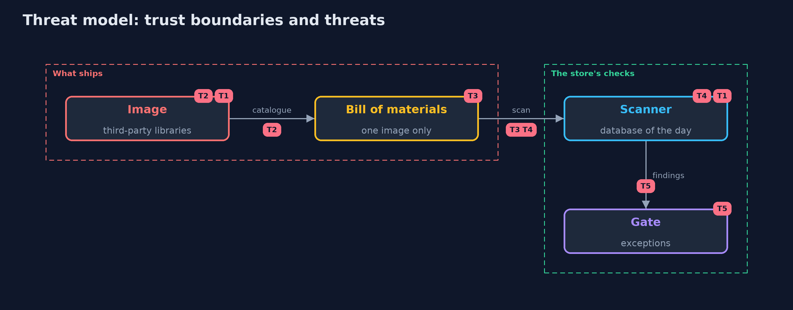

# Threat Model — SBOMs and Scanning with syft and grype

A threat model answers four questions: what are we protecting, who or what could harm it, how, and what do we do about it. This one covers this project's own demo system, not a production deployment. Domain: an online store.

## Scope

Container images that carry third-party Java libraries, catalogued by syft and scanned by grype before a gate. It covers known advisories, what the cataloguer can recognise, stale bills and old databases, and exceptions. It does not cover the signing of the bill or how the image was built.

## What we protect (assets)

- The images the store runs.
- The bills of materials, one per build.

## Who and what acts on the system

- The team that builds and ships the images.
- An attacker who uses a published advisory.
- An author of a library that is shaded or renamed into a jar.

## Trust boundaries

A trust boundary is a line that data or a request crosses between parts that trust each other differently. Threats cluster where those lines are.

- The image: it holds code that the store did not write.
- The gate: the only place that decides what may be deployed.

Each dashed box is a trust boundary. A rose tag such as T1 shows where the threat of that number, in the table below, applies.

## Threats, using STRIDE

STRIDE is a checklist of six kinds of threat: **Spoofing** (S), **Tampering** (T), **Repudiation** (R), **Information disclosure** (I), **Denial of service** (D), **Elevation of privilege** (E).

| Id | Kind | Threat | Where it shows up | Control in this project | What is left |
| --- | --- | --- | --- | --- | --- |
| T1 | Tampering | A library with a known critical advisory is shipped | the image, the scanner | Scan every build and gate on critical and high advisories | An advisory published after the scan |
| T2 | Information disclosure | A library the cataloguer cannot recognise is in the image | the image | Build from declared dependencies and compare the bill with the build file | A renamed or shaded jar is still invisible |
| T3 | Repudiation | A bill for another image is used as proof | the bill | Write the bill at every build and keep it with the image's digest | A bill that nobody compares with the image |
| T4 | Tampering | An old database misses new advisories | the scanner | Refresh the database before each scan and scan stored bills again on a schedule | The days between a publication and the database |
| T5 | Elevation of privilege | An exception stays for ever | the gate | Each exception names the advisory, the reason and an end day, and cannot cover a critical advisory | Exceptions that are renewed without a review |

## Assumptions

- The pipeline writes the bill at the build, from the image that is deployed.
- The vulnerability database is refreshed before each scan.

## Out of scope

- Unknown vulnerabilities that have no advisory.
- Malicious libraries that have no advisory.

## How the tests check this

- `SbomScanTest` builds real images and runs syft and grype for the bill, the advisories, a scan of the bill alone, the gate with exceptions, a renamed jar and a stale bill.
- `DemoRunsTest` compares the whole demo with the golden output.

## Where this model goes next

The next project in this module, dependency-confusion-with-gradle, looks at where a dependency comes from, which neither a bill nor a scan can see.
