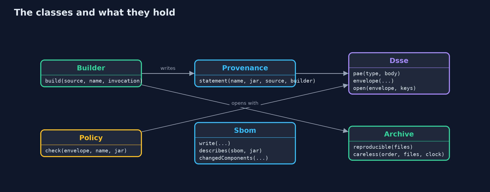

# SBOMs and Build Provenance: What Is Inside, Who Built It, and From What

```
src/main/java/com/jk/explore/security/provenance/
├── Archive.java         Builds a jar-like zip archive
├── Builder.java         A build service: it builds a source into an artifact reproducibly and signs a provenance statement about it with its own key
├── Component.java       One library the store is built with: its Maven coordinates and the bytes of its jar
├── Digests.java         SHA-256 digests, written as hex, and compared in constant time
├── Dsse.java            Dead Simple Signing Envelope (DSSE), the envelope in-toto uses
├── Ed25519.java         Ed25519 with the JDK
├── Json.java            A small JSON writer and reader
├── Pipeline.java        A build pipeline described by the facts SLSA build levels depend on
├── Policy.java          What the deployment gate checks before an artifact runs: a signature from a trusted builder key over the statement, the statement about this exact artifact, built by the expected builder, from the expected repository and branch
├── Provenance.java      An in-toto Statement with a SLSA Provenance v1 predicate: the artifact (by digest) is the subject, and the predicate says how it was built: the build type, the source repository and branch it was asked to build, the exact commit it resolved, and the builder that ran it
├── ProvenanceDemo.java  Runs the online store's release story in five numbered acts and prints exact, repeatable results
├── Sbom.java            A CycloneDX 1.6 bill of materials in JSON
├── Source.java          The source a build starts from: where it lives, which branch, which commit, and the files at that commit
└── Verdict.java         The deployment gate's answer, with the reason
```

**A bill of materials says what a release contains; signed provenance says which builder made it from which repository, branch and commit; a deployment should check both, and only a reproducible build lets anyone confirm them.**

The [artifact-signing](../artifact-signing) project made sure a release is the exact bytes the release team signed. That still leaves two questions open: **what is
inside** the release, and **how and from what it was built**. A signature over a jar built from a fork, or from an unreviewed branch, is still a valid signature.

This project answers both:
- A **software bill of materials (SBOM)** in **CycloneDX 1.6** lists every component with its **package URL** and **SHA-256**. It finds a library that changed after
  the build, and says nothing about who built the release.
- **Provenance**: an **in-toto Statement** with a **SLSA Provenance v1** predicate names the artifact by its digest, the **source repository, branch and commit**, and
  the **builder**, and is signed by the builder in a **DSSE envelope** whose signature covers the payload type too.
- A **deployment gate** that checks the signature, the subject digest, the builder, the repository and the branch before anything runs.
- **SLSA build levels**, and **reproducible builds** that let anyone rebuild the commit and compare digests.

**Maps to:** OWASP Top 10 (2025) A03 Software Supply Chain Failures and A08 Software or Data Integrity Failures · SLSA v1.0 build track · in-toto · NIST SSDF
PS.2, PS.3 and PW.4 · CWE-494 Download of Code Without Integrity Check · CWE-1357 Reliance on Insufficiently Trustworthy Component · OWASP ASVS 5.0, the chapter on
software integrity and dependency management.

## The idea in everyday terms

Think of food in a shop. The label on the packet lists the ingredients: that is the bill of materials. It does not say which factory made it, from which batch, or
whether the factory followed its recipe. For that the shop wants a certificate of origin, stamped by the factory and naming the batch, and a shop that checks the stamp
before the packet goes on the shelf. And if the recipe is precise enough, anyone can cook the same dish again and taste whether it matches.

## The scenario

An online store releases shop-1.4.0.jar, built from three files at one commit of its main branch and depending on three libraries. The demo writes the jar with a
reproducible archive builder, writes its SBOM, and has a build service sign provenance with an Ed25519 key made from a fixed demo seed. A deployment gate then checks
builds of a fork, a branch, a laptop, a staging runner, an edited statement and a swapped jar.

## Run

```bash
./gradlew run
```

The demo tells the story in 5 acts, each printing exact numbers that the tests check:

| Act | What it shows |
| --- | --- |
| 1. What a bill of materials answers, and what it does not | The CycloneDX SBOM lists three libraries with purls and SHA-256 hashes, matches the jar, and finds a changed library, but says nothing about who built the jar or from what. |
| 2. Provenance: who built it, from what | An in-toto statement with a SLSA Provenance v1 predicate names the jar by digest, the repository, branch and commit, and the builder, signed in a DSSE envelope whose signature also covers the payload type. |
| 3. Checking before deploying | The gate deploys the real release and refuses a fork, an unreviewed branch, a laptop-signed build, the staging runner, an edited statement, a swapped jar and a jar with no provenance. |
| 4. SLSA build levels, and builds that can be repeated | A laptop build is level 0, self-signed provenance level 1, the hosted CI runner level 2, and an isolated platform level 3; careless builds differ, reproducible builds match and can be checked against the provenance. |
| 5. The bill | A script that never checks deploys a fork; a stolen builder key makes a forged statement pass; an SBOM for 1.4.0 does not describe 1.4.1. |

## Test

```bash
./gradlew test
```

19 tests in `DemoRunsTest`, `DsseAndJsonTest`, `Ed25519Test`, `PolicyTest`, `SbomAndBuildTest`. The DSSE encoding is checked against the example in the DSSE specification, Ed25519 against RFC 8032 test 1, and every gate refusal is checked with its reason; reproducible builds are checked to ignore file order and clock.

## What the simulation got right, and what it left out

The jar is built from three small files with a fixed commit time and sorted entries, stored without compression, so its SHA-256 is the same on every run and every
machine. The builder's key comes from a fixed demo seed, and Ed25519 signatures are deterministic. Timestamps in the documents are fixed strings. Nothing is fetched
from a network, and no real build service runs.

## Technologies and versions

Every version below is pinned in the project's build files and was the latest stable release when the project was built.

| Technology | Version | Used for |
| --- | --- | --- |
| Java | 25 | the language and runtime; a Gradle toolchain finds or downloads the JDK |
| Gradle | 9.8.1 (wrapper) | build and run; nothing to install, the wrapper downloads it |
| org.junit.jupiter:junit-jupiter | 6.1.3, set by junit-bom | JUnit 5: the tests (tests only) |
| org.junit.platform:junit-platform-launcher | 6.1.3, set by junit-bom | JUnit platform launcher, which Gradle needs to run the tests (tests only) |
| videokit | repository tool (`tools/videokit`) | the narrated video and animation: Piper `en_US-amy-medium`, speed 0.8, longer pauses (the amy-slow voice) |

## Learning Material

| Document | What it is for |
| --- | --- |
| [Problem statement](docs/problem-statement.md) | the situation and what the project must show |
| [Prerequisites](docs/prerequisites.md) | what you need to know first |
| [SBOMs and Build Provenance: What Is Inside, Who Built It, and From What, explained](docs/sbom-and-provenance-explained.md) | the acts in prose |
| [Session guide](docs/session.md) | a one-hour lesson with exercises |
| [Animated walkthrough](docs/animation.html) | the acts step by step, narrated |
| [Threat model](docs/threat-model.md) | what is protected, who could harm it, and how, using STRIDE |
| [Spec](docs/spec.md) | what this project must be true of |
| [Expected output](docs/expected-output.txt) | the golden demo output every test and every port checks against |

### The idea in one picture

The builder records how it built the jar and signs that record; the gate checks the record before the jar runs.


### Where each piece sits

Builder makes the jar and signs Provenance in a Dsse envelope; Policy checks it; Sbom lists the components.



### How the data moves

The subject is the artifact by digest; the predicate says how it was built and by whom.


### Who calls whom, in order


### Video

`video/sbom-and-provenance-explained.mp4` (with `.m4a` audio and `.srt` subtitles) is built by `video/build_video.sh`. Rendered media is not committed.

## What it costs

- **Provenance helps only when it is checked.** A deploy script that never asks deploys a fork's build as happily as the real one.
- **The builder's key and the builder itself are now the target.** With the key, anyone can sign a statement that a fork's jar came from main; with control of the build, anyone can make the builder sign it.
- **An SBOM goes stale.** It describes one build; the next release needs a new one, and both need scanning against advisories published after the build.
- **Reproducible builds take work.** Timestamps, file order, locales and tool versions all have to be fixed before two builds agree.
- **Levels are claims about the platform.** A pipeline is only level three if its build steps really cannot reach the signing key.

## When this is too much

Any team that ships software to others should produce an SBOM at every build, and any deployment that runs code it did not build should check signed provenance.
The higher SLSA levels matter most for builds that many others depend on, and for teams whose build systems are shared or exposed.

## Where you have already met this

- CycloneDX and SPDX files attached to releases and requested by customers and regulators.
- `*.intoto.jsonl` and `*.sigstore.json` files next to release downloads.
- SLSA levels mentioned in project security policies and OpenSSF Scorecard checks.
- Supply chain incidents where a build server was compromised and signed releases were shipped.

## Where this sits

This project is in [secrets-and-supply-chain](..), after [artifact-signing](../artifact-signing), which signed the exact bytes of a release. It builds on
[patching-and-dependency-hygiene](../../../beginner/safe-habits/patching-and-dependency-hygiene), which introduced bills of materials and advisories.
