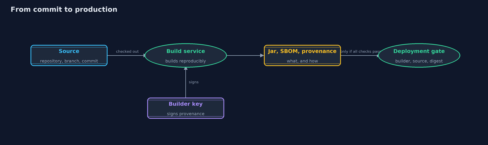

# SBOMs and Build Provenance: What Is Inside, Who Built It, and From What — Architecture Diagram

The builder records how it built the jar and signs that record; the gate checks the record before the jar runs.

