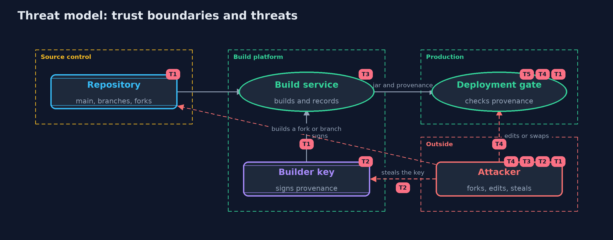

# Threat Model — SBOMs and Build Provenance: What Is Inside, Who Built It, and From What

A threat model answers four questions: what are we protecting, who or what could harm it, how, and what do we do about it. This one covers this project's own demo system, not a production deployment. Domain: an online store.

## Scope

How an online store records what a release contains and how it was built, and how its deployment checks that record: the SBOM, the provenance statement, the DSSE
envelope, the builder's key and the deployment gate. It does not cover vulnerabilities in the listed components, the source review process, or public transparency logs.

## What we protect (assets)

- The release jar and its SBOM.
- The provenance statements and the builder's signing key.
- The build service itself.
- The deployment gate's trust settings: the key, builder id, repository and branch.

## Who and what acts on the system

- The store's build service.
- Developers, who can push branches and run builds on their laptops.
- An outsider who can fork the repository and request builds.
- A thief or insider with access to the builder's key or the build machines.

## Trust boundaries

A trust boundary is a line that data or a request crosses between parts that trust each other differently. Threats cluster where those lines are.

- Source control to the build service: what is built is decided here.
- Build service to everything else: only the platform should hold the signing key.
- Delivery to production: nothing runs until the gate has checked it.

Each dashed box is a trust boundary. A rose tag such as T1 shows where the threat of that number, in the table below, applies.

## Threats, using STRIDE

STRIDE is a checklist of six kinds of threat: **Spoofing** (S), **Tampering** (T), **Repudiation** (R), **Information disclosure** (I), **Denial of service** (D), **Elevation of privilege** (E).

| Id | Kind | Threat | Where it shows up | Control in this project | What is left |
| --- | --- | --- | --- | --- | --- |
| T1 | Spoofing | A build of a fork or an unreviewed branch is deployed as if it were the release | `Policy.check` | The gate checks the repository and branch named in signed provenance | A malicious commit merged into main passes; code review protects main |
| T2 | Elevation of privilege | A stolen builder key signs provenance that lies about the source | the builder key | Only the build platform holds the key; builds are isolated from it at SLSA level three | Until the theft is noticed and the key revoked, forged statements pass |
| T3 | Tampering | A compromised build service builds something other than the commit and signs provenance that looks honest | `Builder.build` | Reproducible builds let an independent rebuild of the commit check the digest | Someone has to actually rebuild and compare |
| T4 | Tampering | A statement is edited after signing, or a different jar is paired with real provenance | `Dsse.open`, `Policy.check` | The signature covers the payload type and statement; the subject digest must match the jar | None within this check |
| T5 | Repudiation | Nobody can tell which components or source a running release came from | `Sbom`, `Provenance` | An SBOM and signed provenance kept with every release | A stale SBOM misleads; it must be written at every build |

## Assumptions

- The gate's trusted key and builder id were installed through a trusted channel.
- The gate is on every path to production.
- In the demo, the builder key comes from a fixed demo seed and timestamps are fixed strings.

## Out of scope

- Scanning components against advisories: the -with-syft-and-grype version.
- Public transparency logs: the artifact-signing project.
- Reviewing the commits that main contains.

## How the tests check this

- `DsseAndJsonTest` checks the DSSE encoding against the specification's example, trusted and untrusted keys, bad envelopes, and the JSON reader and writer.
- `PolicyTest` checks every gate refusal and its reason, an edited statement, and the statement's fields.
- `SbomAndBuildTest` checks the CycloneDX document, SBOM matching, reproducible and careless builds, and SLSA levels.
- `Ed25519Test` checks RFC 8032 test 1 and determinism.
- `DemoRunsTest` compares the whole demo with the golden output.

## Where this model goes next

The next project, dependency-confusion, looks at how a build can be tricked into fetching the wrong component in the first place.
