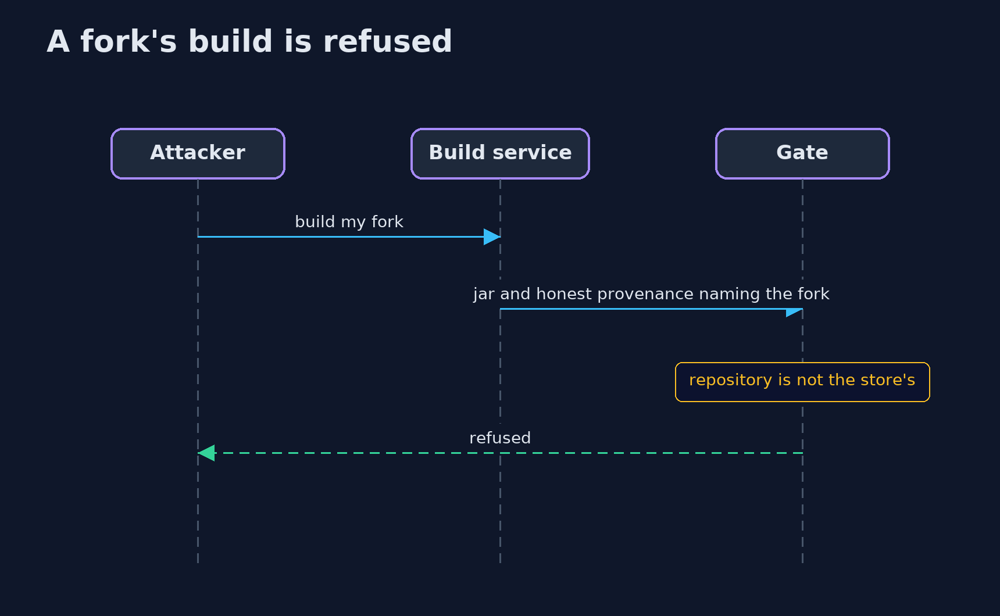
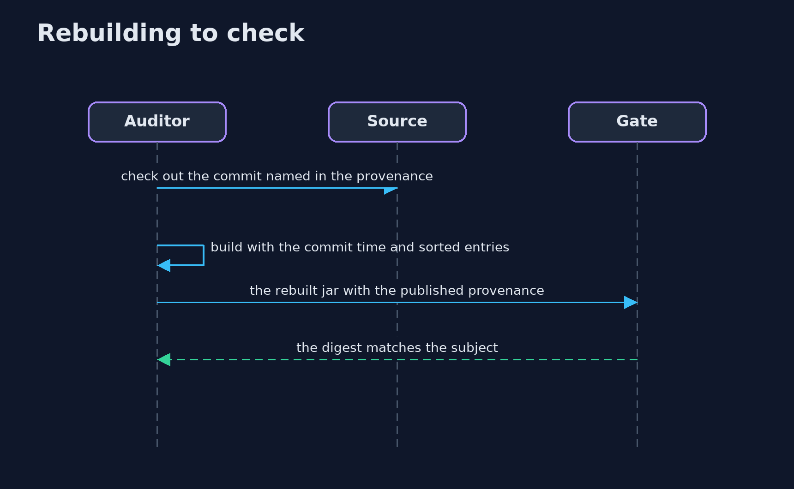

# SBOMs and Build Provenance: What Is Inside, Who Built It, and From What — UML Sequence Diagrams

## 1. A fork's build is refused

The signature is valid, but the statement says where the jar came from.

## 2. Rebuilding to check

A reproducible build lets anyone confirm the provenance subject.

