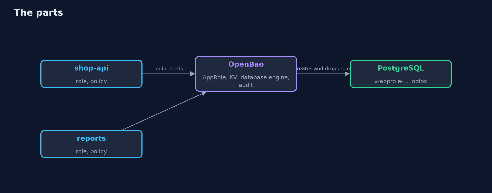
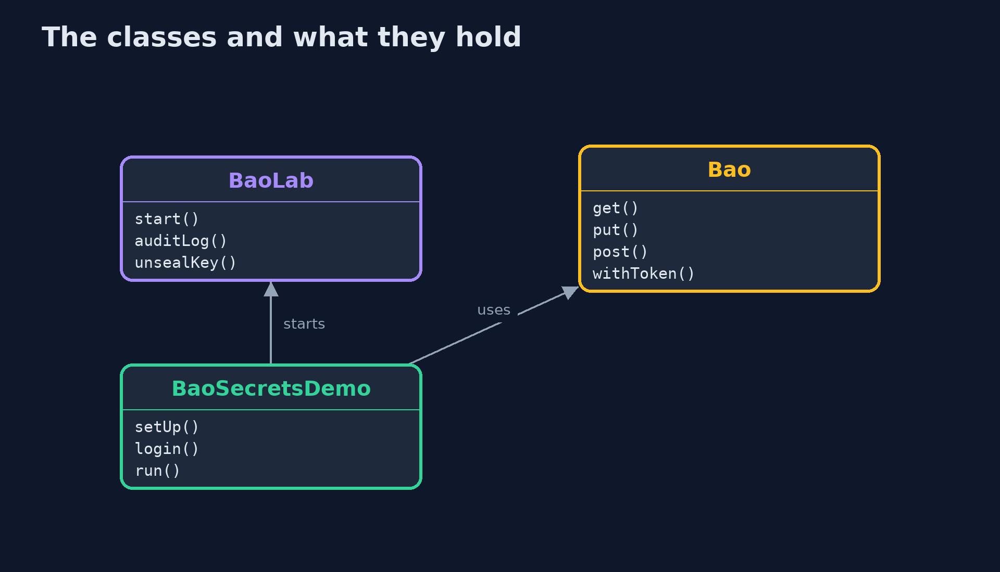
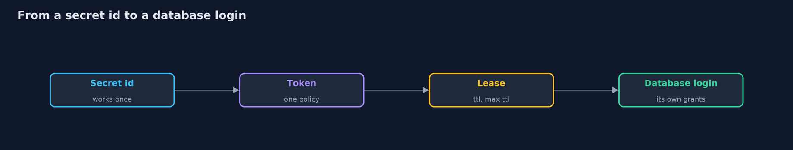

# Secrets Management with OpenBao

```
src/main/java/com/jk/explore/security/baosecrets/
├── Bao.java             A small client for OpenBao's HTTP API, with a token
├── BaoLab.java          One OpenBao in dev mode and one PostgreSQL, on a private Docker network, each bound to a free port on the loopback address and removed on close
└── BaoSecretsDemo.java  Runs the store's secrets story in five numbered acts against a real OpenBao and a real PostgreSQL in Docker, all on the loopback interface
```

**With OpenBao an application proves who it is with a role and a secret id that works once, gets a token that carries only its own policy, reads versioned secrets, and is leased a database login of its own that ends with its lease or when the operator revokes it, while the audit trail records every request with the values hashed; the price is a service that holds every secret, that must be sealed, unsealed, backed up and watched, and that the store cannot start without.**

The plain [secrets-management](../secrets-management) project builds a secrets service from scratch and ends with "the -with-openbao version runs the same leases against a real secrets server". This is that version: a real **OpenBao 2.7** and a real **PostgreSQL 18** in Docker, on a private network, each bound to a free loopback port, with a small Java client that speaks OpenBao's HTTP API. It needs Docker; its tests are tagged `integration`: `./gradlew integrationTest`.

What it shows:
- **Who may ask.** `shop-api` and `reports` each have an AppRole and a policy. A **secret id works once**: the same one again, or one nobody issued, gets 400. The shop reads its payment key and is refused (403) the reports key, the reports app the other way round, and a request with no token is refused.
- **Secrets that stay still.** KV version 2 keeps versions: during a changeover version 1 and version 2 are both readable by number, the application cannot destroy versions, the operator destroys version 1, and version 2 goes on working. The **audit trail** records the path and the application, and writes the values as HMACs, never the key.
- **Database logins that are leased.** Each application is given a login of its own, named `v-approle-shop-api-<random>`, that really connects to PostgreSQL and can read `orders` but not `card_numbers`. A lease is renewed up to its **maximum of 20 seconds**; an unrenewed one ends and the login is removed; **revoking a lease ends the login at once.** (A `VALID UNTIL` in the creation statement is not extended by a renewal unless a renew statement says so.)
- **Rotation and blast radius.** A static password that OpenBao manages is rotated and the thief's copy stops working; **revoking every lease under one path** ends all of an application's logins and leaves the others alone.
- **The bill.** A **sealed** OpenBao refuses every read with 503, so the store cannot start a server; logins already held go on working until their lease would have ended; unsealing restores service. This dev server keeps everything in memory.

**Maps to:** OWASP Top 10 (2025) A02 Security Misconfiguration, A04 Cryptographic Failures · CWE-798, CWE-522 · OWASP Secrets Management Cheat Sheet · NIST SP 800-57.

## The idea in everyday terms

A hotel that stops handing out master keys. Each guest gets a card for their own room that stops working at checkout, the front desk can cancel one card or all of a floor's at once, and a log records every card that was cut. The price is a front desk that must always be open.

## The scenario

An online store has a shop API and a reports job that both need a payment key and a database login. The demo starts a real OpenBao and a real PostgreSQL, gives each application a role and a policy, leases logins, and then renews, expires, rotates, revokes and seals.

## Run

```bash
./gradlew run
```

The demo tells the story in 5 acts, each printing exact numbers that the tests check:

| Act | What it shows |
| --- | --- |
| 1. A secrets server, and who may ask | An application proves who it is with a role id and a secret id that works once, and gets a token that carries only its own policy. |
| 2. Secrets that stay still: versions, rotation and the audit trail | Versions of a secret are readable by number during a changeover, the application cannot destroy them, the operator does, and the audit trail records requests with values hashed. |
| 3. Database logins that are leased | Each application gets a real database login of its own, with only its grants, that is renewed up to a maximum, ends when unrenewed, and ends at once when revoked. |
| 4. Rotation, and the blast radius of a leak | A static password that OpenBao manages is rotated and the thief's copy stops working; revoking every lease under one path ends one application's logins and no others. |
| 5. The bill | A sealed OpenBao refuses every request with 503, so the store cannot start a server; logins already held keep working until their lease ends; unsealing restores service. |

## Test

```bash
./gradlew test
```

13 tests in `BaoSecretsTest`, `DemoRunsTest`. The tests start one OpenBao and one PostgreSQL for the whole class and remove them (./gradlew integrationTest). Two tests wait for a lease to end.

## What the simulation got right, and what it left out

OpenBao and PostgreSQL are real containers on a private Docker network, each bound to a free loopback port and removed at the end. OpenBao's audit device writes to a file inside its container, which the demo reads. Tokens, passwords, lease ids and ports are never printed; the demo waits about ten seconds, once, for a lease to end.

## Technologies and versions

Every version below is pinned in the project's build files and was the latest stable release when the project was built.

| Technology | Version | Used for |
| --- | --- | --- |
| Java | 25 | the language and runtime; a Gradle toolchain finds or downloads the JDK |
| Gradle | 9.8.1 (wrapper) | build and run; nothing to install, the wrapper downloads it |
| tools.jackson.core:jackson-databind | 3.1.5 | library the code uses |
| org.postgresql:postgresql | 42.7.13 | library the code uses |
| org.junit.jupiter:junit-jupiter | 6.1.3, set by junit-bom | JUnit 5: the tests (tests only) |
| org.junit.platform:junit-platform-launcher | 6.1.3, set by junit-bom | JUnit platform launcher, which Gradle needs to run the tests (tests only) |
| videokit | repository tool (`tools/videokit`) | the narrated video and animation: Piper `en_US-amy-medium`, speed 0.8, longer pauses (the amy-slow voice) |

## Learning Material

| Document | What it is for |
| --- | --- |
| [Problem statement](docs/problem-statement.md) | the situation and what the project must show |
| [Prerequisites](docs/prerequisites.md) | what you need to know first |
| [Secrets Management with OpenBao, explained](docs/secrets-management-with-openbao-explained.md) | the acts in prose |
| [Session guide](docs/session.md) | a one-hour lesson with exercises |
| [Animated walkthrough](docs/animation.html) | the acts step by step, narrated |
| [Threat model](docs/threat-model.md) | what is protected, who could harm it, and how, using STRIDE |
| [Spec](docs/spec.md) | what this project must be true of |
| [Expected output](docs/expected-output.txt) | the golden demo output every test and every port checks against |

### The idea in one picture

OpenBao creates and removes the database logins; the applications only ask for them.



### Where each piece sits

The lab starts the containers; the client speaks the API.



### How the data moves

Each step narrows what the application can do.



### Who calls whom, in order


### Video

`video/secrets-management-with-openbao-explained.mp4` (with `.m4a` audio and `.srt` subtitles) is built by `video/build_video.sh`. Rendered media is not committed.

## What it costs

- **The secrets service holds every secret,** so it needs its own access control, audit, backups and unseal procedure.
- **The store cannot start while it is sealed or down,** so its availability is now part of the store's.
- **Applications need a first credential,** a role id and a secret id, to prove who they are.
- **Leases and rotation need applications that can reconnect** with a new login without a restart.
- **Policies are one more thing to write and review,** and a policy that is too wide undoes the point.

## When this is too much

A single small service on one machine with one secret can read an owner-only file injected at deploy time. Use a secrets server when several applications need secrets of their own, when logins should expire, or when a leak must be containable.

## Where you have already met this

- `vault read database/creds/...` and `v-approle-...` user names in a database.
- `role_id` and `secret_id` in a deployment pipeline.
- A `403 permission denied` from a secrets server.
- A secrets service sealed after a restart.

## Where this sits

This is the tools version of [secrets-management](../secrets-management), in the [secrets-and-supply-chain](..) module. It runs the same ideas, leases, rotation and revocation, against a real secrets server and a real database.
