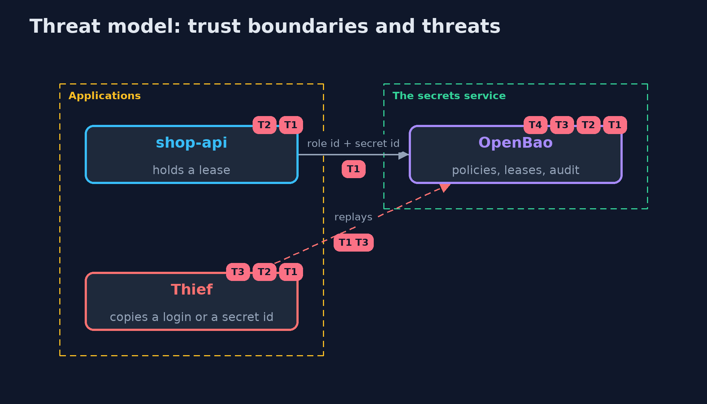

# Threat Model — Secrets Management with OpenBao

A threat model answers four questions: what are we protecting, who or what could harm it, how, and what do we do about it. This one covers this project's own demo system, not a production deployment. Domain: an online store.

## Scope

Secrets for an online store's applications held in OpenBao, and the database logins it leases. It covers identity, policy, leases, rotation, revocation and the failure of the service. It does not cover the host that runs OpenBao.

## What we protect (assets)

- The payment key and the database logins.
- The unseal key and the root token.

## Who and what acts on the system

- An application with its own role.
- A thief who copies a secret id or a login.
- An operator with the root token.

## Trust boundaries

A trust boundary is a line that data or a request crosses between parts that trust each other differently. Threats cluster where those lines are.

- The application to OpenBao: a token with one policy.
- OpenBao to PostgreSQL: an administrator login that only OpenBao holds.

Each dashed box is a trust boundary. A rose tag such as T1 shows where the threat of that number, in the table below, applies.

## Threats, using STRIDE

STRIDE is a checklist of six kinds of threat: **Spoofing** (S), **Tampering** (T), **Repudiation** (R), **Information disclosure** (I), **Denial of service** (D), **Elevation of privilege** (E).

| Id | Kind | Threat | Where it shows up | Control in this project | What is left |
| --- | --- | --- | --- | --- | --- |
| T1 | Spoofing | A stolen secret id or token lets another party act as the application | AppRole login, tokens | A secret id that works once and a short token life | A thief who is first to use the secret id |
| T2 | Information disclosure | A leaked database login stays valid | database/creds | Short leases, a renewal cap and revocation | The seconds until the lease ends or is revoked |
| T3 | Elevation of privilege | An application reads another application's secrets | policies | One policy per application that names its paths only | A policy that is written too wide |
| T4 | Denial of service | The secrets service is sealed or down and the store cannot start | OpenBao | Held logins keep working until their lease ends; unseal procedure and monitoring | An outage longer than the leases |

## Assumptions

- The channel to OpenBao is TLS in production.
- The root token and unseal keys are held by several people.

## Out of scope

- Compromise of the OpenBao host.
- Storage and high availability of OpenBao.

## How the tests check this

- `BaoSecretsTest` starts a real OpenBao and PostgreSQL and checks the single use of a secret id, the policies, versions, the audit trail, per-application logins, revocation, expiry, the renewal cap, revoking a prefix, rotation and sealing.
- `DemoRunsTest` compares the whole demo with the golden output.

## Where this model goes next

The next project in this module, artifact-signing-with-cosign, moves from the secrets the store holds to the proof that what it runs is what was built.
