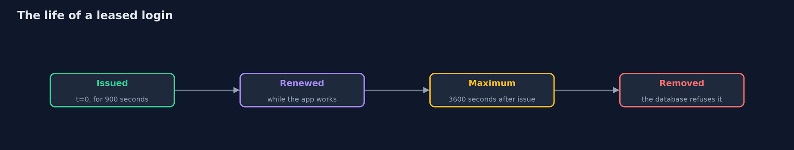
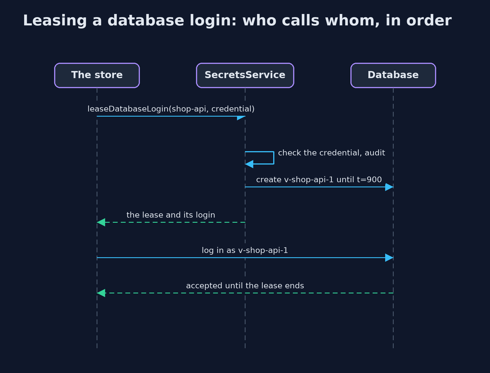

# Secrets Management

```
src/main/java/com/jk/explore/security/secrets/
├── Database.java         The store's database, which accepts a login only for an account that exists, has not expired, and has the right password
├── ImageLayers.java      A container image modelled as a stack of layer archives
├── MountedSecrets.java   Secrets injected at run time as files in a mounted folder (as container platforms do with /run/secrets), read once at startup
├── PaymentProvider.java  The payment provider's side of an API key
├── Secret.java           A secret value that cannot be printed by accident: toString, string concatenation and log lines show "[redacted]"
├── SecretScanner.java    Finds secrets written into files, the way repository and image scanners do: by the name of the setting (password, secret, api key, token) and by how random a long value looks (its Shannon entropy)
├── SecretsDemo.java      Runs the online store story in five numbered acts and prints exact, repeatable results
├── SecretsService.java   A small secrets service, run in the same process to keep the lab self-contained
└── SimClock.java         A clock in seconds that moves only when told to, so leases and rotations are the same on every run
```

**Secrets leak from code, environment variables and image layers; inject them at run time from owner-only files, keep them out of logs, and better still lease short-lived, per-application logins from a secrets service that can rotate and revoke them.**

Every application has secrets: a database password, an API key for the payment provider, a signing key. The beginner project
[keystore-basics](../../../beginner/cryptography/keystore-basics) showed where a key can live on one machine. This project looks at how
secrets reach a running application, and how they **leak** on the way: written into a configuration file and committed, passed in an
**environment variable** that every child process and crash report can read, or copied into a container **image layer** that a later layer
only hides. The fixes are **run-time injection** from a file only the application can read, a **Secret** type that never prints its value,
and better still a **secrets service** that gives each application its own **leased** login with a time to live, so a stolen login stops
working by itself, and can be **rotated** and **revoked** without downtime.

It maps to OWASP Top 10 (2025) A02 Security Misconfiguration and A04 Cryptographic Failures, CWE-798 (hard-coded credentials), CWE-522
(insufficiently protected credentials), CWE-526 (secrets in environment variables), CWE-532 (secrets in logs), and the ASVS 5.0 chapter on
secret management.

## The idea in everyday terms

Think of a hotel. The old way is one master key, copied for every member of staff, never changed, and written on a note in the office. The
better way is a key card for each guest, programmed at the desk, opening only that guest's room, and stopping at checkout. If a card is lost,
the desk cancels it at once, and the other guests never notice. The desk itself, which can make any card, becomes the thing to guard.

## The scenario

An online store needs a database password and an API key for its payment provider. The demo looks for those secrets where teams leave
them, injects them at run time instead, replaces the shared password with leased logins from a secrets service, rotates the payment key
with no downtime, and counts the cost.

## Run

```bash
./gradlew run
```

The demo tells the story in 5 acts, each printing exact numbers that the tests check:

| Act | What it shows |
| --- | --- |
| 1. Where secrets leak | A scanner finds 3 secrets in 3 committed files; a child process reads a key from the environment; a key deleted in a later image layer is still in layer two. |
| 2. Secrets injected at run time | A secret file readable by others is refused; an owner-only file is read once at startup; the value prints as [redacted] and the startup copy is wiped. |
| 3. A secrets service that hands out leased logins | Each application gets its own database login for 900 seconds; a wrong credential is refused; renewals stop at 3600 seconds; ended leases are removed; every request is audited. |
| 4. Rotation without downtime, and the blast radius of a leak | Both key versions work during a changeover and only the new one after; a leaked leased login works for at most 300 more seconds and is revoked at once, while a static password works for years. |
| 5. The bill | The secrets service becomes the target; the first credential remains; applications must handle new logins; a scanner is one check. |

## Test

```bash
./gradlew test
```

17 tests in `DemoRunsTest`, `LeaksTest`, `SecretTest`, `ServiceTest`. A simulated clock makes leases exact; generated passwords are random and never printed, so the demo shows only facts that do not depend on them. A test checks that no demo secret value ever appears in the output.

## What the simulation got right, and what it left out

Everything runs in one process with a simulated clock in seconds, so leases and rotations are exact. The secrets service is a small model of
how Vault and OpenBao lease database logins, not a full server. The demo values are obviously fake and never printed. Generated passwords are
random and never printed either, so the demo shows only facts that do not depend on them. The environment-variable act starts a real child
process (`printenv`), and file permissions are the POSIX ones of macOS and Linux.

## Technologies and versions

Every version below is pinned in the project's build files and was the latest stable release when the project was built.

| Technology | Version | Used for |
| --- | --- | --- |
| Java | 25 | the language and runtime; a Gradle toolchain finds or downloads the JDK |
| Gradle | 9.8.1 (wrapper) | build and run; nothing to install, the wrapper downloads it |
| org.junit.jupiter:junit-jupiter | 6.1.3, set by junit-bom | JUnit 5: the tests (tests only) |
| org.junit.platform:junit-platform-launcher | 6.1.3, set by junit-bom | JUnit platform launcher, which Gradle needs to run the tests (tests only) |
| videokit | repository tool (`tools/videokit`) | the narrated video and animation: Piper `en_US-amy-medium`, speed 0.8, longer pauses (the amy-slow voice) |

## Learning Material

| Document | What it is for |
| --- | --- |
| [Problem statement](docs/problem-statement.md) | the situation and what the project must show |
| [Prerequisites](docs/prerequisites.md) | what you need to know first |
| [Secrets Management, explained](docs/secrets-management-explained.md) | the acts in prose |
| [Session guide](docs/session.md) | a one-hour lesson with exercises |
| [Animated walkthrough](docs/animation.html) | the acts step by step, narrated |
| [Threat model](docs/threat-model.md) | what is protected, who could harm it, and how, using STRIDE |
| [Spec](docs/spec.md) | what this project must be true of |
| [Expected output](docs/expected-output.txt) | the golden demo output every test and every port checks against |

### The idea in one picture

Red paths copy a secret into places that outlive it; the green path leases it at run time.


### Where each piece sits

SecretsService leases logins that Database accepts until they expire; Secret never prints its value.


### How the data moves

Issued, renewed up to a maximum, then removed: a copy stops working on its own.



### Who calls whom, in order




### Video

`video/secrets-management-explained.mp4` (with `.m4a` audio and `.srt` subtitles) is built by `video/build_video.sh`. Rendered media is not committed.

## What it costs

- **The secrets service holds every secret.** It needs its own access control, audit trail and backups, and an outage of it stops every application that needs a new login.
- **The first credential is the hard part.** An application still has to prove who it is to the secrets service. Platform identity (workload identity, in the advanced track) removes that last shared secret.
- **Leases and rotation need applications that cope.** A connection pool must reconnect with a new login without a restart, and every server must switch keys before the old one is revoked.
- **A scanner is one check.** It finds only what it has patterns for; the history of a repository and the layers of every image must be scanned too.

## When this is too much

For a single demo on one laptop, a file that only the developer can read is enough. As soon as there are servers, teams or customers, secrets
belong outside the code and the image, injected at run time, and for anything that holds money or personal data, short-lived credentials
from a secrets service are the standard.

## Where you have already met this

- Docker and Kubernetes secrets mounted as files under /run/secrets.
- HashiCorp Vault and OpenBao, AWS Secrets Manager, Azure Key Vault and Google Secret Manager.
- gitleaks, trufflehog and GitHub secret scanning, which fail a build or block a push.
- Breach reports that begin with a key found in a public repository or an image.

## Where this sits

This project opens [secrets-and-supply-chain](..) in the intermediate track. It builds on [keystore-basics](../../../beginner/cryptography/keystore-basics),
and the `-with-openbao` version runs the same leases against a real secrets server.
