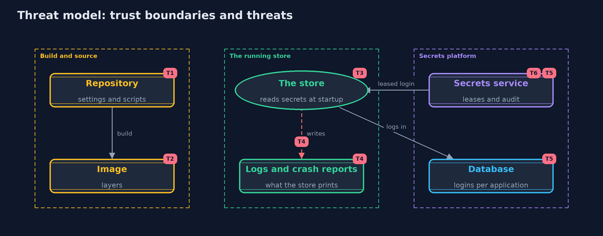

# Threat Model — Secrets Management

A threat model answers four questions: what are we protecting, who or what could harm it, how, and what do we do about it. This one covers this project's own demo system, not a production deployment. Domain: an online store.

## Scope

How an online store's database password and payment key reach its servers: the repository, the build and image, the running process, its logs,
and a secrets service that leases database logins. It covers developers' mistakes, a thief with a copy of the repository or image, and a thief
with a copied login. It does not cover the security of the secrets server's own storage, or platform identity.

## What we protect (assets)

- The database password and every leased database login.
- The payment provider's API key and its versions.
- Each application's credential for the secrets service.
- The audit trail of the secrets service.

## Who and what acts on the system

- Developers and build servers that handle configuration.
- The store's servers, which read secrets at startup.
- A thief with a copy of the repository, an image or a log.
- A thief with a copied login.

## Trust boundaries

A trust boundary is a line that data or a request crosses between parts that trust each other differently. Threats cluster where those lines are.

- Source and build to the running store: anything copied across outlives the run.
- The store's process to its logs and child processes.
- The store to the secrets service: the application must prove who it is.

Each dashed box is a trust boundary. A rose tag such as T1 shows where the threat of that number, in the table below, applies.

## Threats, using STRIDE

STRIDE is a checklist of six kinds of threat: **Spoofing** (S), **Tampering** (T), **Repudiation** (R), **Information disclosure** (I), **Denial of service** (D), **Elevation of privilege** (E).

| Id | Kind | Threat | Where it shows up | Control in this project | What is left |
| --- | --- | --- | --- | --- | --- |
| T1 | Information disclosure | A secret committed to the repository is read by anyone with a copy, for ever | `SecretScanner`, the sample repository | Secrets stay out of files; settings name where a secret comes from; a scanner checks every commit | A scanner finds only what it has patterns for, and a secret once committed must be treated as leaked and rotated |
| T2 | Information disclosure | A secret copied into an image layer is read from the image, even after a later layer deletes it | `ImageLayers` | Secrets are injected at run time, never built into images | Images built before the change still contain the secret and must be deleted |
| T3 | Information disclosure | A secret in an environment variable, or a secret file readable by others, is read by another process or user | `MountedSecrets.read` | Owner-only secret files are read once at startup; files readable by others are refused | Anyone who can run code as the store's own user can still read the secret from its memory |
| T4 | Information disclosure | A secret is written into a log line, a crash report or an error page | `Secret.toString` | The Secret type prints [redacted] and is wiped after use | Code that turns the value into a String on purpose can still log it; reviews and log scanning remain |
| T5 | Spoofing | A copied database login is used by someone else | `SecretsService`, `Database.login` | Logins are per application, leased for 900 seconds, renewable only to 3600, and revocable at once | A thief can use a copied login until it ends or is revoked, and can renew it with a stolen application credential |
| T6 | Elevation of privilege | The secrets service is compromised and hands out every secret | the secrets service | Applications prove who they are; every request is audited | The secrets service is the most valuable system to protect, with its own access control, monitoring and backups |

## Assumptions

- The secrets service is reachable only by the store's applications, and its own storage is protected.
- File permissions are enforced by the operating system.
- In the demo, every secret value is an obviously fake demo value, and generated passwords are random and never printed.

## Out of scope

- Encryption at rest and unsealing of a real secrets server: the -with-openbao version.
- Workload and platform identity: the advanced track.
- Scanning the history of a real repository.

## How the tests check this

- `SecretTest` checks that a secret never prints, compares values and stops working once wiped.
- `LeaksTest` checks the scanner, entropy, the image-layer leak and refusal of a secret file readable by others.
- `ServiceTest` checks per-application logins, refusals and audit, expiry, renewal limits, revocation and rotation.
- `DemoRunsTest` compares the whole demo with the golden output and checks that no secret value is printed.

## Where this model goes next

The next project, artifact-signing, moves from the secrets an application uses to the trust in the application itself: signing a release and
checking it before it runs.
