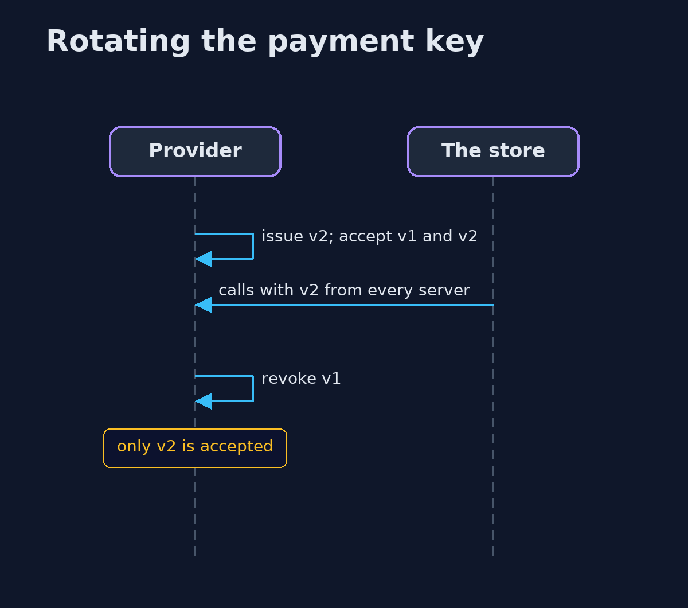
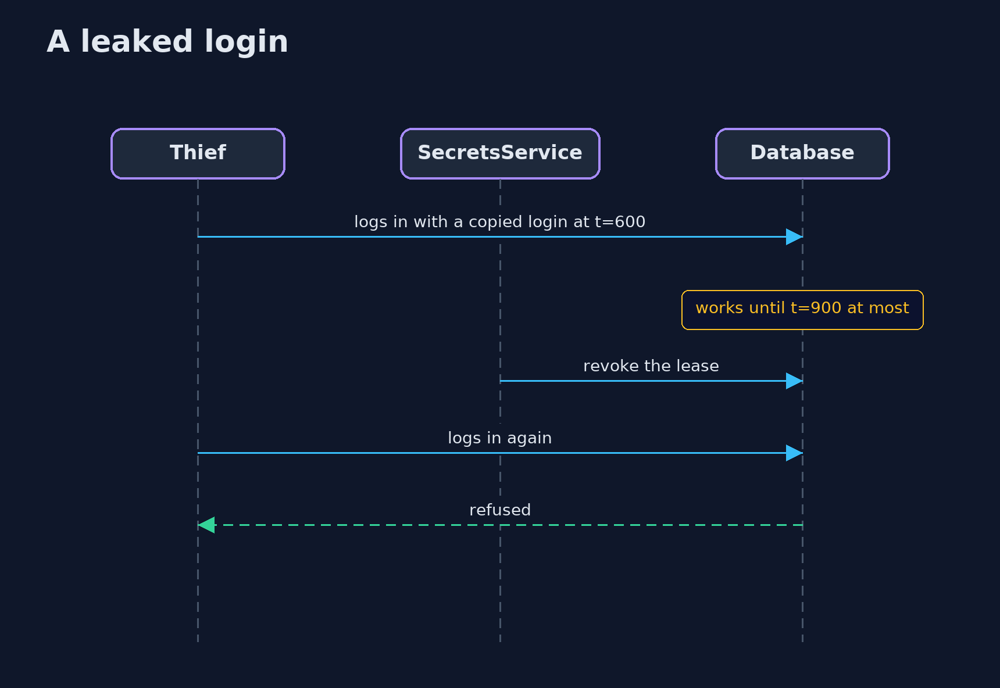

# Secrets Management — UML Sequence Diagrams

## 1. Rotating the payment key

Two versions overlap, so the store is never without a working key.

## 2. A leaked login

A leased login stops by itself and can be revoked at once; a static password does not.

