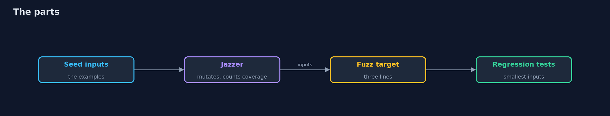
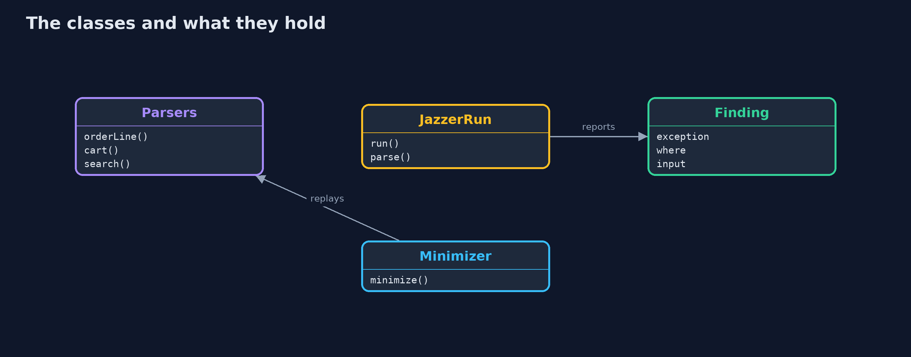
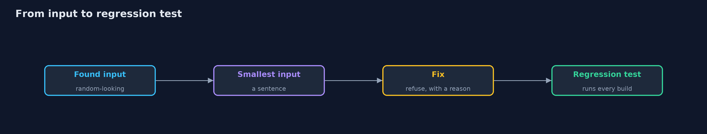
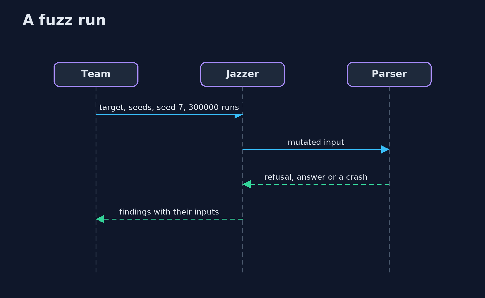

# Fuzzing with Jazzer

```
src/main/java/com/jk/explore/security/jazzerfuzz/
├── CartParser.java                 The store's cart format, a small subset of JSON: numbers, strings with {@code \"} and {@code \\} escapes, lists and objects
├── Crashes.java                    Runs a parser on an input and says what, if anything, it did wrong: the exception that is not a refusal, and the first line of the store's code in it
├── Finding.java                    One distinct problem that Jazzer reported: the kind of exception, where in the store's code it happened, and the file that holds the input
├── JazzerFuzzDemo.java             
├── JazzerRun.java                  The real Jazzer, started as a program of its own on one fuzz target, with a corpus of seed inputs and a fixed random seed, and its report read back
├── Minimizer.java                  Makes a crashing input as small and plain as it can while it still crashes in the same place: it deletes stretches of characters, from half of the input down to one, then replaces each with a plainer one (A for a letter, 0 for a digit), and repeats until nothing changes
├── Money.java                      An amount of money in cents
├── OrderLine.java                  One line of the store's order import file: {@code SKU,quantity,unit price in cents}, such as {@code SHO-1042,2,8990}
├── ParseException.java             The one failure a parser is allowed to have: "this input is not valid"
├── Parsers.java                    The parsers of the store behind one public door each, so that a fuzz target can reach them
├── Value.java                      A value in the store's small cart format: a number, a string, a list or an object, as in JSON
├── targets/CartCareless.java       The fuzz target for the careless cart parser
├── targets/CartFixed.java          The fuzz target for the fixed cart parser
├── targets/OrderLineCareless.java  The fuzz target for the careless order line parser: anything but a refusal is a finding
├── targets/OrderLineFixed.java     The fuzz target for the fixed order line parser: it may refuse, and nothing else may be thrown
├── targets/SearchBoxCareless.java  The fuzz target for a search box that hands the customer's words to the regular expression engine as they are
└── targets/SearchBoxFixed.java     The fuzz target for the search box that quotes what the customer typed
```

**Jazzer 0.30 fuzzes the store's parsers from a fuzz target of three lines and a handful of seed inputs: it instruments the bytecode itself, finds three crashes in the order line parser and a gift-message bug in the cart parser, saves each input, and its sanitizers report a regular expression injection that is not a crash; but it cannot guess a product code with no seeds, it stops at a default input length, it does not know a business rule, and every saved input is only worth something once it is made smallest and kept as a regression test.**

The plain [fuzzing](../fuzzing) project writes a mutation fuzzer and a coverage counter by hand and ends with "coverage-guided tools such as Jazzer add the branch counters to the bytecode by themselves: the -with-jazzer version". This is that version: the real **Jazzer 0.30**, started as a program by the demo on the same two parsers, with a fixed random seed. It needs no server, no Docker and nothing beyond Gradle (the Jazzer jars include the native part for macOS and Linux); the demo takes about half a minute, and the real-Jazzer tests are tagged `integration`: `./gradlew integrationTest`.

What it shows:
- **The example tests pass.** Six of six, and a line with only a product code still crashes the parser.
- **The real Jazzer.** A fuzz target of three lines (`Parsers.orderLineCareless(data.consumeRemainingAsAsciiString())`), the two example lines as seeds, random seed 7 and 300000 runs: **three distinct findings** (two `ArrayIndexOutOfBoundsException` at different lines, and a `Money` that went negative through an int overflow), each with its input saved.
- **Guided by coverage, and by the seeds.** With no seeds it reaches 7 coverage points and finds nothing: it cannot guess a product code. The cart parser's gift-message bug is found only when a seed has a `note` field.
- **From crash to fix.** Each saved input is made smallest (`AAA-0000`, `AAA-0000,0`, `AAA-0000,4000,4000000`) and replayed as a regression test through the **Jazzer JUnit** integration, in milliseconds; the fixed parsers run clean under the same fuzzer.
- **Beyond crashes.** A **sanitizer** reports `Regular Expression Injection` in a search box that hands the customer's words to the pattern engine. A cart with a quantity of -5 is no crash, so no report; the nesting crash needs more than the default input length.

**Maps to:** NIST SSDF PW.8 (test executable code) · OWASP Top 10 (2025) A05 Injection (for the sanitizer) · CWE-20, CWE-248, CWE-674 (uncontrolled recursion), CWE-190 (integer overflow).

## The idea in everyday terms

A tireless clerk who takes the three forms you already have, changes a letter here and a number there, hands thousands of variants to the counter, and writes down every one that makes the counter jam. The clerk does not know what the forms mean, only that a jam is a jam.

## The scenario

An online store parses order lines and carts that come from outside. The demo gives Jazzer the example inputs of the team and watches what comes back.

## Run

```bash
./gradlew run
```

The demo tells the story in 5 acts, each printing exact numbers that the tests check:

| Act | What it shows |
| --- | --- |
| 1. The example tests pass | Six of six example tests pass, and a line with only a product code still crashes the parser. |
| 2. The real Jazzer | A three-line fuzz target, two seed lines, a fixed random seed and 300000 runs find three distinct bugs. |
| 3. Guided by coverage, and by what you give it | With no seeds it reaches 7 coverage points and finds nothing; with the examples, 19 and three bugs; the gift-message bug needs a seed with a note field. |
| 4. From crash to fix | Each saved input is made smallest, kept as a regression test, and the fixed parsers run clean under the same fuzzer. |
| 5. What fuzzing finds besides crashes, and what it does not | A sanitizer flags a regular expression injection; a quantity of -5 is no crash; the nesting crash needs a longer input than the default. |

## Test

```bash
./gradlew test
```

17 tests in `DemoRunsTest`, `FixedParsersFuzzTest`, `JazzerRealTest`, `MinimizerTest`, `ReportTest`, `SavedInputsTest`. Most tests run in milliseconds: the saved inputs as regression tests, the minimizer and the reader of Jazzer's report. The tests that start Jazzer are tagged integration (./gradlew integrationTest).

## What the simulation got right, and what it left out

Jazzer runs for real, in a program of its own with a fixed random seed, so the same findings come out each time. The two parsers are the same as in the plain project, without the hand-written coverage counters. Nothing here is mocked.

## Technologies and versions

Every version below is pinned in the project's build files and was the latest stable release when the project was built.

| Technology | Version | Used for |
| --- | --- | --- |
| Java | 25 | the language and runtime; a Gradle toolchain finds or downloads the JDK |
| Gradle | 9.8.1 (wrapper) | build and run; nothing to install, the wrapper downloads it |
| com.code-intelligence:jazzer-api | 0.30.0 | library the code uses |
| com.code-intelligence:jazzer | 0.30.0 | library the code uses |
| com.code-intelligence:jazzer-junit | 0.30.0 | library the code uses (tests only) |
| org.junit.jupiter:junit-jupiter | 6.1.3, set by junit-bom | JUnit 5: the tests (tests only) |
| org.junit.platform:junit-platform-launcher | 6.1.3, set by junit-bom | JUnit platform launcher, which Gradle needs to run the tests (tests only) |
| videokit | repository tool (`tools/videokit`) | the narrated video and animation: Piper `en_US-amy-medium`, speed 0.8, longer pauses (the amy-slow voice) |

## Learning Material

| Document | What it is for |
| --- | --- |
| [Problem statement](docs/problem-statement.md) | the situation and what the project must show |
| [Prerequisites](docs/prerequisites.md) | what you need to know first |
| [Fuzzing with Jazzer, explained](docs/fuzzing-with-jazzer-explained.md) | the acts in prose |
| [Session guide](docs/session.md) | a one-hour lesson with exercises |
| [Animated walkthrough](docs/animation.html) | the acts step by step, narrated |
| [Threat model](docs/threat-model.md) | what is protected, who could harm it, and how, using STRIDE |
| [Spec](docs/spec.md) | what this project must be true of |
| [Expected output](docs/expected-output.txt) | the golden demo output every test and every port checks against |

### The idea in one picture

Seeds in, findings out, and the smallest inputs back into the build.



### Where each piece sits

Parsers, their fuzz targets, and the code that runs Jazzer and reads its report.



### How the data moves

Each stage makes the crash easier to understand.



### Who calls whom, in order




### Video

`video/fuzzing-with-jazzer-explained.mp4` (with `.m4a` audio and `.srt` subtitles) is built by `video/build_video.sh`. Rendered media is not committed.

## What it costs

- **Each parser needs a fuzz target,** a few lines, and someone to keep them working.
- **The seeds decide a lot:** a fuzzer with none cannot guess a product code.
- **A run is a budget:** a fixed number in the build, longer ones at night.
- **Findings must be made smallest, reproduced and fixed,** or they pile up.
- **A fuzzer finds crashes and what its sanitizers know,** not wrong decisions.

## When this is too much

Code that only moves data between two typed fields has nothing to fuzz. Fuzz what reads bytes or text from outside: parsers, decoders, importers, anything with a format.

## Where you have already met this

- A `crash-...` file next to a build.
- `@FuzzTest` in a JUnit class.
- A `corpus` folder in a repository.
- A nightly job named `fuzz`.

## Where this sits

This is the tools version of [fuzzing](../fuzzing), in the [secure-coding](..) module. The input checks it exercises are the subject of [input-validation](../input-validation) and its Hibernate Validator version.
