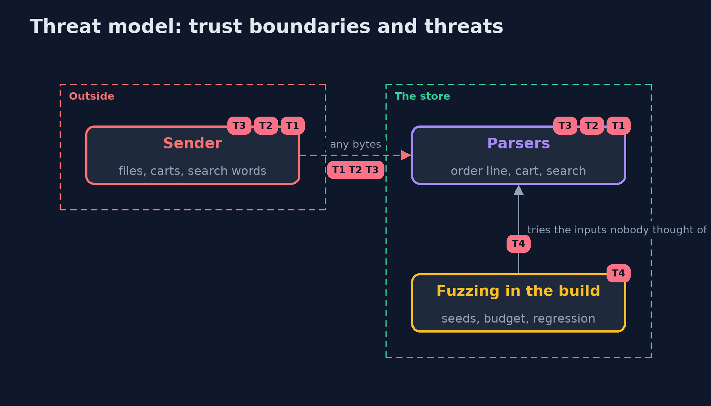

# Threat Model — Fuzzing with Jazzer

A threat model answers four questions: what are we protecting, who or what could harm it, how, and what do we do about it. This one covers this project's own demo system, not a production deployment. Domain: an online store.

## Scope

The store's parsers for order lines, carts and search words, and the fuzzing that exercises them. It does not cover business rules or the code behind the parsers.

## What we protect (assets)

- The availability of the import and the checkout.
- The correctness of order totals.

## Who and what acts on the system

- A sender of files and carts who controls every byte.
- A developer who writes the fuzz targets.

## Trust boundaries

A trust boundary is a line that data or a request crosses between parts that trust each other differently. Threats cluster where those lines are.

- The parsers' door: everything they take comes from outside.

Each dashed box is a trust boundary. A rose tag such as T1 shows where the threat of that number, in the table below, applies.

## Threats, using STRIDE

STRIDE is a checklist of six kinds of threat: **Spoofing** (S), **Tampering** (T), **Repudiation** (R), **Information disclosure** (I), **Denial of service** (D), **Elevation of privilege** (E).

| Id | Kind | Threat | Where it shows up | Control in this project | What is left |
| --- | --- | --- | --- | --- | --- |
| T1 | Denial of service | A malformed line or cart crashes the import | the order line and cart parsers | Parsers that only refuse, fuzzed with the team's examples as seeds | Inputs that need a longer length or a better seed |
| T2 | Tampering | An integer overflow makes a total negative | the order line parser | Ranges checked before the multiplication, which is done in a long | Other arithmetic nobody fuzzed |
| T3 | Tampering | The customer's words are taken as a pattern | the search box | Search for the text as text; Jazzer's regular expression sanitizer | Other sinks that no sanitizer knows |
| T4 | Repudiation | A fixed bug comes back unnoticed | the build | Every smallest crash input is a regression test | Bugs that were never found |

## Assumptions

- A parser may refuse input; anything else it throws is a bug.
- The fuzz targets stay in step with the parsers.

## Out of scope

- Vulnerabilities outside the parsers.
- Denial of service by volume.

## How the tests check this

- `SavedInputsTest` and `FixedParsersFuzzTest` replay the smallest inputs of each crash against the careless and the fixed parsers, through the Jazzer JUnit integration.
- `MinimizerTest` and `ReportTest` check the minimizer and the reader of Jazzer's report.
- `JazzerRealTest` and `DemoRunsTest` start the real Jazzer (integrationTest).

## Where this model goes next

The next module, platform-hardening, starts with linux-hardening-with-docker.
