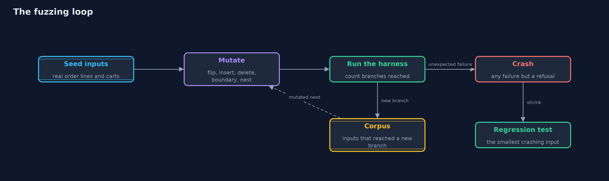
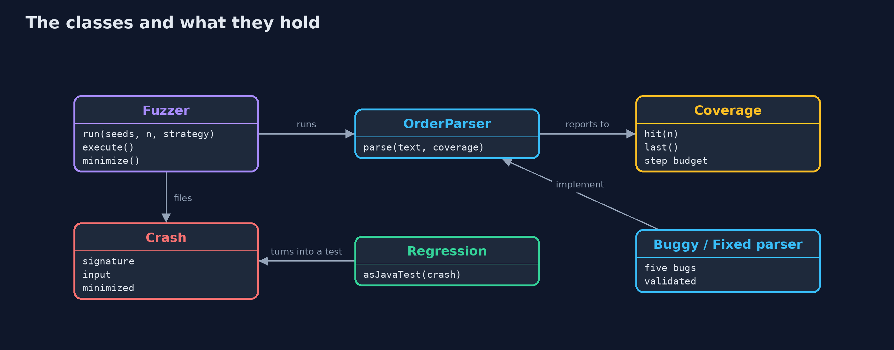
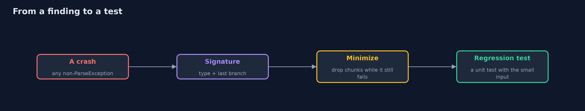
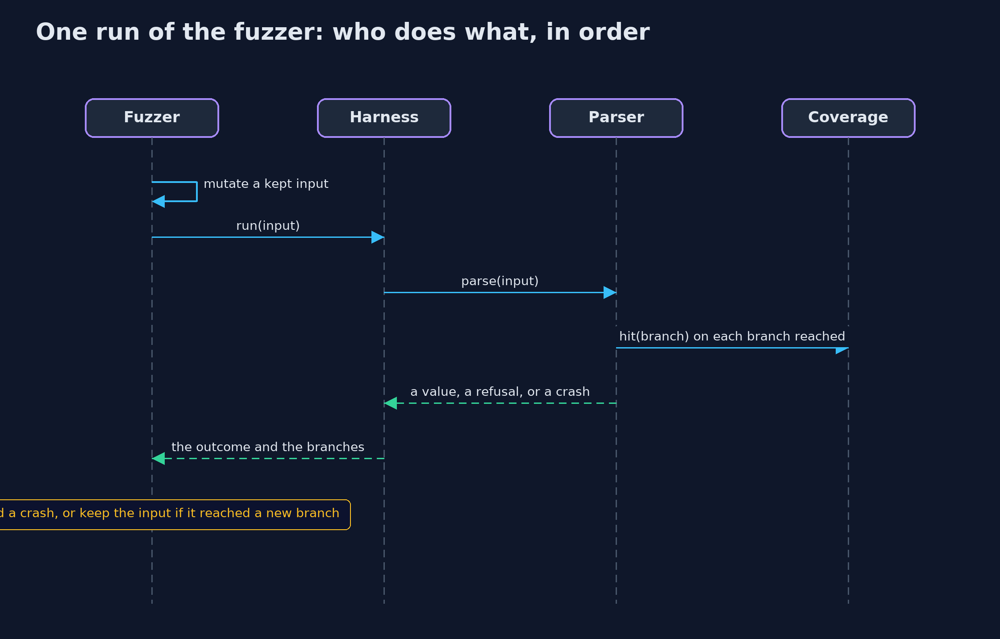

# Fuzzing a Parser

```
src/main/java/com/jk/explore/security/fuzz/
├── BuggyOrderParser.java  The first version of the supplier order file parser
├── Coverage.java          What a coverage-guided fuzzer learns from a run
├── Crash.java             A bug the fuzzer found: how it is recognised, the input that triggered it, and the shortest input that still does
├── FixedOrderParser.java  The same format with every input checked before it is used, and every failure reported as a {@link ParseException}
├── FuzzDemo.java          Runs the order file fuzzing story in four numbered acts and prints exact, repeatable results
├── Fuzzer.java            A small fuzzer
├── Hang.java              Thrown by {@link Coverage} when a run has taken too many steps: a deterministic stand-in for a timeout
├── OrderLine.java         One parsed product line: what, how many, and the total in cents
├── OrderParser.java       A parser for the shop's order files
├── ParseException.java    The one failure a parser is allowed to report: "this input is not valid"
├── Regression.java        Turns a crash into the source of a unit test, so that the bug stays fixed: the minimized input, the parser, and the one thing that may happen
└── Strategy.java          How the next input is made
```

**A parser may refuse bad input in exactly one way, so a fuzzer feeds it mutated and generated input until anything else happens, shrinks each failure to the smallest input that still triggers it, and turns it into a regression test; coverage feedback reaches the deeper bugs that random text and simple mutation do not.**

A shop reads order files from suppliers. The parser works on every file the suppliers' tool writes, and the developers tested it on those. But a parser is a door that anyone can send anything through, and the inputs that break it are the ones nobody thought of: a number that is not a number,
a decimal point with nothing after it, a suffix with half its letters, a quantity that overflows, a loop that never ends.

**Fuzzing** is a machine doing the thinking-of: it makes thousands of inputs, runs the parser, and reports anything that is not either a clean parse or the one failure the parser promises, a `ParseException`. This project writes a small fuzzer so that nothing is a black box:
- **Three ways to make inputs:** random text, valid example files changed a little (**mutation**), and mutation with **coverage feedback**, which keeps any input that reaches a branch no earlier input reached and mutates those in turn.
- **An oracle:** the only allowed failure is `ParseException`. A `NumberFormatException`, an `ArrayIndexOutOfBoundsException`, a negative total or a run that never ends is a finding.
- **Deduplication:** each kind of failure is filed once, with the run that found it.
- **Minimization (delta debugging):** drop chunks of the input while the same failure remains, until nothing more can go.
- **Regression tests:** each minimized input becomes a unit test, so the bug cannot come back.

The parser, `BuggyOrderParser`, has five planted bugs of the kinds real parsers have; `FixedOrderParser` validates every field before using it.

**Maps to:** NIST SSDF PW.8 (test executable code) · OWASP ASVS 5.0, the validation and secure development requirements · CWE-20 · CWE-248 · CWE-190 · CWE-835 · OWASP Top 10 (2025) A06 Insecure Design.

## The idea in everyday terms

A quality inspector who tries a product with the inputs customers never think of: pressing every button at once, dropping it, holding it upside down. Most of the time nothing happens. Once in a while the product breaks, and the inspector writes down the shortest way to break it, so that the fix can be checked.

## The scenario

A shop's supplier order file parser, with five planted bugs. The demo fuzzes it with a fixed random seed, so the same inputs are made in the same order on every run and the bugs are found at the same run numbers.

## Run

```bash
./gradlew run
```

The demo tells the story in 4 acts, each printing exact numbers that the tests check:

| Act | What it shows |
| --- | --- |
| 1. The parser works on the files it was written for | Both example files parse: one line, and two lines. |
| 2. Three ways to make inputs, 5000 runs each | Random text covers 1 branch of 16 and finds nothing; mutated seeds cover 15 and find 7 bugs; coverage-guided mutation covers all 16 and finds 8. |
| 3. Each bug, as the smallest input that still triggers it | Eight findings, each shrunk to a few bytes and filed with the run that found it, and the first one shown as a generated regression test. |
| 4. After the fix | Each minimized input is now refused with a clear message or read without a hang, and fuzzing the fixed parser the same way finds 0 bugs in 5000 runs, which proves little. |

## Test

```bash
./gradlew test
```

12 tests in `DemoRunsTest`, `FuzzTest`. The random seed is fixed, so the demo finds the same bugs at the same run numbers every time.

## What the simulation got right, and what it left out

The fuzzer is about 100 lines of Java: a seeded random generator (`SplittableRandom`, whose algorithm is fixed, so the run is repeatable), six mutation operators and a dictionary of tokens from the format, coverage bits reported by hand-placed `cov.hit(n)` calls, signatures made from the exception type and the last branch reached
(a real fuzzer uses the stack trace), and a simplified delta-debugging minimizer. A step budget stands in for a timeout.

## Technologies and versions

Every version below is pinned in the project's build files and was the latest stable release when the project was built.

| Technology | Version | Used for |
| --- | --- | --- |
| Java | 25 | the language and runtime; a Gradle toolchain finds or downloads the JDK |
| Gradle | 9.8.1 (wrapper) | build and run; nothing to install, the wrapper downloads it |
| org.junit.jupiter:junit-jupiter | 6.1.3, set by junit-bom | JUnit 5: the tests (tests only) |
| org.junit.platform:junit-platform-launcher | 6.1.3, set by junit-bom | JUnit platform launcher, which Gradle needs to run the tests (tests only) |

## Learning Material

| Document | What it is for |
| --- | --- |
| [Problem statement](docs/problem-statement.md) | the situation and what the project must show |
| [Prerequisites](docs/prerequisites.md) | what you need to know first |
| [Fuzzing a Parser, explained](docs/fuzzing-explained.md) | the acts in prose |
| [Session guide](docs/session.md) | a one-hour lesson with exercises |
| [Animated walkthrough](docs/animation.html) | the acts step by step |
| [Threat model](docs/threat-model.md) | what is protected, who could harm it, and how, using STRIDE |
| [Spec](docs/spec.md) | what this project must be true of |
| [Expected output](docs/expected-output.txt) | the golden demo output every test and every port checks against |

### The idea in one picture

Inputs that reach new branches are kept and mutated in turn.



### Where each piece sits

The fuzzer drives any OrderParser and reports crashes.



### How the data moves

Each step makes the finding smaller or more durable.



### Who calls whom, in order




## What it costs

- **Fuzzing needs an oracle.** The rule "only ParseException may escape" is simple. Rules about correct results (the total is right) are harder to state and need properties or a second implementation.
- **It is a search, not a proof.** Finding nothing in 5,000 runs says nothing about run 5,001. Run it longer, in CI and on a schedule, and keep a corpus.
- **Coverage needs instrumentation.** Real tools (Jazzer for the JVM, AFL++, libFuzzer) instrument the code automatically; this project instruments by hand to show the idea.
- **Slow or stateful targets fuzz badly.** Keep the target a pure function of its input where possible, and give it a time or step budget.
- **Triage costs time.** Many findings share a root cause; deduplication and minimization are what make the list readable.

## When this is too much

Fuzz where untrusted input meets complicated code: parsers, decoders, file and network formats. Do not fuzz a function that only adds two numbers; test it. And use a proven fuzzer for real projects: the hand-written one here is for understanding what the tool does.

## Where you have already met this

- Crashes in image, PDF, archive and font libraries found by AFL and libFuzzer.
- OSS-Fuzz, which fuzzes open-source projects continuously.
- `@FuzzTest` in Jazzer, with JUnit 5.
- `ClassCastException` or `NegativeArraySizeException` reported in a bug tracker from a file that someone made.

## Where this sits

This project is in [secure-coding](..) and follows [input-validation](../input-validation), whose validators it tests, and [secrets-in-errors-and-logs](../secrets-in-errors-and-logs), which shows what a leaked exception reveals. The with-Jazzer version applies a real coverage-guided fuzzer to the store's parsers.
