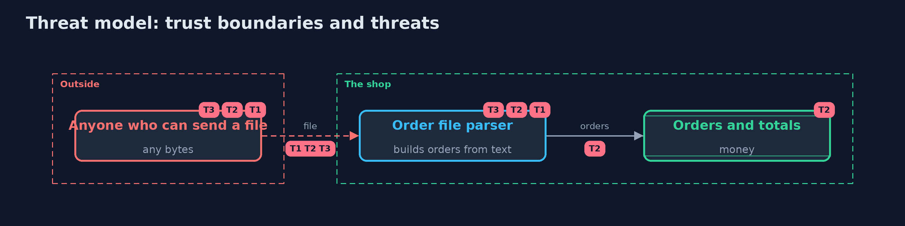

# Threat Model — Fuzzing a Parser

A threat model answers four questions: what are we protecting, who or what could harm it, how, and what do we do about it. This one covers this project's own demo system, not a production deployment. Domain: a supplier order file parser.

## Scope

A supplier order file parser: the behaviour of the parser on arbitrary input. It covers crashes, hangs and wrong totals that arbitrary input can cause.
It does not cover the authenticity of the sender or what the shop does with a valid order.

## What we protect (assets)

- The availability of the order import.
- The correctness of order totals.

## Who and what acts on the system

- A supplier's tool, which writes valid files.
- Anyone who can send a file: a malicious sender or a faulty tool.

## Trust boundaries

A trust boundary is a line that data or a request crosses between parts that trust each other differently. Threats cluster where those lines are.

- File to parser: the bytes are untrusted.

Each dashed box is a trust boundary. A rose tag such as T1 shows where the threat of that number, in the table below, applies.

## Threats, using STRIDE

STRIDE is a checklist of six kinds of threat: **Spoofing** (S), **Tampering** (T), **Repudiation** (R), **Information disclosure** (I), **Denial of service** (D), **Elevation of privilege** (E).

| Id | Kind | Threat | Where it shows up | Control in this project | What is left |
| --- | --- | --- | --- | --- | --- |
| T1 | Denial of service | A malformed file crashes the import with an unexpected exception | `BuggyOrderParser` | Validate every field before use; report failures as `ParseException`; fuzz the parser | Cases the fuzzer has not reached |
| T2 | Tampering | A number that overflows or is negative corrupts a total | `BuggyOrderParser` totals | Strict patterns for numbers, long arithmetic, caps | Other business invariants that need their own checks |
| T3 | Denial of service | A directive makes the parser loop forever | `BuggyOrderParser` @repeat | No loops driven by input numbers; a step or time budget | Loops hidden in libraries the parser calls |

## Assumptions

- A crash in the importer is a denial of service, and a wrong total costs money.
- The fuzzer's oracle is complete enough: only a clean parse or ParseException is correct.

## Out of scope

- Memory-safety bugs: the JVM prevents them in this code.
- Business rules beyond the format.

## How the tests check this

- `FuzzTest` checks the parsers, each bug by hand, the strategies' results, deduplication, minimization, the regression generator, the step budget and that the fixed parser survives several seeds.
- `DemoRunsTest` compares the whole demo with the golden output.

## Where this model goes next

The next module, secrets-and-supply-chain, looks at where secrets are kept and what the build trusts, starting with dependency confusion.
