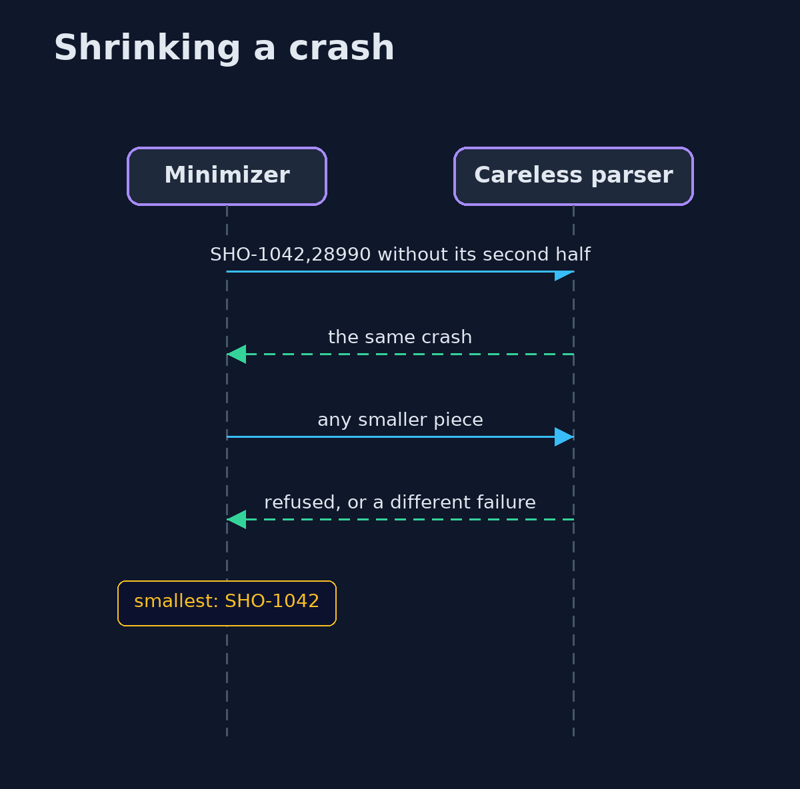
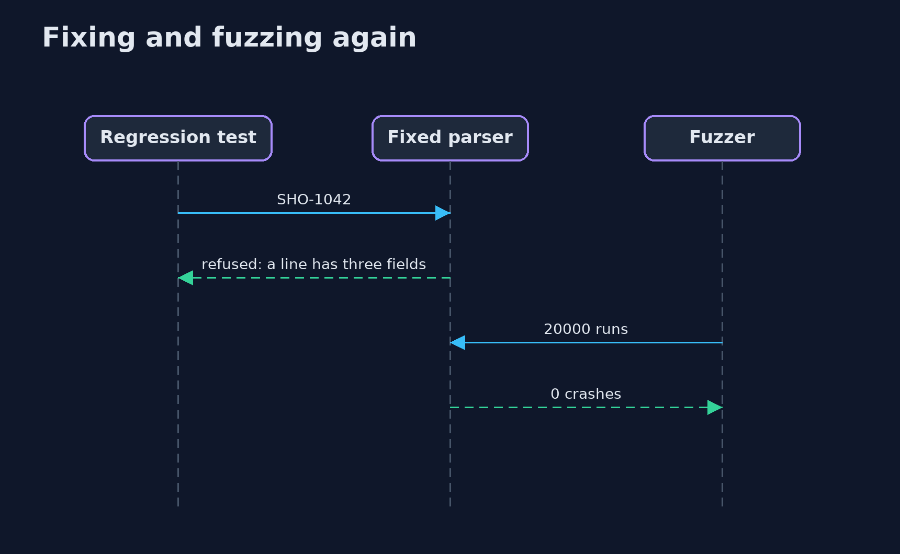

# Fuzzing: Finding the Inputs Nobody Tested — UML Sequence Diagrams

## 1. Shrinking a crash

Delta debugging removes pieces while the crash stays the same.

## 2. Fixing and fuzzing again

The smallest inputs become tests; the fixed parser refuses them, and the fuzzer finds nothing new.

