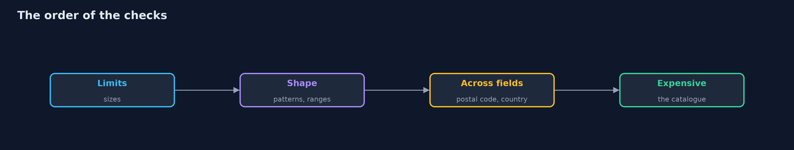
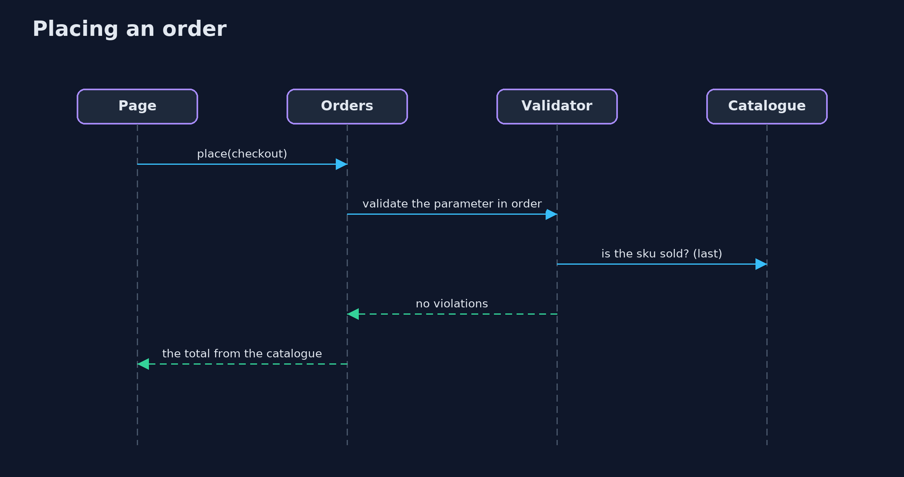

# Input Validation with Hibernate Validator

```
src/main/java/com/jk/explore/security/beanvalidation/
├── Basic.java                     Validation groups: the cheap checks first, then the ones that cost something, and each stage only if the one before found nothing wrong
├── BeanValidationDemo.java        
├── Catalogue.java                 The shop's catalogue: the only place a price comes from
├── Checkout.java                  What the checkout page posts
├── Checks.java                    A validator the way a service would build one: English messages, and a factory that gives a constraint validator the services it needs
├── Country.java                   A two-letter ISO country code in capitals, as the JDK knows them
├── Coupon.java                    A coupon code: its length is checked first, so the slow pattern never sees a long value
├── Handle.java                    Only the invisible-character rule, apart from the login's other rules
├── InStock.java                   The sku is in the catalogue
├── Line.java                      One line of a cart
├── NoInvisible.java               No control or invisible characters, and already in normal form C: what is checked is what is stored
├── Orders.java                    The service that takes an order
├── PostalCodeMatchesCountry.java  A rule across two fields: the postal code has the shape of the country's
├── Redos.java                     A pattern with repetitions nested two deep, as a constraint, with its work counted: every character the regular expression engine reads is a step
├── Review.java                    A product review title whose message repeats the value, and a coupon field written two ways, for what validation does not do
├── SafeMessage.java               The version of {@link UnsafeMessage} that passes the visitor's text as a message parameter
└── UnsafeMessage.java             A custom constraint written the way it should not be: it puts what the visitor typed into the message template, which is then interpolated
```

**Hibernate Validator 9 with Jakarta Validation 3.1 turns the rules of the shop into annotations on records: built-in and custom constraints, a rule across two fields, container elements, method validation at the service boundary, and a group sequence that runs the limits first, then the shapes, then the checks that cost a lookup; but a built-in constraint can be wider than the rule, a pattern can still be exponential, a message can repeat the visitor's text, and validation is not encoding.**

The plain [input-validation](../input-validation) project writes the rules of a checkout form by hand. This one writes them as **annotations** and lets **Hibernate Validator 9.1** (Jakarta Validation 3.1) run them. It needs no server and no tool beyond Gradle; the demo takes a couple of seconds.

What it shows:
- **Where validation belongs.** A shop that trusts the page totals a quantity of -3 as a refund. The same service with constraints on its parameter (`@NotNull @Valid Checkout`) refuses it, and refuses a missing form. The form has no price, so no hidden field can set one.
- **Annotations.** `@Min`, `@Max`, `@Pattern`, `@Email`, `@NotBlank`, `@Size`, container constraints on the lines of a cart. A form with several bad fields reports **all of them at once** with their paths. The built-in `@Email` takes `ben@localhost`, which the shop's rule refuses: a built-in check can be wider than your rule.
- **Your own constraints and groups.** A rule for invisible characters in normal form C, a class-level rule across two fields (the postal code fits the country, reported on the postal code), and a **group sequence** (limits, then shapes, then an expensive catalogue lookup) so that a bad value never costs a lookup.
- **Limits.** A cart of 10000 lines and an address of 10013 characters are refused before anything inside them is looked at. A pattern with repetitions nested two deep is exponential on the JDK; a length limit that runs first keeps it away from long input.
- **The bill.** A message that repeats the value repeats markup; a template built from the visitor's text is evaluated by a validator that allows method calls, and is not by default; valid text is not safe text.

**Maps to:** OWASP Top 10 (2025) A05 Injection · CWE-20 (improper input validation), CWE-1333 (inefficient regular expression complexity), CWE-917 (expression language injection) · Jakarta Validation 3.1.

## The idea in everyday terms

A customs desk with a written list. Each item on the list is a rule that a clerk can read, the clerks check the cheap rules first and send only the clean parcels to the slow inspection, and the desk never tells a traveller more than the rule that stopped them.

## The scenario

An online store takes a checkout form: an e-mail address, a country and postal code, a login and the lines of a cart. The demo writes the rules once on the types and sends forms through them.

## Run

```bash
./gradlew run
```

The demo tells the story in 5 acts, each printing exact numbers that the tests check:

| Act | What it shows |
| --- | --- |
| 1. Where validation belongs | The same service takes a quantity of -3 as a refund, or refuses it because its parameter has constraints. |
| 2. Say what is allowed, in annotations | Built-in constraints on a record, all violations at once, and a built-in check that is wider than the shop's rule. |
| 3. Your own constraints, across fields, and in an order | An invisible-character rule, a postal code that must fit the country, and a group sequence that asks the catalogue only when the cheap checks pass. |
| 4. Limits are validation too | A cart of 10000 lines and an address of 10013 characters are refused first, and a nested pattern costs sixteen times more for four more characters unless a length limit runs before it. |
| 5. The bill: what validation does not do | A message can repeat markup, a template built from the visitor's text is evaluated when method calls are allowed, and valid text is not safe text. |

## Test

```bash
./gradlew test
```

13 tests in `BeanValidationTest`, `DemoRunsTest`. The tests run the real validator and need no other tool.

## What the simulation got right, and what it left out

Hibernate Validator is the real library with its default settings, English messages and the Expressly implementation of Jakarta EL. Nothing is mocked and nothing needs a network; step counts for the pattern are counted by a wrapper around the input.

## Technologies and versions

Every version below is pinned in the project's build files and was the latest stable release when the project was built.

| Technology | Version | Used for |
| --- | --- | --- |
| Java | 25 | the language and runtime; a Gradle toolchain finds or downloads the JDK |
| Gradle | 9.8.1 (wrapper) | build and run; nothing to install, the wrapper downloads it |
| org.hibernate.validator:hibernate-validator | 9.1.5.Final | library the code uses |
| org.glassfish.expressly:expressly | 6.0.0 | library the code uses |
| org.junit.jupiter:junit-jupiter | 6.1.3, set by junit-bom | JUnit 5: the tests (tests only) |
| org.junit.platform:junit-platform-launcher | 6.1.3, set by junit-bom | JUnit platform launcher, which Gradle needs to run the tests (tests only) |
| videokit | repository tool (`tools/videokit`) | the narrated video and animation: Piper `en_US-amy-medium`, speed 0.8, longer pauses (the amy-slow voice) |

## Learning Material

| Document | What it is for |
| --- | --- |
| [Problem statement](docs/problem-statement.md) | the situation and what the project must show |
| [Prerequisites](docs/prerequisites.md) | what you need to know first |
| [Input Validation with Hibernate Validator, explained](docs/input-validation-with-hibernate-validator-explained.md) | the acts in prose |
| [Session guide](docs/session.md) | a one-hour lesson with exercises |
| [Animated walkthrough](docs/animation.html) | the acts step by step, narrated |
| [Threat model](docs/threat-model.md) | what is protected, who could harm it, and how, using STRIDE |
| [Spec](docs/spec.md) | what this project must be true of |
| [Expected output](docs/expected-output.txt) | the golden demo output every test and every port checks against |

### The idea in one picture

Annotations on the types; one validator; the service at the boundary.


### Where each piece sits

Records with constraints, custom constraints, and the validator wrapper.


### How the data moves

Each stage runs only if the one before found nothing wrong.



### Who calls whom, in order




### Video

`video/input-validation-with-hibernate-validator-explained.mp4` (with `.m4a` audio and `.srt` subtitles) is built by `video/build_video.sh`. Rendered media is not committed.

## What it costs

- **The rules live in annotations,** which are easy to read and easy to forget on a new field.
- **Built-in constraints are general,** and the shop's rule is usually narrower.
- **A custom constraint is code,** with its own tests and its own ways to be slow.
- **Messages are output:** they need the same care as any other text sent back.
- **A group sequence makes the order explicit,** and someone must keep it right.

## When this is too much

A script that reads one trusted file does not need a validation framework. Use one where input from outside crosses into code, and where more than one place needs the same rules.

## Where you have already met this

- `@Valid` on a controller parameter.
- `@NotNull` and `@Size` on an entity.
- A 400 response with a list of field errors.
- `javax.validation` imports from before the move to `jakarta`.

## Where this sits

This is the tools version of [input-validation](../input-validation), in the [secure-coding](..) module. It follows the same five questions with a real library: where validation belongs, what is allowed, what must be normalised, which limits apply, and what validation does not do.
