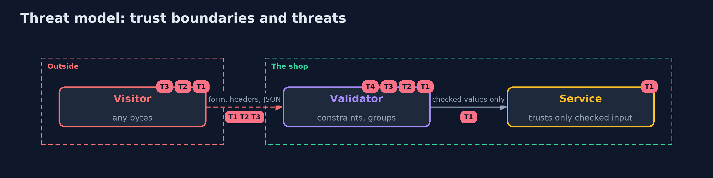

# Threat Model — Input Validation with Hibernate Validator

A threat model answers four questions: what are we protecting, who or what could harm it, how, and what do we do about it. This one covers this project's own demo system, not a production deployment. Domain: an online store.

## Scope

The checkout form and the service that takes it, validated by Hibernate Validator constraints. It covers shapes, ranges, sizes, order, the cost of the checks and their messages. It does not cover encoding on output or query parameters.

## What we protect (assets)

- The order totals and the catalogue.
- The server's time and memory.

## Who and what acts on the system

- A visitor who can send any bytes.
- A developer who adds a field or a constraint.

## Trust boundaries

A trust boundary is a line that data or a request crosses between parts that trust each other differently. Threats cluster where those lines are.

- The edge of the service: everything past it is meant to be checked.

Each dashed box is a trust boundary. A rose tag such as T1 shows where the threat of that number, in the table below, applies.

## Threats, using STRIDE

STRIDE is a checklist of six kinds of threat: **Spoofing** (S), **Tampering** (T), **Repudiation** (R), **Information disclosure** (I), **Denial of service** (D), **Elevation of privilege** (E).

| Id | Kind | Threat | Where it shows up | Control in this project | What is left |
| --- | --- | --- | --- | --- | --- |
| T1 | Tampering | A request sets a value the page never offered | the service's parameter | Constraints on the type, validated at the service, with no price on the form | A field added without a constraint |
| T2 | Denial of service | A huge value or a nested pattern exhausts the server | sizes and patterns | Limits in the first group, no nested repetition | Patterns that look safe |
| T3 | Spoofing | Look-alike or invisible characters get through | text fields | A custom constraint, normal form C, plain patterns | Characters that the pattern allows and people confuse |
| T4 | Information disclosure | A message repeats the visitor's text or evaluates it | message templates | No raw values in messages, message parameters, the default expression language level | A validator configured to allow method calls |

## Assumptions

- The service is the only way to place an order.
- Messages are encoded when they are put in a page.

## Out of scope

- Authentication and authorisation.
- Injection into other interpreters.

## How the tests check this

- `BeanValidationTest` runs the real validator for the violations and paths, the built-in and custom constraints, the group sequence and its lookups, the limits, the nested pattern, method validation and the message templates.
- `DemoRunsTest` compares the whole demo with the golden output.

## Where this model goes next

The next project in this module, race-conditions-and-business-logic-with-postgres, moves from what is allowed to what is allowed at the same time.
