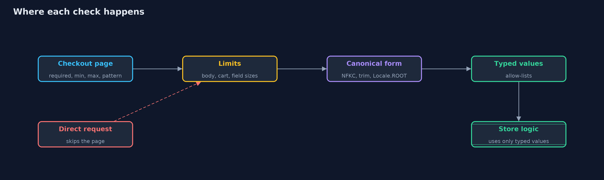
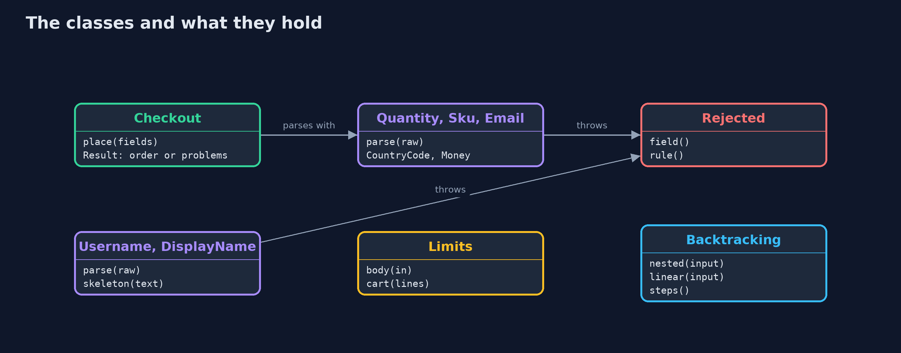
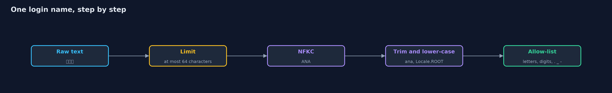
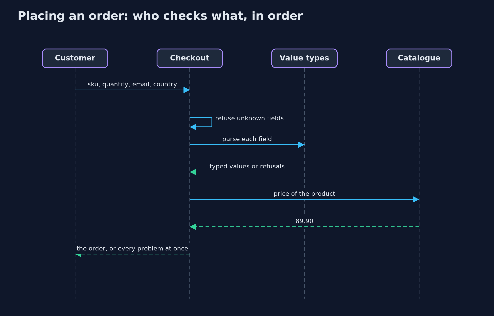

# Input Validation Done Right

```
src/main/java/com/jk/explore/security/validation/
├── Accounts.java        Registered login names
├── Backtracking.java    A model of how a backtracking regular-expression engine (such as java.util.regex) runs the pattern {@code (a+)+$}: the inner and outer repetitions can split a run of a's in every possible way, and on an input that fails at the last character the engine tries them all
├── BrowserForm.java     The checks a browser makes before it sends the checkout form: the form's `required`, `min`, `max` and `pattern` attributes
├── Catalogue.java       The store's own prices
├── Checkout.java        The checkout at the trust boundary
├── CountryCode.java     A shipping country as an ISO 3166 two-letter code, checked against the list the JDK ships
├── DisplayName.java     A name shown to other people, where letters from every script are welcome
├── Email.java           An e-mail address for receipts
├── Limits.java          Size limits are validation too: a request body, a list and a text field each have a maximum, checked before the work they would cost
├── Money.java           An amount of money: digits, an optional point and at most two decimals, more than zero and at most 10000.00
├── Quantity.java        How many of one item: a whole number from 1 to 99, written with digits only
├── Rejected.java        A value refused at the trust boundary
├── Sku.java             A product code: three capital letters, a dash and four digits, such as SHO-1042
├── Text.java            Small helpers shared by the value types: limits first, then canonical form, then character rules
├── TrustingShop.java    The checkout that trusts what arrives because the page already checked it, including the price in a hidden field
├── Username.java        A login name in its one canonical form
└── ValidationDemo.java  Runs the online store story in five numbered acts and prints exact, repeatable results
```

**Validation belongs on the server, at the trust boundary: say exactly what is allowed and parse it into types, put text into one canonical form before checking it, and limit sizes before doing work, while remembering that a valid value is still not safe to print or to paste into a query.**

Every value that reaches a server came from somewhere it does not control. **Input validation** decides, at that **trust boundary**, which values the code will accept. Four habits make it work.
**Validate on the server**: checks in the page help honest customers and stop nobody else, because anyone can send the request without the page. **Allow, do not block**: say exactly what
a value may be, and **parse** it into a **type** (a quantity, a product code, an e-mail address, an amount of money) that cannot hold anything else. **Canonicalise first**: text has many spellings
of one value, such as full-width letters, accents typed in two ways and letters from other scripts that look Latin, so normalise before comparing. **Limit before working**: a maximum size for bodies, lists
and fields, and no regular expression that can take exponential time.

The demo follows an online store's checkout and account forms through each habit, and ends with what validation does not do.

Maps to: OWASP Top 10 2025 A05 (Injection) and A06 (Insecure Design); CWE-20 (improper input validation), CWE-1333 (inefficient regular expression complexity), CWE-176 (improper handling of Unicode encoding),
CWE-180 (validate before canonicalise); OWASP ASVS 5.0, the chapter on validation and business logic.

## The idea in everyday terms

Think of a concert with tickets. A sticker on the visitor's coat saying "checked" means nothing, because the visitor printed it at home: the check happens at the door. The attendant has a list
of what a ticket looks like rather than a list of every fake ever seen. A ticket written in a different alphabet that looks like a real name gets a closer look, and nobody is allowed to bring a lorry
through the turnstile.

## The scenario

An online store has a checkout form (product code, quantity, e-mail address, shipping country) and an account form (login name and display name). The demo sends values the page would never send,
values in unusual spellings and values of extreme size, first to code that trusts them and then to code that validates at the boundary.

## Run

```bash
./gradlew run
```

The demo tells the story in 5 acts, each printing exact numbers that the tests check:

| Act | What it shows |
| --- | --- |
| 1. Where validation belongs | The page refuses a quantity of -3, but the same request sent without the page gives a total of -269.70 and a hidden price of 0.01 gives 0.02; the server-side checkout refuses both. |
| 2. Say what is allowed, and parse into types | Quantities, product codes, e-mail addresses, country codes and amounts each have one allowed shape; 0, 1e2, sho-1042, ben@@shop.example, ZZ and 19.505 are refused, and four bad fields are reported at once. |
| 3. Canonicalise before validating | A raw-text registry accepts full-width ａｎａ and ANA as new accounts; the canonical one folds them to ana and refuses them, refuses invisible and control characters, and NFC makes José typed two ways equal. |
| 4. Limits are validation too | A 1000000-byte body is refused after reading 16385 bytes, a 10000-line cart and a 10000-character address are refused, and the pattern (a+)+$ needs 2097130 steps for 20 a's against 21 for the linear check. |
| 5. The bill: what validation does not do | A valid review can still be markup, a valid surname can hold a quote, refusals never repeat raw input, and a limit of 99 refuses a wholesale order of 150. |

## Test

```bash
./gradlew test
```

31 tests in `CanonicalTest`, `CheckoutTest`, `DemoRunsTest`, `LimitsTest`, `ValueTypesTest`. Every rule is checked with parameterized tests of accepted and refused values. The regular-expression cost is counted in steps rather than timed, so the golden output is the same on every machine.

## What the simulation got right, and what it left out

Everything runs in memory with fixed inputs, so the output is the same on every run. The cost of the regular expression is measured by counting the steps of a model of a backtracking
engine, not by timing, so it is exact on every machine. The country list is the one the JDK ships.

## Technologies and versions

Every version below is pinned in the project's build files and was the latest stable release when the project was built.

| Technology | Version | Used for |
| --- | --- | --- |
| Java | 25 | the language and runtime; a Gradle toolchain finds or downloads the JDK |
| Gradle | 9.8.1 (wrapper) | build and run; nothing to install, the wrapper downloads it |
| org.junit.jupiter:junit-jupiter | 6.1.3, set by junit-bom | JUnit 5: the tests (tests only) |
| org.junit.platform:junit-platform-launcher | 6.1.3, set by junit-bom | JUnit platform launcher, which Gradle needs to run the tests (tests only) |
| videokit | repository tool (`tools/videokit`) | the narrated video and animation: Piper `en_US-amy-medium`, speed 0.8, longer pauses (the amy-slow voice) |

## Learning Material

| Document | What it is for |
| --- | --- |
| [Problem statement](docs/problem-statement.md) | the situation and what the project must show |
| [Prerequisites](docs/prerequisites.md) | what you need to know first |
| [Input Validation Done Right, explained](docs/input-validation-explained.md) | the acts in prose |
| [Session guide](docs/session.md) | a one-hour lesson with exercises |
| [Animated walkthrough](docs/animation.html) | the acts step by step, narrated |
| [Threat model](docs/threat-model.md) | what is protected, who could harm it, and how, using STRIDE |
| [Spec](docs/spec.md) | what this project must be true of |
| [Expected output](docs/expected-output.txt) | the golden demo output every test and every port checks against |

### The idea in one picture

The page helps honest customers; the server's boundary is the only check an attacker cannot skip.



### Where each piece sits

Each value type parses or refuses; Checkout collects every refusal.



### How the data moves

The order is the point: limit, refuse invisible characters, normalise, trim, lower-case, then check the allow-list.



### Who calls whom, in order




### Video

`video/input-validation-explained.mp4` (with `.m4a` audio and `.srt` subtitles) is built by `video/build_video.sh`. Rendered media is not committed.

## What it costs

- **Rules must match the business.** A quantity limit of 99 refuses a wholesale customer ordering 150; every rule is a business decision that has to be written down and kept up to date.
- **Validation is not output encoding.** A review that says `<b>great</b>` is valid text and still markup, so it must be encoded when written into a page.
- **Validation is not query safety.** O'Brien is a valid surname with a quote in it, so the database layer must bind values as parameters.
- **Strict types cost code.** One small class per kind of value is more code than a string, and pays back by never being checked twice.
- **Unicode is large.** A small look-alike table catches the common cases; the full Unicode confusables data is bigger and changes with each Unicode release.

## When this is too much

For an internal tool used by a handful of trusted people, a few simple checks may be enough. For anything that faces customers, every field at the boundary deserves a type, a limit and a
canonical form, because the cost of a value nobody expected is paid later and somewhere else.

## Where you have already met this

- Forms with `required`, `min`, `max` and `pattern` attributes, and the same requests sent with curl.
- Jakarta Validation annotations such as `@Size`, `@Pattern` and `@Email` in Java applications.
- Look-alike domain names and account names used in phishing.
- Outages caused by one regular expression on one long input.

## Where this sits

This project is the first in the intermediate track's **secure-coding** module ([secure-coding](..)). It builds on
[cross-site-scripting](../../web-security/cross-site-scripting), which encodes what validation lets through, and on the beginner project
[http-basics-and-headers](../../../beginner/networking/http-basics-and-headers), whose strict parser refuses ambiguous requests.
