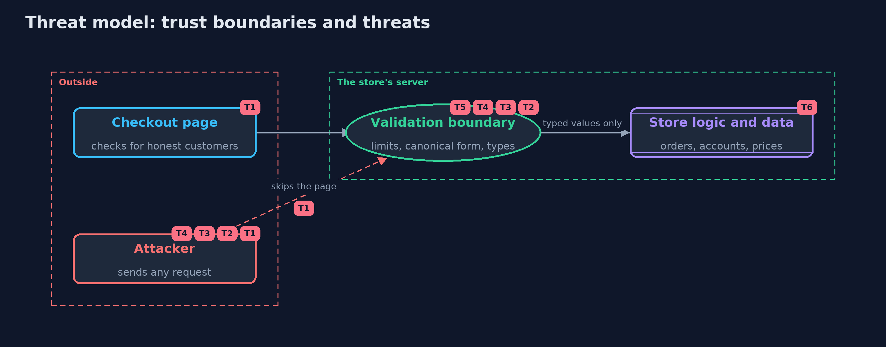

# Threat Model — Input Validation Done Right

A threat model answers four questions: what are we protecting, who or what could harm it, how, and what do we do about it. This one covers this project's own demo system, not a production deployment. Domain: an online store.

## Scope

The online store's checkout and account forms at the server's trust boundary: the values they accept, the form of text they compare, and the sizes they allow. It covers anyone who can send a request.
It does not cover output encoding, database queries or access control, which have their own projects.

## What we protect (assets)

- Order totals and prices.
- Account names and the uniqueness of each name.
- The server's time and memory.
- The trust customers place in names shown as the shop's staff.

## Who and what acts on the system

- An honest customer using the page.
- An attacker sending requests directly.
- Someone registering a look-alike account name.

## Trust boundaries

A trust boundary is a line that data or a request crosses between parts that trust each other differently. Threats cluster where those lines are.

- Client to server: the page's checks end here, and the server's begin.
- Validated values to the store's logic: only typed values cross it.

Each dashed box is a trust boundary. A rose tag such as T1 shows where the threat of that number, in the table below, applies.

## Threats, using STRIDE

STRIDE is a checklist of six kinds of threat: **Spoofing** (S), **Tampering** (T), **Repudiation** (R), **Information disclosure** (I), **Denial of service** (D), **Elevation of privilege** (E).

| Id | Kind | Threat | Where it shows up | Control in this project | What is left |
| --- | --- | --- | --- | --- | --- |
| T1 | Tampering | Values the page would refuse are sent directly to the server | `TrustingShop`, `Checkout.place` | Every field is validated on the server; the page's checks are only a convenience | None for these fields; every new field needs its own type |
| T2 | Tampering | A hidden or extra field, such as a price, changes what the server does | `Checkout.place` | Unknown fields are refused, and prices come from the catalogue | A field that is expected but trusted too much is still a risk, so each one is reviewed |
| T3 | Spoofing | A second account, or a staff look-alike, is registered with another spelling of a name | `Username`, `DisplayName`, `Accounts` | One canonical form (NFKC, trim, Locale.ROOT), invisible characters refused, and a look-alike check for display names | The look-alike table is small; the full Unicode confusables data catches more |
| T4 | Denial of service | A huge body, a huge list or a slow pattern uses up the server | `Limits`, `Backtracking` | Size limits before any work, and no nested repetition in patterns that read input | Limits must also be set in the web server and gateway in front of the application |
| T5 | Information disclosure | An error message repeats raw input, which may hold markup or forged log lines | `Rejected` | Messages name the field and the rule only | Logs of refused requests must also be written safely |
| T6 | Tampering | A valid value is treated as safe for output or for a query | the code after the boundary | None here: output encoding and query parameters are separate controls | Covered by the cross-site-scripting project and by parameterized queries |

## Assumptions

- Prices and products come from the store's own catalogue.
- The country list is the one the JDK ships, and is current enough for shipping.
- In the demo, all values are fixed and no network is used.

## Out of scope

- Output encoding: the cross-site-scripting project.
- Database query safety: parameters, named here as the reason validation is not enough.
- Authorization: the broken-access-control project.

## How the tests check this

- `ValueTypesTest` checks accepted and refused values for every type, and that refusals never repeat the raw input.
- `CheckoutTest` checks the boundary: direct requests, unknown fields, unknown products, every problem at once.
- `CanonicalTest` checks canonical names, invisible characters, locale independence, NFC and look-alikes.
- `LimitsTest` checks body, cart and pattern limits.
- `DemoRunsTest` compares the whole demo with the golden output.

## Where this model goes next

The next project, race-conditions-and-business-logic, turns from single values to sequences of requests: two valid withdrawals that together spend money twice.
