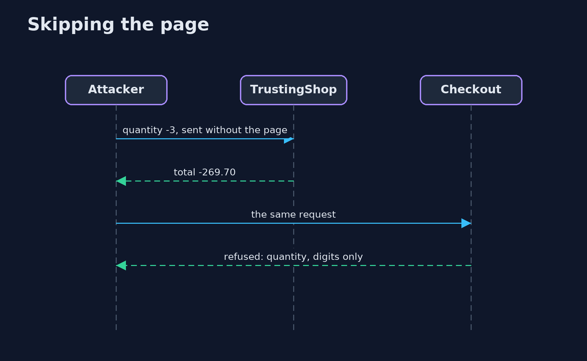
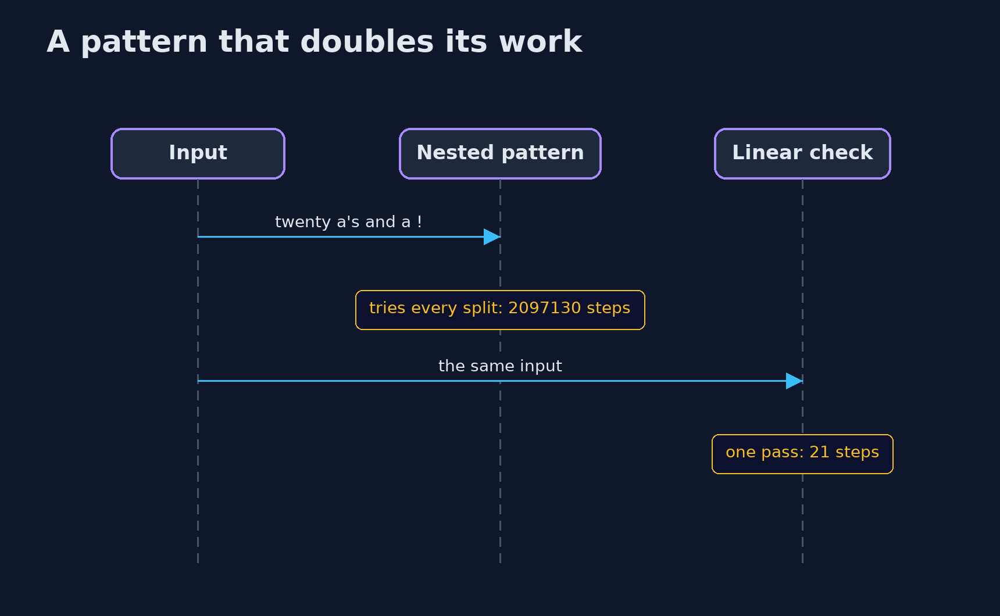

# Input Validation Done Right — UML Sequence Diagrams

## 1. Skipping the page

The page's checks run only in the page.

## 2. A pattern that doubles its work

A repetition inside a repetition tries every way to split the input before it can fail.

