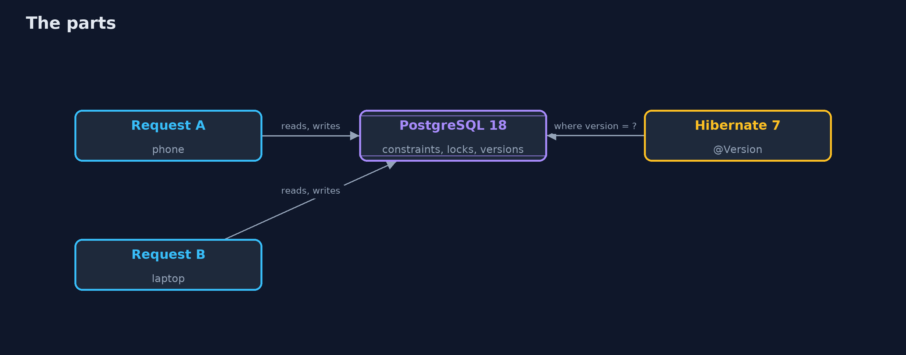
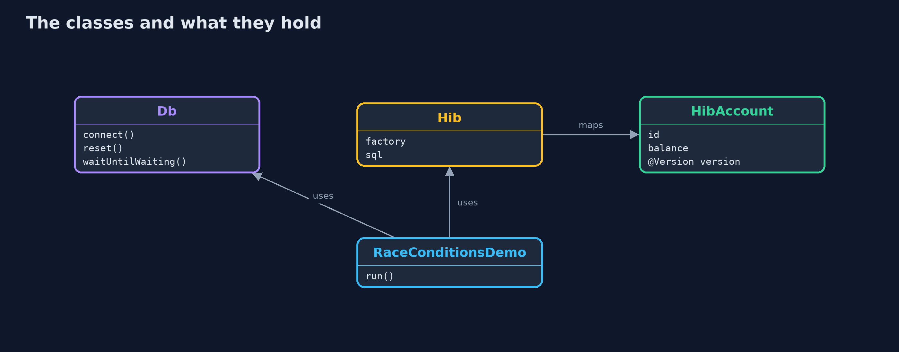
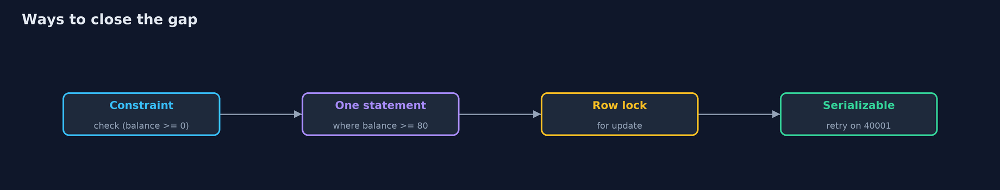
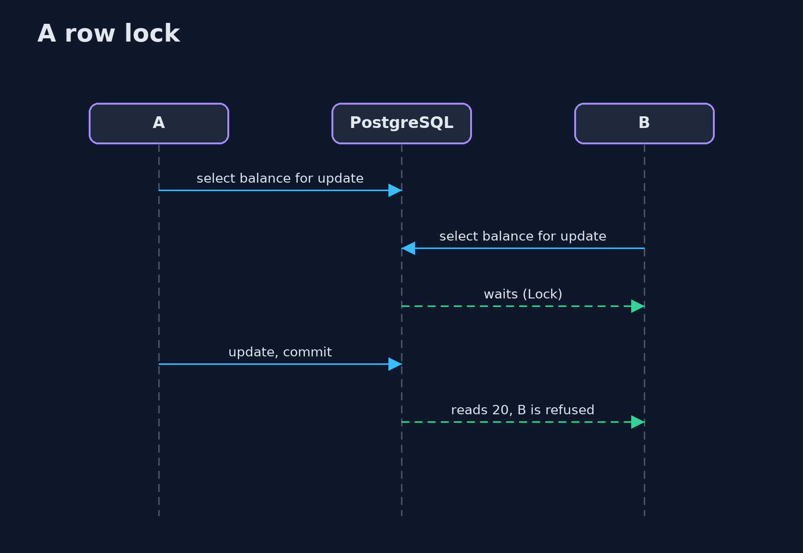

# Race Conditions with PostgreSQL and Hibernate

```
src/main/java/com/jk/explore/security/racepg/
├── Db.java                  A real PostgreSQL 18 in a container on a free loopback port, removed on close, and the small things every act needs from it
├── Hib.java                 Hibernate ORM 7 against the lab's database, remembering every SQL statement it sends
├── HibAccount.java          An account as Hibernate sees it: the version column is what makes the update conditional
└── RaceConditionsDemo.java  Runs on a thread of its own, so that the caller can watch it wait
```

**In a real PostgreSQL 18 two withdrawals that read before either writes pay out 160 from 100; a check constraint and a conditional update, a row lock with wait, NOWAIT, a timeout and SKIP LOCKED, REPEATABLE READ and SERIALIZABLE against write skew, a Hibernate @Version column and a one-time key claimed in the same transaction as the money each close the gap in their own way, but they bring retries, deadlocks that PostgreSQL cancels, and waits behind a person, and a lock in one server's memory protects nothing in another.**

The plain [race-conditions-and-business-logic](../race-conditions-and-business-logic) project shows the gap between a check and a write with a scripted interleaving and its own locks. This one runs it against a real **PostgreSQL 18** in Docker, with plain JDBC and **Hibernate ORM 7**. It needs Docker; the tests are tagged `integration`: `./gradlew integrationTest`.

What it shows:
- **Check, then act.** Two withdrawals of 80 from a balance of 100 each read 100: the bank pays out 160 and the balance says 20. A check constraint (`balance >= 0`) with a relative update, or a condition inside the update (`where balance >= 80`, one row or none), refuses the second. A single-use coupon is claimed in one statement.
- **Row locks.** `SELECT ... FOR UPDATE`: the second session waits (`pg_stat_activity` shows a Lock wait), then reads 20 and is refused. `NOWAIT` refuses at once, `lock_timeout` gives up, `SKIP LOCKED` takes the next row.
- **Isolation levels.** READ COMMITTED applies a relative update to the new value; REPEATABLE READ refuses it (`40001`) and the caller retries; write skew across two rows passes under REPEATABLE READ (total -100) and is refused under SERIALIZABLE.
- **Hibernate.** `@Version` makes the update `... where id=? and version=?`, so the second writer gets an `OptimisticLockException`; a pessimistic lock is `for no key update`. A payment key is claimed in the same transaction as the money.
- **The bill.** Opposite lock order deadlocks and PostgreSQL cancels one (`40P01`); locks in the memory of two servers protect nothing; a transaction that waits for a person keeps everyone waiting.

**Maps to:** OWASP Top 10 (2025) A06 Insecure Design · CWE-362 (race condition), CWE-367 (time-of-check time-of-use), CWE-840 (business logic errors).

## The idea in everyday terms

A bank counter with two clerks and one ledger. If both read the balance before either writes, both pay out. Writing the rule on the ledger itself, queueing at the page, or stamping every page with a number so that a stale copy is refused each stop the double payment, and each has a different cost.

## The scenario

A bank lets a customer withdraw from the same account on a phone and a laptop at the same moment. The demo plays the two requests against a real database and tries every way to close the gap.

## Run

```bash
./gradlew run
```

The demo tells the story in 5 acts, each printing exact numbers that the tests check:

| Act | What it shows |
| --- | --- |
| 1. Check, then act: two requests in the gap | Two withdrawals that read before either writes pay out 160 from 100; a check constraint, a conditional update and a one-statement claim close the gap. |
| 2. Row locks: making the check and the write one step | SELECT FOR UPDATE makes the second request wait and then see the first; NOWAIT, a timeout and SKIP LOCKED are the other ways to meet a lock. |
| 3. Isolation levels | READ COMMITTED applies a relative update to the new value; REPEATABLE READ refuses it; only SERIALIZABLE stops write skew. |
| 4. Optimistic locking with Hibernate, and one-time keys | A version column makes the update conditional; a payment key claimed in the same transaction as the money runs once. |
| 5. The bill | Opposite lock order deadlocks, locks in one server's memory protect nothing in another, and a transaction that waits for a person keeps everyone waiting. |

## Test

```bash
./gradlew test
```

11 tests in `DemoRunsTest`, `RaceConditionsTest`. The tests start one PostgreSQL for the whole class and remove it (./gradlew integrationTest). They need Docker.

## What the simulation got right, and what it left out

PostgreSQL 18.6 is the real server in a container on a free loopback port, started with a short deadlock timeout and removed at the end. The sessions are real connections; the interleavings are scripted, so that the output is the same on every run. Ports and container names are never printed; the demo takes about thirty seconds.

## Technologies and versions

Every version below is pinned in the project's build files and was the latest stable release when the project was built.

| Technology | Version | Used for |
| --- | --- | --- |
| Java | 25 | the language and runtime; a Gradle toolchain finds or downloads the JDK |
| Gradle | 9.8.1 (wrapper) | build and run; nothing to install, the wrapper downloads it |
| org.postgresql:postgresql | 42.7.14 | library the code uses |
| org.hibernate.orm:hibernate-core | 7.4.13.Final | library the code uses |
| org.slf4j:slf4j-nop | 2.0.17 | library the code uses |
| org.junit.jupiter:junit-jupiter | 6.1.3, set by junit-bom | JUnit 5: the tests (tests only) |
| org.junit.platform:junit-platform-launcher | 6.1.3, set by junit-bom | JUnit platform launcher, which Gradle needs to run the tests (tests only) |
| videokit | repository tool (`tools/videokit`) | the narrated video and animation: Piper `en_US-amy-medium`, speed 0.8, longer pauses (the amy-slow voice) |

## Learning Material

| Document | What it is for |
| --- | --- |
| [Problem statement](docs/problem-statement.md) | the situation and what the project must show |
| [Prerequisites](docs/prerequisites.md) | what you need to know first |
| [Race Conditions with PostgreSQL and Hibernate, explained](docs/race-conditions-and-business-logic-with-postgres-explained.md) | the acts in prose |
| [Session guide](docs/session.md) | a one-hour lesson with exercises |
| [Animated walkthrough](docs/animation.html) | the acts step by step, narrated |
| [Threat model](docs/threat-model.md) | what is protected, who could harm it, and how, using STRIDE |
| [Spec](docs/spec.md) | what this project must be true of |
| [Expected output](docs/expected-output.txt) | the golden demo output every test and every port checks against |

### The idea in one picture

Two sessions meet in one database.



### Where each piece sits

The lab database, the Hibernate side and the demo.



### How the data moves

From the cheapest to the strongest.



### Who calls whom, in order




### Video

`video/race-conditions-and-business-logic-with-postgres-explained.mp4` (with `.m4a` audio and `.srt` subtitles) is built by `video/build_video.sh`. Rendered media is not committed.

## What it costs

- **Locks make requests wait,** and a long transaction makes everybody wait.
- **Stronger isolation means retries,** and the code must be safe to repeat.
- **Optimistic locking pushes the conflict to the user** or to a retry loop.
- **Deadlocks happen when locks are taken in different orders,** and the database resolves them by cancelling one.
- **A rule in the schema holds for every program,** but only the rules that a constraint can express.

## When this is too much

A table that one background job updates once a night does not need row locks or serializable transactions. Use them where two requests can reach the same row, or the same rule across rows, at the same moment.

## Where you have already met this

- `@Version` on a JPA entity.
- `SELECT ... FOR UPDATE` in a repository query.
- `@Transactional(isolation = ...)`.
- A 409 Conflict or an "optimistic lock" error page.

## Where this sits

This is the tools version of [race-conditions-and-business-logic](../race-conditions-and-business-logic), in the [secure-coding](..) module. The plain project explains the gap with its own locks; this one uses what a database already has.
