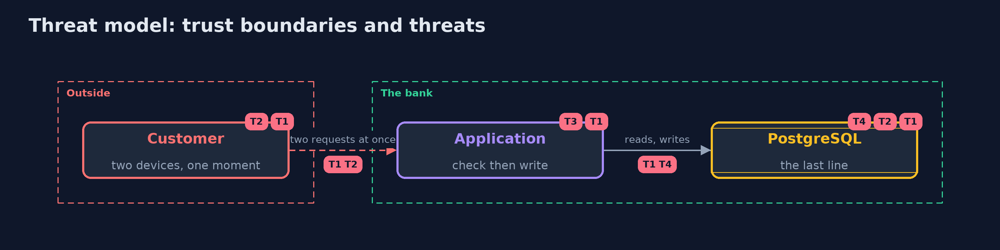

# Threat Model — Race Conditions with PostgreSQL and Hibernate

A threat model answers four questions: what are we protecting, who or what could harm it, how, and what do we do about it. This one covers this project's own demo system, not a production deployment. Domain: a bank.

## Scope

Concurrent requests that change the same rows of a bank's accounts, coupons and payments in PostgreSQL. It covers the gap between check and write, locks, isolation, versions, deadlocks and waits. It does not cover distributed systems or the network.

## What we protect (assets)

- The balances and what the bank has paid out.
- The availability of the accounts.

## Who and what acts on the system

- A customer who sends the same request twice, or at the same time.
- A script that sends many requests at once.

## Trust boundaries

A trust boundary is a line that data or a request crosses between parts that trust each other differently. Threats cluster where those lines are.

- The database: the one place all requests meet.

Each dashed box is a trust boundary. A rose tag such as T1 shows where the threat of that number, in the table below, applies.

## Threats, using STRIDE

STRIDE is a checklist of six kinds of threat: **Spoofing** (S), **Tampering** (T), **Repudiation** (R), **Information disclosure** (I), **Denial of service** (D), **Elevation of privilege** (E).

| Id | Kind | Threat | Where it shows up | Control in this project | What is left |
| --- | --- | --- | --- | --- | --- |
| T1 | Tampering | Two requests overspend a balance or reuse a coupon | the gap between check and write | A constraint, a conditional update, a row lock or a version | Rules that no constraint can express |
| T2 | Tampering | A rule across rows is broken by two writers | write skew | SERIALIZABLE and a retry, or a lock on a row that stands for the rule | Retries that are not safe to repeat |
| T3 | Repudiation | A retried request is applied twice | the client and the network | A one-time key claimed in the same transaction | Keys that expire too soon |
| T4 | Denial of service | Locks and deadlocks make the accounts unavailable | long transactions, lock order | Short transactions, one lock order, lock timeouts | A flood of requests for one row |

## Assumptions

- All writers go through the same database.
- The application can repeat a transaction that the database refuses.

## Out of scope

- Replication and failover.
- Attacks on the database itself.

## How the tests check this

- `RaceConditionsTest` runs real sessions against PostgreSQL for the lost update, the constraint and conditional update, the lock and its waits, the isolation levels, write skew, the Hibernate version, the one-time key and the deadlock.
- `DemoRunsTest` compares the whole demo with the golden output.

## Where this model goes next

The next project in this module, secrets-in-errors-and-logs-with-logback, moves from what the database refuses to what the logs reveal.
