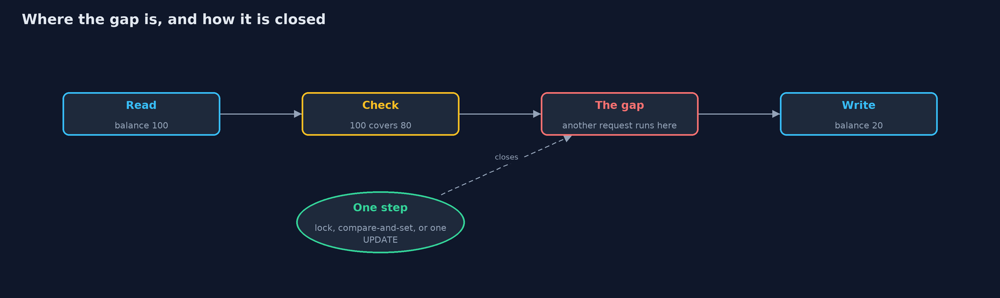
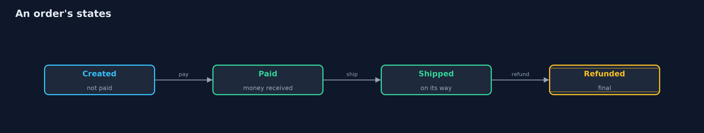

# Race Conditions and Business Logic

```
src/main/java/com/jk/explore/security/races/
├── Bank.java              A bank's transfer service
├── CasWithdrawal.java     No lock: read, check, then write with a compare-and-set that succeeds only if the balance is still the value that was read
├── Checkout.java          Prices an order on the server
├── CouponBook.java        Single-use coupons in the step-by-step model, and the total discount the store has given
├── CouponRedemption.java  Redeems a single-use coupon at checkout
├── Interleaving.java      Runs requests step by step in a written order, such as "ABAB": the letter says which request takes its next step
├── Ledger.java            The shared state of the step-by-step model: account balances, what has been paid out, and which request holds which lock
├── LockedWithdrawal.java  The same three steps inside a lock on the account, so they run as one unit: a second request waits until the first has written
├── LockingTransfer.java   Moves money between two accounts holding both accounts' locks
├── NaiveWithdrawal.java   Check, then act: read the balance, check it, write the new balance
├── Order.java             An order as a state machine: created, then paid, then shipped, and refunded at most once, only after it was paid
├── RacesDemo.java         Runs the bank and store story in five numbered acts and prints exact, repeatable results
├── RealAccounts.java      The same three withdrawals as real Java code, for the tests that run them on real threads
└── Steps.java             A request broken into the separate steps a server performs, so that two requests can be interleaved in a chosen order
```

**A check and the action it protects must happen as one step, a retried request must not run twice, and the server must keep its own rules about amounts, coupons and order states, because attackers send requests together, again and out of order.**

A **race condition** happens when the result depends on the order in which two things run. The classic case in money handling is **check, then act**: a withdrawal reads the balance,
checks that it covers the amount, then writes the new balance. Each step is right on its own. But two requests can both read and both check before either writes, so both pass,
and the bank pays out twice what the account held. The same gap lets a single-use coupon be used twice. Testing one request at a time never finds it.

The fixes make the check and the action **one step**: a **lock** around both, or a **compare-and-set** that writes only if the value is still the one that was checked. A request
that may be sent again, because a reply was lost, carries an **idempotency key**, so the second copy returns the first answer instead of moving money again. And the server keeps its own
**business rules**, whatever the client sends: amounts above zero, no transfers to oneself, one coupon per order, prices from the catalogue, and an order that moves through
**states** (created, paid, shipped) and is refunded at most once.

Real thread timing changes from run to run, so the demo shows concurrency with a model: each request is split into its steps, and the order in which the steps run is written down.
The tests try every order, and also run the real Java code on real threads with the bad order forced.

Maps to: OWASP Top 10 2025 A06 (Insecure Design); CWE-362 (concurrent execution with improper synchronization), CWE-367 (time-of-check time-of-use), CWE-840 (business logic errors),
CWE-841 (improper enforcement of behavioural workflow); OWASP ASVS 5.0, the chapter on business logic.

## The idea in everyday terms

Think of two cashiers at two counters. A customer with 100 in the account asks both for 80 at the same moment. Each cashier looks at the screen, sees 100, says yes, and hands over the money,
and only then does each update the account. Both looked; neither was wrong to look; together they paid 160. The fix is one key to the account book: whoever holds it looks and writes before
handing it on.

## The scenario

An online bank pays out withdrawals and transfers, and an online store takes coupons and payments for orders. The demo sends two requests at once, sends one request twice, and sends
requests that break the rules, and watches what the careless and careful versions do.

## Run

```bash
./gradlew run
```

The demo tells the story in 5 acts, each printing exact numbers that the tests check:

| Act | What it shows |
| --- | --- |
| 1. Check, then act | Two withdrawals of 80 from a balance of 100 both read and check before either writes, so the bank pays out 160 and the balance says 20; one after the other, the second is refused; a coupon is used twice the same way. |
| 2. Making the check and the write one step | With a lock, B waits while A reads, checks and writes, then sees 20 and is refused; with a compare-and-set, B's write fails because the balance changed, and B starts again and is refused; a coupon claimed in one step is used once. |
| 3. Sending the same request twice | Without a key, a retried rent payment of 300 leaves ana with 400 and ben with 600; with an idempotency key, the second send returns the first answer, the same key with another amount is refused, and a new key is a new payment. |
| 4. Rules the server must keep | A careless bank moves money the wrong way for -50 and rewards ten transfers to oneself; a careless checkout charges -59 for boots at 180; an order kept as flags is refunded 360 without being paid; the careful versions refuse each one. |
| 5. The bill | A lock made B wait 3 steps; two transfers that lock their own sender first deadlock, while one fixed lock order finishes both; two servers with locks in their own memory both pay 80 from 100, so the guarantee must come from the database. |

## Test

```bash
./gradlew test
```

20 tests in `DemoRunsTest`, `InterleavingTest`, `RealThreadsTest`, `RulesTest`. Concurrency in the demo is a model with a written order of steps, so the output is the same on every run. The tests try every order of two requests, and run the real Java code on real threads, forcing the bad order with a barrier and checking the good versions under load fifty times.

## What the simulation got right, and what it left out

Concurrency is shown with a model: each request is a list of steps, and an `Interleaving` runs them in a written order, so the demo prints the same trace on every run. The tests try every
possible order of two requests, and run the real Java versions (`RealAccounts`, `Bank`) on real threads, with the bad order forced by a barrier rather than left to chance.

## Technologies and versions

Every version below is pinned in the project's build files and was the latest stable release when the project was built.

| Technology | Version | Used for |
| --- | --- | --- |
| Java | 25 | the language and runtime; a Gradle toolchain finds or downloads the JDK |
| Gradle | 9.8.1 (wrapper) | build and run; nothing to install, the wrapper downloads it |
| org.junit.jupiter:junit-jupiter | 6.1.3, set by junit-bom | JUnit 5: the tests (tests only) |
| org.junit.platform:junit-platform-launcher | 6.1.3, set by junit-bom | JUnit platform launcher, which Gradle needs to run the tests (tests only) |
| videokit | repository tool (`tools/videokit`) | the narrated video and animation: Piper `en_US-amy-medium`, speed 0.8, longer pauses (the amy-slow voice) |

## Learning Material

| Document | What it is for |
| --- | --- |
| [Problem statement](docs/problem-statement.md) | the situation and what the project must show |
| [Prerequisites](docs/prerequisites.md) | what you need to know first |
| [Race Conditions and Business Logic, explained](docs/race-conditions-and-business-logic-explained.md) | the acts in prose |
| [Session guide](docs/session.md) | a one-hour lesson with exercises |
| [Animated walkthrough](docs/animation.html) | the acts step by step, narrated |
| [Threat model](docs/threat-model.md) | what is protected, who could harm it, and how, using STRIDE |
| [Spec](docs/spec.md) | what this project must be true of |
| [Expected output](docs/expected-output.txt) | the golden demo output every test and every port checks against |

### The idea in one picture

Check-then-act leaves a gap between reading and writing; a lock, a compare-and-set or a single conditional update closes it.



### Where each piece sits

Requests are lists of steps; the Interleaving runs them in a written order over shared state.


### How the data moves

Each step is allowed only from the states where it makes sense; a refund happens once, after payment.



### Who calls whom, in order


### Video

`video/race-conditions-and-business-logic-explained.mp4` (with `.m4a` audio and `.srt` subtitles) is built by `video/build_video.sh`. Rendered media is not committed.

## What it costs

- **Locks make requests take turns.** Requests to the same account wait for each other, which costs throughput on a busy account.
- **Locks can deadlock.** Two transfers that lock their own sender first can each wait for the other for ever. Taking every lock in one fixed order prevents it.
- **A lock in one process does not stop another.** With more than one server, the guarantee must come from the database: row locks, isolation levels or a version check.
- **Idempotency keys need storage and expiry.** Keys must be kept long enough to cover retries, and the same key with a different request must be refused.
- **Business rules must be written down.** A rule nobody stated, such as one coupon per order, is a rule nobody enforces.

## When this is too much

For data that one request at a time can change, such as a user's own preferences, a race costs little. For money, stock, coupons, votes and anything counted, the check and the action must be
one step, and retries must be idempotent. The more servers there are, the more the guarantee belongs in the database.

## Where you have already met this

- Gift cards and coupons redeemed many times by sending the same request in parallel.
- `Idempotency-Key` headers in payment provider APIs.
- `SELECT ... FOR UPDATE`, optimistic locking with a version column, and isolation levels in database code.
- Order and refund workflows with states such as created, paid, shipped and refunded.

## Where this sits

This project is the second in [secure-coding](..), after [input-validation](../input-validation), and builds on the beginner project
[least-privilege](../../../beginner/safe-habits/least-privilege): the server, not the client, decides what is allowed.
