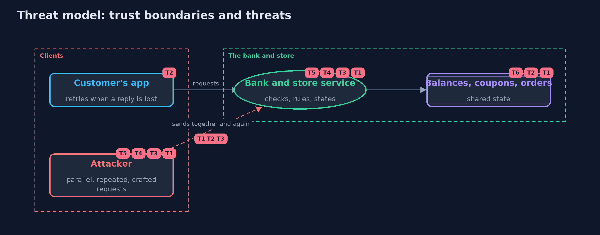

# Threat Model — Race Conditions and Business Logic

A threat model answers four questions: what are we protecting, who or what could harm it, how, and what do we do about it. This one covers this project's own demo system, not a production deployment. Domain: an online bank.

## Scope

An online bank's withdrawals and transfers and an online store's coupons, checkout and order workflow, under requests that arrive together, arrive again, and break the rules. It covers one service process; the database-level
guarantees for many servers are the -with-postgres version. It does not cover authentication or input parsing, covered by earlier projects.

## What we protect (assets)

- Account balances and the money paid out.
- Single-use coupons and the discounts given.
- Orders, their states and refunds.
- Idempotency keys and their stored answers.

## Who and what acts on the system

- Customers, whose apps retry when a reply is lost.
- An attacker who sends the same request many times in parallel, or with crafted values.
- Operators who run more than one server.

## Trust boundaries

A trust boundary is a line that data or a request crosses between parts that trust each other differently. Threats cluster where those lines are.

- Client to server: amounts, totals, coupons and steps arrive from outside and must be checked against the server's own rules.
- Request to shared state: every check and action on shared state is a place where requests can overlap.

Each dashed box is a trust boundary. A rose tag such as T1 shows where the threat of that number, in the table below, applies.

## Threats, using STRIDE

STRIDE is a checklist of six kinds of threat: **Spoofing** (S), **Tampering** (T), **Repudiation** (R), **Information disclosure** (I), **Denial of service** (D), **Elevation of privilege** (E).

| Id | Kind | Threat | Where it shows up | Control in this project | What is left |
| --- | --- | --- | --- | --- | --- |
| T1 | Tampering | Two requests both pass a balance or coupon check before either writes, and spend the same money or coupon twice | `NaiveWithdrawal`, `CouponRedemption` | The check and the write as one step: a lock, a compare-and-set, or a claim in one step | A lock in one process does not protect state shared by many servers |
| T2 | Tampering | A retried request moves money again | `Bank.transfer` | An idempotency key claimed in one step, returning the first answer to every copy | Keys must be stored long enough to cover retries, and clients must send them |
| T3 | Tampering | A negative amount, a transfer to oneself or an overdraft is accepted | `Bank` rules | Server-side rules for every transfer | Rules nobody wrote down are not enforced; new features need new rules |
| T4 | Tampering | The client's total or stacked coupons set the price | `Checkout` | Prices from the catalogue, the client's total ignored, one coupon per order | Promotions with complex rules need their own tests |
| T5 | Elevation of privilege | Workflow steps are skipped or repeated: shipped before payment, refunded twice | `Order` | A state machine that allows each step only from the right states | States must be checked and changed in one step too, or a race returns |
| T6 | Denial of service | Locks taken in different orders deadlock, and requests hang | `LockingTransfer` | Every lock taken in one fixed order | Locks still cost throughput, and timeouts are needed for anything that waits |

## Assumptions

- One service process in the plain version; the model's locks are the process's locks.
- Clients choose a new idempotency key for each new operation, and reuse it only for retries.
- In the demo, concurrency is modelled with a written order of steps; the real-thread tests force the bad order.

## Out of scope

- Database isolation levels and row locks: the -with-postgres version.
- Distributed locks across services.
- Authentication and input validation: the earlier projects.

## How the tests check this

- `InterleavingTest` runs every order of two requests: check-then-act overdraws in some, the lock and compare-and-set in none; coupons, deadlock and fixed lock order.
- `RealThreadsTest` forces the bad order with a barrier on real threads, and checks the lock, compare-and-set and idempotency key under load fifty times.
- `RulesTest` checks the transfer rules, idempotency answers, the order state machine and checkout pricing.
- `DemoRunsTest` compares the whole demo with the golden output.

## Where this model goes next

The next project, secrets-in-errors-and-logs, looks at what leaks when things go wrong, and the -with-postgres version moves these guarantees into the database.
