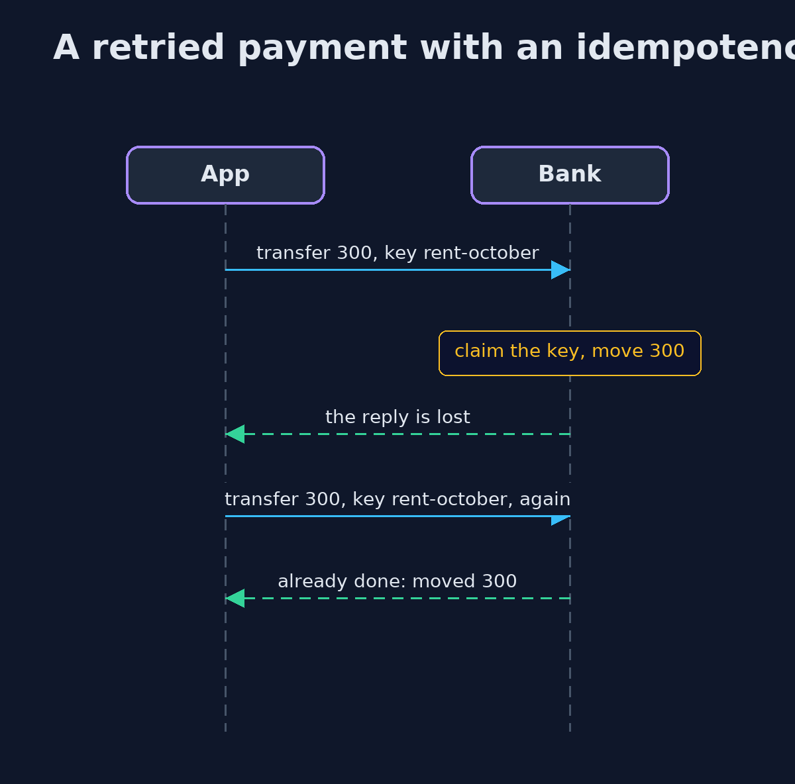
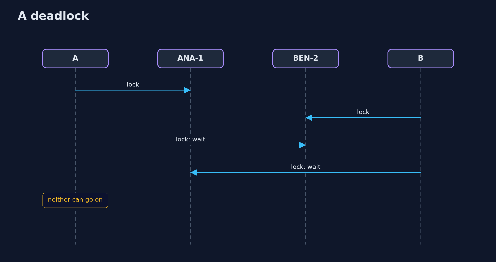

# Race Conditions and Business Logic — UML Sequence Diagrams

## 1. A retried payment with an idempotency key

The key is claimed before the money moves; the second copy gets the first answer.

## 2. A deadlock

Each transfer holds one lock and waits for the other.

