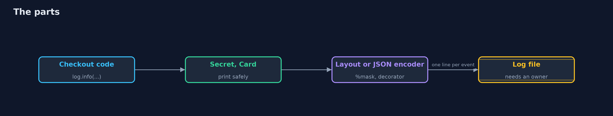
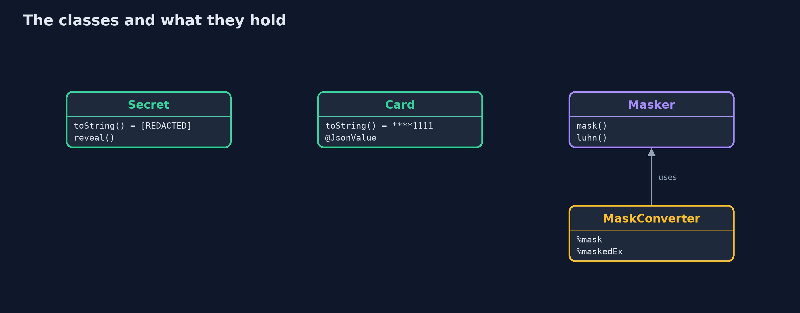
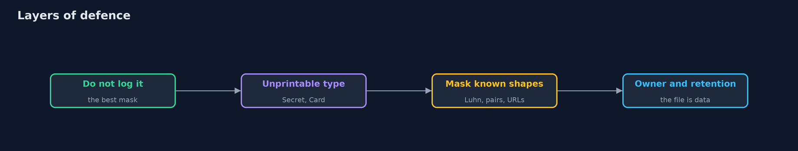
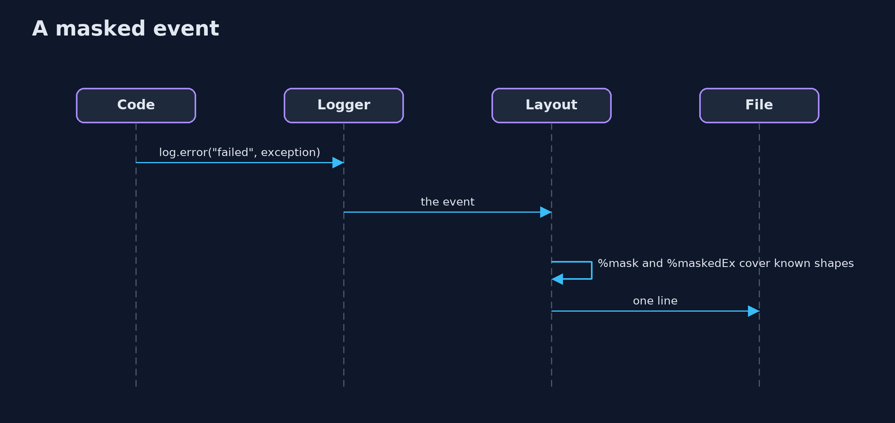

# Secrets in Logs with Logback

```
src/main/java/com/jk/explore/security/logging/
├── Card.java                      A card number that prints as its last four digits, in a string and in JSON
├── CheckoutRequest.java           What the checkout page posts, with the sensitive parts in types that cannot be printed by accident
├── LogSetup.java                  One Logback logger writing into memory, configured in code: a layout, or JSON
├── LoggingDemo.java               The events of the lesson, written the careless way: whatever is at hand goes into the message
├── MaskConverter.java             %mask: the formatted message on one line, with the shapes of secrets covered
├── MaskedThrowableConverter.java  %maskedEx: " | " and the exception and its causes, class and message only, with the shapes of secrets covered; no frames, so no code layout either
├── Masker.java                    Finds the shapes of secrets in text that was already written, and covers them
├── PlainCard.java                 The same card without the care: a record, whose JSON form is its components
└── Secret.java                    A value that is never printed: logging it, or putting it in a message or a string, shows a marker
```

**With Logback 1.6 and logstash-logback-encoder 9 a careless message puts the card, the cvv, the token and the database password in the file and lets a line break forge a second event; a masking layout and a masking JSON decorator cover the shapes they know (a card only if it passes Luhn), types that print as [REDACTED] or ****1111 need no masking at all, JSON keeps one event on one line, but a record is written as its fields, a mask never covers a shape it has not seen, and the log file stays data that needs an owner.**

The plain [secrets-in-errors-and-logs](../secrets-in-errors-and-logs) project writes its own redactor and its own logger. This one uses **Logback 1.6** and **logstash-logback-encoder 9** (JSON events, masking), configured in code, writing into memory so that the output can be compared. It needs no server and no tool beyond Gradle; the demo takes a couple of seconds.

What it shows:
- **What the log keeps.** A careless message: the card, the cvv and the token in a map, the database password in an exception message, and a customer name with a line break that **forges a second event** (4 lines from 3 events).
- **Covering shapes in the layout.** A `%mask` conversion word and a `%maskedEx` word (class and message of the exception and its causes, no frames). A card is covered only if it passes the **Luhn** check, so a 16-digit order number is left alone; the line break becomes `\n`.
- **Make the secret unprintable.** `Secret` prints `[REDACTED]`, `Card` prints `****1111`, a `CheckoutRequest` record made of them prints safely under a plain layout. An exception from a library is logged by class, with a reference.
- **Structured logs.** JSON events keep a line break inside one line; a record is written as its **fields**, not its `toString` (`PlainCard` leaks `number`, `Card` with `@JsonValue` does not); path masks and a value masker cover the rest.
- **The bill.** A pin, a code word and an SSN in free text are in shapes nobody listed; a log file needs an owner, a retention and a level.

**Maps to:** OWASP Top 10 (2025) A09 Security Logging and Alerting Failures · CWE-532 (sensitive information in a log file), CWE-209, CWE-117 (improper output neutralization for logs).

## The idea in everyday terms

A shop's till roll. If it prints the whole card number, anyone who finds the roll in the bin has it. A till that cannot print the number, because the number never reaches the printer, is safer than a till with a person who blacks out what they recognise.

## The scenario

An online store logs its checkout. The demo writes the same three events four ways and reads what each way leaves in the file.

## Run

```bash
./gradlew run
```

The demo tells the story in 5 acts, each printing exact numbers that the tests check:

| Act | What it shows |
| --- | --- |
| 1. What the log keeps | A careless message puts the card, the cvv, the token and the database password in the file, and a line break forges a second event. |
| 2. Covering the shapes of secrets in the layout | A %mask conversion word and a %maskedEx word cover what they recognise; a card only if it passes Luhn; a line break becomes \n. |
| 3. Make the secret unprintable | Types that print as [REDACTED] and ****1111 need no mask at all, and a library's exception is logged by class with a reference. |
| 4. Structured logs | JSON events keep a line break inside one line; a record is written as its fields; path masks and a value masker cover the rest. |
| 5. The bill | A pin, a code word and an SSN in free text are in shapes nobody listed; the file needs an owner, a retention and a level. |

## Test

```bash
./gradlew test
```

12 tests in `DemoRunsTest`, `LoggingTest`. The tests run the real Logback and need no other tool.

## What the simulation got right, and what it left out

Logback and the Logstash encoder are the real libraries; each case has a logger context of its own that writes into memory. Times and thread names are left out of the lines so that the output is the same on every run.

## Technologies and versions

Every version below is pinned in the project's build files and was the latest stable release when the project was built.

| Technology | Version | Used for |
| --- | --- | --- |
| Java | 25 | the language and runtime; a Gradle toolchain finds or downloads the JDK |
| Gradle | 9.8.1 (wrapper) | build and run; nothing to install, the wrapper downloads it |
| ch.qos.logback:logback-classic | 1.6.5 | library the code uses |
| net.logstash.logback:logstash-logback-encoder | 9.0 | library the code uses |
| org.junit.jupiter:junit-jupiter | 6.1.3, set by junit-bom | JUnit 5: the tests (tests only) |
| org.junit.platform:junit-platform-launcher | 6.1.3, set by junit-bom | JUnit platform launcher, which Gradle needs to run the tests (tests only) |
| videokit | repository tool (`tools/videokit`) | the narrated video and animation: Piper `en_US-amy-medium`, speed 0.8, longer pauses (the amy-slow voice) |

## Learning Material

| Document | What it is for |
| --- | --- |
| [Problem statement](docs/problem-statement.md) | the situation and what the project must show |
| [Prerequisites](docs/prerequisites.md) | what you need to know first |
| [Secrets in Logs with Logback, explained](docs/secrets-in-errors-and-logs-with-logback-explained.md) | the acts in prose |
| [Session guide](docs/session.md) | a one-hour lesson with exercises |
| [Animated walkthrough](docs/animation.html) | the acts step by step, narrated |
| [Threat model](docs/threat-model.md) | what is protected, who could harm it, and how, using STRIDE |
| [Spec](docs/spec.md) | what this project must be true of |
| [Expected output](docs/expected-output.txt) | the golden demo output every test and every port checks against |

### The idea in one picture

Events pass types, a layout or an encoder, and a mask, on the way to the file.



### Where each piece sits

Types that print safely, a masker, and two converters.



### How the data moves

From never logging it, to covering what is left.



### Who calls whom, in order




### Video

`video/secrets-in-errors-and-logs-with-logback-explained.mp4` (with `.m4a` audio and `.srt` subtitles) is built by `video/build_video.sh`. Rendered media is not committed.

## What it costs

- **A mask is a guess about shapes,** and secrets arrive in shapes nobody listed.
- **Types that cannot print need discipline,** and a library's own exception message is outside them.
- **JSON logs need a pipeline that reads JSON.**
- **Records and beans are written as fields,** which is not what their toString says.
- **Every log line is retained data:** it needs an owner and an end date.

## When this is too much

A throwaway script that nobody else reads does not need structured logging or masking. Add them when logs leave the machine: to a file others can read, to a central service, to a vendor.

## Where you have already met this

- `logback.xml` with a pattern and a rolling file.
- A `toString()` generated by an IDE that prints every field.
- A log line that says "user=... password=..." from a debugging session.
- A log search that shows a stranger's name.

## Where this sits

This is the tools version of [secrets-in-errors-and-logs](../secrets-in-errors-and-logs), in the [secure-coding](..) module. Where such logs are shipped and searched is the subject of [security-logging-with-loki-and-grafana](../../detection-and-response/security-logging-with-loki-and-grafana).
