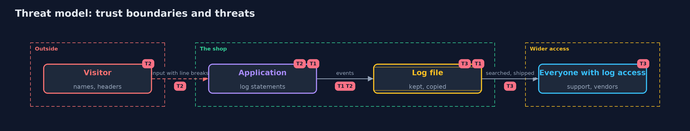

# Threat Model — Secrets in Logs with Logback

A threat model answers four questions: what are we protecting, who or what could harm it, how, and what do we do about it. This one covers this project's own demo system, not a production deployment. Domain: an online store.

## Scope

The log statements of the checkout, the layouts and encoders that write them, and the files they end up in. It does not cover the log shipping system.

## What we protect (assets)

- Cards, tokens and passwords that pass through the code.
- The integrity of the log as evidence.

## Who and what acts on the system

- A visitor who controls some of what is logged.
- A person with access to the logs.
- A developer who adds a log statement.

## Trust boundaries

A trust boundary is a line that data or a request crosses between parts that trust each other differently. Threats cluster where those lines are.

- The edge between the code and the log: whatever crosses it is kept.

Each dashed box is a trust boundary. A rose tag such as T1 shows where the threat of that number, in the table below, applies.

## Threats, using STRIDE

STRIDE is a checklist of six kinds of threat: **Spoofing** (S), **Tampering** (T), **Repudiation** (R), **Information disclosure** (I), **Denial of service** (D), **Elevation of privilege** (E).

| Id | Kind | Threat | Where it shows up | Control in this project | What is left |
| --- | --- | --- | --- | --- | --- |
| T1 | Information disclosure | A secret is written to the log | log statements, exception messages | Do not log it, unprintable types, masks for known shapes | Shapes nobody listed |
| T2 | Tampering | A visitor forges log lines | values with line breaks | One event per line: escape control characters, or write JSON | Log readers that render markup |
| T3 | Information disclosure | Logs are read, copied or kept by more people than intended | the log file and its copies | An owner, a retention, access control | Copies made by tools nobody listed |

## Assumptions

- Log files are copied to places with wider access than the code.
- Developers log at debug level while testing.

## Out of scope

- Secrets in memory dumps.
- Network capture of log traffic.

## How the tests check this

- `LoggingTest` runs the real Logback for the masker, Luhn, idempotency, the layout and exception converters, the types, the JSON events and the decorator.
- `DemoRunsTest` compares the whole demo with the golden output.

## Where this model goes next

The next project in this module is fuzzing-with-jazzer.
