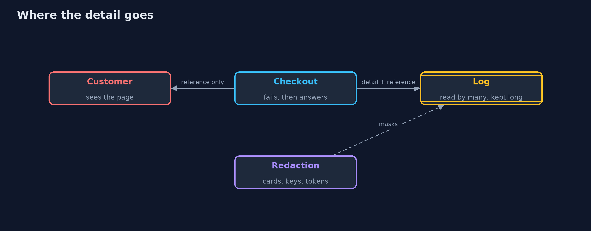
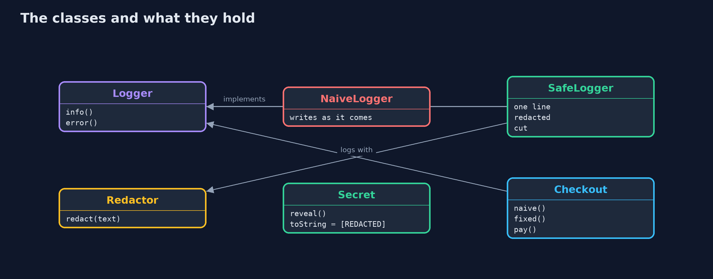
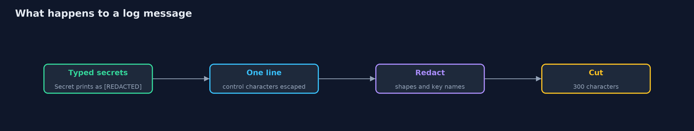
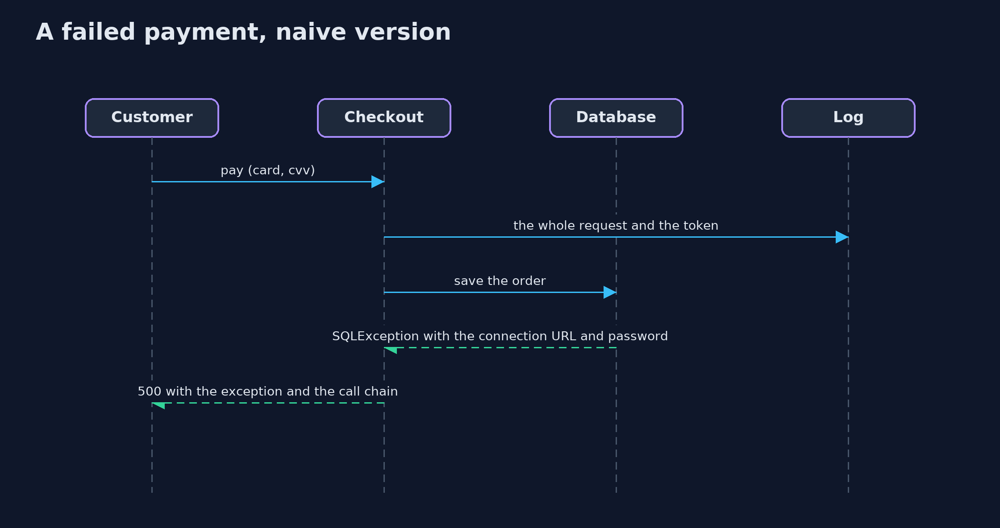

# Secrets in Errors and Logs

```
src/main/java/com/jk/explore/security/leaks/
├── Checkout.java     The shop's checkout call
├── Database.java     The shop's database connection, which is down in this story
├── LeaksDemo.java    Runs the checkout story in four numbered acts and prints exact, repeatable results
├── LogSink.java      Where log lines end up
├── Logger.java       Writes log lines for the shop
├── Luhn.java         The check digit that card numbers carry
├── NaiveLogger.java  The first version: the message is written as it comes, including line breaks that a customer typed, and the exception's message and trace
├── Redactor.java     Masks secrets in text that has already been written, as a last line of defence
├── SafeLogger.java   The fixed version
└── Secret.java       A value that must never be printed: its {@code toString} says so
```

**Error pages and log files collect what the code touched, so stack traces show the customer the database password, logs keep card numbers and tokens for everyone who can search them, and a line break in a name forges log entries; give the customer a reference, keep secrets out of messages, redact as a last defence, and keep each event on one line.**

When something goes wrong, developers want detail: the exception, the request, the values. That detail travels to two places that are easy to forget. The **error page** goes to the customer (and to anyone who causes an error on purpose): a stack trace names classes, hosts, users and sometimes passwords
that were in a connection string. The **log** goes to a file, a log service, a ticket, a screenshot in a chat: far more people can read it than can read the database, and it is kept for years.

Four problems, in the order this project shows them:
- **Detailed errors reach the customer** (CWE-209): the page shows the connection URL with the database password and the call chain.
- **Secrets reach the log** (CWE-532): the whole request, with the card number and CVV, and the session token.
- **Log injection** (CWE-117): a customer whose name contains a line break writes a second log line that looks like "login succeeded for admin".
- **Redaction cannot find everything:** it works on shapes and names, and a secret with neither passes through.

The defences:
- **A generic answer with a reference** for the customer; the detail goes to the log under the same reference.
- **A `Secret` wrapper** whose `toString` is `[REDACTED]`, so that logging it by accident leaks nothing.
- **A logger that keeps every event on one line** and redacts card numbers (with the Luhn check), key-named values, bearer tokens, JWTs and URL passwords.
- **Canary tests:** put a known fake secret through the flow, and fail the build if it appears in a response or a log.

**Maps to:** OWASP Top 10 (2025) A09 Security Logging and Alerting Failures and A02 Security Misconfiguration · CWE-209 · CWE-532 · CWE-117 · OWASP ASVS 5.0, the logging and error handling chapters · PCI DSS requirement 3 (never keep the CVV).

## The idea in everyday terms

A shop assistant who, when a card is declined, reads the whole card out loud to the queue and writes it on the receipt that goes in the public bin. The fix is to say "that did not work, here is a reference", and to keep a private note that never contains the number.

## The scenario

An online shop's checkout fails because the database is down. The demo shows the response the customer gets and the log lines the team keeps, first in a naive version and then in a fixed one. All values are fake: the card is a standard test number, the password and token are harmless markers.

## Run

```bash
./gradlew run
```

The demo tells the story in 4 acts, each printing exact numbers that the tests check:

| Act | What it shows |
| --- | --- |
| 1. What the customer sees when the database is down | A 500 page shows the exception, the connection URL with the database password and the shop's own call chain. |
| 2. What the log keeps | The log holds the card number, CVV, session token and the database password; a name with a line break writes a second, forged line. |
| 3. A generic answer, and the details where only the team looks | The customer gets 'Something went wrong. Quote reference ref-0001 to support.'; the log holds the failure under that reference with the password redacted and the token as [REDACTED]. |
| 4. Redaction, wrappers and forged lines | Luhn-valid card numbers, key-named credentials, bearer tokens, JWTs and URL passwords are masked; a number that fails the check is left; a forged name stays on one line. |

## Test

```bash
./gradlew test
```

11 tests in `DemoRunsTest`, `LeaksTest`. All values are fixed markers and the card is a standard test number, so the demo prints the same text on every run.

## What the simulation got right, and what it left out

The logger, the redactor and the checkout are plain Java. The database error is a fake `SQLException` whose message looks like the ones real drivers produce. All secrets are fixed markers, so the output is the same on every run.

## Technologies and versions

Every version below is pinned in the project's build files and was the latest stable release when the project was built.

| Technology | Version | Used for |
| --- | --- | --- |
| Java | 25 | the language and runtime; a Gradle toolchain finds or downloads the JDK |
| Gradle | 9.8.1 (wrapper) | build and run; nothing to install, the wrapper downloads it |
| org.junit.jupiter:junit-jupiter | 6.1.3, set by junit-bom | JUnit 5: the tests (tests only) |
| org.junit.platform:junit-platform-launcher | 6.1.3, set by junit-bom | JUnit platform launcher, which Gradle needs to run the tests (tests only) |
| videokit | repository tool (`tools/videokit`) | the narrated video and animation: Piper `en_US-amy-medium`, speed 0.8, longer pauses (the amy-slow voice) |

## Learning Material

| Document | What it is for |
| --- | --- |
| [Problem statement](docs/problem-statement.md) | the situation and what the project must show |
| [Prerequisites](docs/prerequisites.md) | what you need to know first |
| [Secrets in Errors and Logs, explained](docs/secrets-in-errors-and-logs-explained.md) | the acts in prose |
| [Session guide](docs/session.md) | a one-hour lesson with exercises |
| [Animated walkthrough](docs/animation.html) | the acts step by step, narrated |
| [Threat model](docs/threat-model.md) | what is protected, who could harm it, and how, using STRIDE |
| [Spec](docs/spec.md) | what this project must be true of |
| [Expected output](docs/expected-output.txt) | the golden demo output every test and every port checks against |

### The idea in one picture

The page and the log have different readers; the fixed version sends them different things.



### Where each piece sits

Two loggers share an interface; the safe one cleans lines and uses the redactor.



### How the data moves

The first defence is not to put the secret in the message.



### Who calls whom, in order




### Video

`video/secrets-in-errors-and-logs-explained.mp4` (with `.m4a` audio and `.srt` subtitles) is built by `video/build_video.sh`. Rendered media is not committed.

## What it costs

- **Less detail in the response makes support harder.** The reference number bridges that: support finds the full record in the log.
- **Redaction costs time on every line,** and can hide something a developer needs. Redact at the edge, keep the pattern list in one place and test it.
- **Patterns produce false positives and false negatives.** An order number that happens to pass the Luhn check is masked; an unnamed secret is not.
- **Structured logs help.** Typed fields can be redacted by name rather than by guessing at a free-text line.
- **Retention is a risk too.** A log kept forever is a secret kept forever; set short retention for detailed logs.

## When this is too much

Do not log request bodies at all by default: log the fields you need to explain what happened. And do not write your own redaction library for production if your logging framework has a maintained one: use this project to understand what it must do, and to write the tests that prove it.

## Where you have already met this

- A framework's default error page with a stack trace, in development mode.
- `log.info("request: " + request)` and `log.debug("response: " + response)` in most code bases.
- `%replace`, `MaskingConverter` and similar in logging configurations.
- A breach report that begins "credentials found in a log file".

## Where this sits

This project is in [secure-coding](..) and follows [fail-closed-error-handling](../../secure-configuration/fail-closed-error-handling), whose error pages it completes with the details of what must not be in them.
[security-logging](../../detection-and-response/security-logging) shows what logs must contain; this one shows what they must not.
