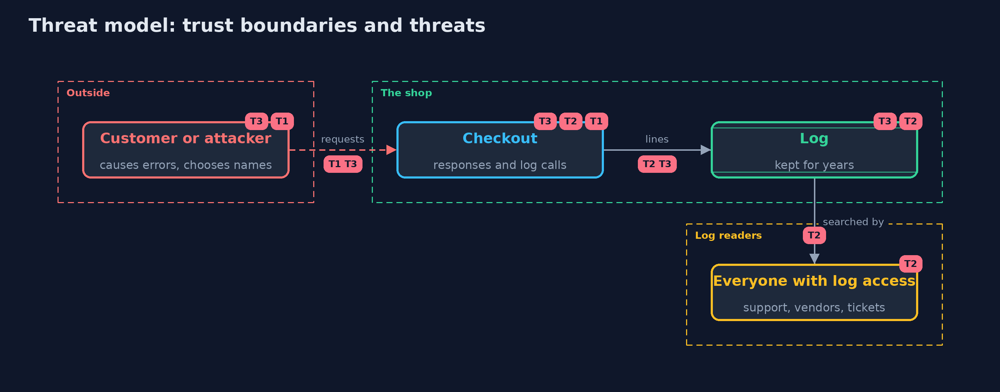

# Threat Model — Secrets in Errors and Logs

A threat model answers four questions: what are we protecting, who or what could harm it, how, and what do we do about it. This one covers this project's own demo system, not a production deployment. Domain: an online shop's checkout.

## Scope

A shop's checkout responses and log lines. It covers what goes into error pages and logs and what a customer can cause to be written.
It does not cover who may access the log service, or how the log is shipped and stored.

## What we protect (assets)

- Card numbers, CVVs, session tokens and database credentials.
- The integrity of the audit trail.

## Who and what acts on the system

- A customer, honest or not.
- Anyone with access to the logs: staff, vendors, a contractor, an attacker with a stolen log-service account.

## Trust boundaries

A trust boundary is a line that data or a request crosses between parts that trust each other differently. Threats cluster where those lines are.

- The server to the customer: the response.
- The application to the log service: the line, and then every reader and backup.

Each dashed box is a trust boundary. A rose tag such as T1 shows where the threat of that number, in the table below, applies.

## Threats, using STRIDE

STRIDE is a checklist of six kinds of threat: **Spoofing** (S), **Tampering** (T), **Repudiation** (R), **Information disclosure** (I), **Denial of service** (D), **Elevation of privilege** (E).

| Id | Kind | Threat | Where it shows up | Control in this project | What is left |
| --- | --- | --- | --- | --- | --- |
| T1 | Information disclosure | An error response gives the customer hosts, users, passwords and code structure | `Checkout` naive error path | A generic answer with a correlation reference | Support needs the log to resolve the reference |
| T2 | Information disclosure | Cards, CVVs, tokens and passwords are kept in the log and read by many people | `NaiveLogger`, `Checkout.pay` | Do not log secrets; `Secret` wrapper; redaction at the logging edge; short retention | Secrets with no name and no shape are not recognised |
| T3 | Tampering | A customer forges log lines with line breaks and control characters | `NaiveLogger.info` | Escape control characters so each event is one line; cut long lines | Structured (JSON) logging is safer still |

## Assumptions

- Logs are readable by more people than the database is.
- Developers add log lines without thinking about every field.

## Out of scope

- Log shipping, retention and access control.
- Detection rules over logs: detecting-attacks.

## How the tests check this

- `LeaksTest` checks the naive and fixed checkout and loggers with canary secrets, one-line events, line length, the Secret wrapper, Luhn card detection and the redaction patterns, and states that unnamed secrets are not found.
- `DemoRunsTest` compares the whole demo with the golden output.

## Where this model goes next

The next project, fuzzing, finds the inputs that make parsers fail in the first place.
