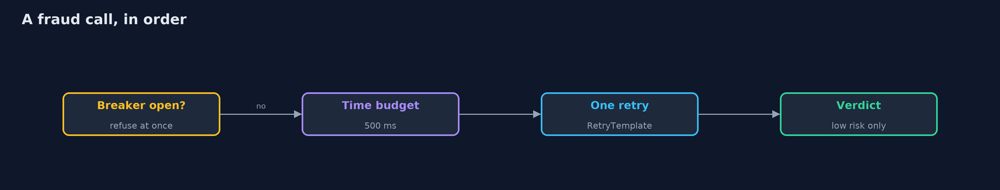

# Failing Closed with Spring Boot

```
src/main/java/com/jk/explore/security/failclosedspring/
├── BankApp.java                 
├── BankConfig.java              One retry after a failed fraud call, with no pause: a limited retry is part of the budget, an unlimited one is an attack on a struggling service
├── Breaker.java                 Stops asking a service that keeps failing
├── CheckFailedException.java    A check could not be made
├── ClosedPaymentService.java    The decision starts as no
├── Decision.java                What the bank answers
├── ErrorHandling.java           One place that turns every failure into the same short answer
├── FailClosedSpringDemo.java    Runs the bank story in five numbered acts against real Spring Boot servers and a real fraud-check server on the loopback interface
├── FraudClient.java             Asks the fraud service about a payment, with a time budget for the whole call
├── FraudServer.java             The fraud-check service: a real HTTP server on the loopback interface that can be made to misbehave
├── FrozenAccountException.java  A checked exception, which is exactly why a plain {@code @Transactional} does not undo the work before it
├── Ledger.java                  The accounts table in an in-memory H2 database
├── MutableClock.java            A clock the demo can move forward, so a cool-down of thirty seconds takes no time to wait for
├── OpenPaymentService.java      The version from a hurry: the decision starts as yes, and a catch-all keeps the payment flowing when the check breaks
├── Payment.java                 A card payment as the customer's app sends it
├── PaymentController.java       
├── PaymentService.java          Decides a payment
├── References.java              Numbers a refusal so the customer can quote it and support can find the log line
├── RefusalWatcher.java          Reads the refusal counters, which is what an alerting rule would do: a closed door is only safe if someone hears it being knocked on
├── Running.java                 A bank and its fraud service, both on free loopback ports
├── SecurityLog.java             The bank's own log of refusals, kept in memory so the demo can read it
├── Transfers.java               Four ways to write the same transfer, and only one of them is a unit of work
└── Wire.java                    A plain HTTP client for the loopback bank
```

**In a Spring Boot bank the decision must start as no, every call to another service needs a time budget, a limited retry and a breaker, a transfer is a unit of work only if the proxy and the rollback rules say so, and one error handler must give the customer a reference while the log keeps the reason; the safety costs availability, which is paid for with breakers and alerts.**

The plain [fail-closed-error-handling](../fail-closed-error-handling) project builds the ideas from scratch. This one uses what a real Spring Boot bank has: **Spring Boot 4.1** with **Spring Framework 7**, a real fraud-check server on the loopback address that can be told to fail in four ways, an in-memory **H2** ledger, and **Micrometer** counters.

What it shows:
- **Failing open.** A `catch (Exception e) { }` around the fraud check approves a risky 1500.00 payment when the fraud service drops the connection, answers 500, answers with a maintenance page or takes too long.
- **Failing closed.** The decision starts as no. The fraud call has a **time budget**, **one retry** with Spring Framework 7's own `RetryTemplate`, and a **breaker**. Every failure becomes a **503** with a reference, and a slow check is cut off at its budget.
- **Failing halfway.** The same transfer to a frozen account written four ways. Without a transaction the debit stays. With `@Transactional` and a **checked exception** it stays too, because Spring rolls back unchecked exceptions only. Called from **inside the same class** the proxy is skipped and it stays again. Only `@Transactional(rollbackFor = Exception.class)` called from outside undoes it.
- **What the customer is told.** With Boot's debugging settings (`spring.web.error.include-*`) the error response names the internal server, the full card number and code lines. One `@RestControllerAdvice` gives a generic answer with a reference, and the log keeps the reason and the last four digits only.
- **The bill.** Ten coffees while the fraud check is slow: 20 calls reach it without a breaker and 6 with one. Refusals are counted by reason, an alert fires, and after the cool-down the breaker closes.

**Maps to:** OWASP Top 10 (2025) A10 Mishandling of Exceptional Conditions · CWE-636 · CWE-755 · CWE-209 · OWASP ASVS 5.0 (error handling and logging).

## The idea in everyday terms

A bank vault with an electronic lock. When the power fails, the door can lock itself or open itself. A vault that opens in a power cut is opened by cutting the power. Failing closed is the vault that locks, and the price is that nobody gets in until the power is back, which is why the bank also has a generator and an alarm.

## The scenario

An online bank on Spring Boot approves card payments by asking a fraud-check service, moves money between accounts, and shows error responses. The demo starts the real application several times, breaks the fraud service in turn, and watches what the code does.

## Run

```bash
./gradlew run
```

The demo tells the story in 5 acts, each printing exact numbers that the tests check:

| Act | What it shows |
| --- | --- |
| 1. Failing open | A catch-all around the fraud check approves a risky 1500.00 payment when the service drops the connection, answers 500, answers with a maintenance page or takes too long. |
| 2. Failing closed | The decision starts as no; a time budget, one retry and a breaker turn every kind of broken check into a 503 with a reference, and a slow check is cut off at its budget. |
| 3. Failing halfway | The same transfer to a frozen account written four ways: without a transaction, with a checked exception, called from the same class, and as a real unit of work. Only the last undoes the debit. |
| 4. What the customer is told | Boot's error response with the debugging settings names the server, the card and code lines; one error handler gives a reference and the log keeps the reason and the last four digits. |
| 5. The bill, and how to pay it | Ten coffees while the fraud check is slow: 20 calls reach it without a breaker and 6 with one; refusals are counted by reason, an alert fires, and the breaker closes after the cool-down. |

## Test

```bash
./gradlew test
```

12 tests in `DemoRunsTest`, `FailClosedSpringTest`. Each test starts a real bank and a real fraud-check server on free loopback ports and stops them. Nothing is printed that changes between runs.

## What the simulation got right, and what it left out

The bank is a real Spring Boot application, the fraud service is a real HTTP server on the loopback interface, and the ledger is an in-memory H2 database. The breaker reads a clock the demo can move forward, so a 30-second cool-down takes no time to wait for. Only statuses, booleans, balances and counts are printed, never ports or time stamps.

## Technologies and versions

Every version below is pinned in the project's build files and was the latest stable release when the project was built.

| Technology | Version | Used for |
| --- | --- | --- |
| Java | 25 | the language and runtime; a Gradle toolchain finds or downloads the JDK |
| Gradle | 9.8.1 (wrapper) | build and run; nothing to install, the wrapper downloads it |
| org.springframework.boot:spring-boot-starter-webmvc | 4.1.1, set by spring-boot-dependencies | library the code uses |
| org.springframework.boot:spring-boot-starter-actuator | 4.1.1, set by spring-boot-dependencies | library the code uses |
| org.springframework.boot:spring-boot-starter-jdbc | 4.1.1, set by spring-boot-dependencies | library the code uses |
| com.h2database:h2 | set by the build | library the code uses |
| org.junit.jupiter:junit-jupiter | 6.1.3, set by junit-bom | JUnit 5: the tests (tests only) |
| org.junit.platform:junit-platform-launcher | 6.1.3, set by junit-bom | JUnit platform launcher, which Gradle needs to run the tests (tests only) |
| videokit | repository tool (`tools/videokit`) | the narrated video and animation: Piper `en_US-amy-medium`, speed 0.8, longer pauses (the amy-slow voice) |

## Learning Material

| Document | What it is for |
| --- | --- |
| [Problem statement](docs/problem-statement.md) | the situation and what the project must show |
| [Prerequisites](docs/prerequisites.md) | what you need to know first |
| [Failing Closed with Spring Boot, explained](docs/fail-closed-error-handling-with-spring-boot-explained.md) | the acts in prose |
| [Session guide](docs/session.md) | a one-hour lesson with exercises |
| [Animated walkthrough](docs/animation.html) | the acts step by step, narrated |
| [Threat model](docs/threat-model.md) | what is protected, who could harm it, and how, using STRIDE |
| [Spec](docs/spec.md) | what this project must be true of |
| [Expected output](docs/expected-output.txt) | the golden demo output every test and every port checks against |

### The idea in one picture

The decision starts as no; the breaker and the budget sit between the bank and the fraud service.


### Where each piece sits

Two payment services behind one interface; the error handler and the log are shared.


### How the data moves

Each step can only turn the answer into a refusal.



### Who calls whom, in order


### Video

`video/fail-closed-error-handling-with-spring-boot-explained.mp4` (with `.m4a` audio and `.srt` subtitles) is built by `video/build_video.sh`. Rendered media is not committed.

## What it costs

- **Failing closed costs availability.** When the fraud check is down, no payment goes through, and ten coffees during a slow outage are all refused.
- **Budgets and retries need tuning.** A budget that is too short refuses healthy calls, and a retry doubles the load on a struggling service: 20 calls instead of 10.
- **A breaker can hide an outage.** Refusing fast is better than waiting, but only if the refusal counters raise an alert.
- **Transactions have rules.** Rollback on unchecked exceptions only, and only through the proxy; each rule is a way to lose money quietly.
- **Generic messages slow support down.** The reference only helps if support can search the log for it.

## When this is too much

For a check that protects nothing important, failing open can be an acceptable business choice, as long as it is a written decision and not an accident. For payments, access control and anything that moves money or data, fail closed, and pay for it with budgets, breakers and alerts.

## Where you have already met this

- `catch (Exception e) { }` and logs full of swallowed exceptions.
- `@Transactional` on a method that is called from the same class.
- A JSON error response with a `trace` field in production.
- `RestClient` or `RestTemplate` with no timeout at all.

## Where this sits

This is the tools version of [fail-closed-error-handling](../fail-closed-error-handling), in the [secure-configuration](..) module. It follows the same story, a bank that must say no when it cannot say yes, on a real framework.
