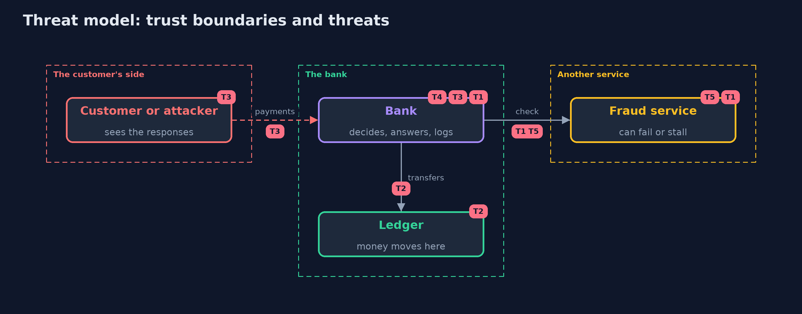

# Threat Model — Failing Closed with Spring Boot

A threat model answers four questions: what are we protecting, who or what could harm it, how, and what do we do about it. This one covers this project's own demo system, not a production deployment. Domain: an online bank.

## Scope

A Spring Boot bank that approves card payments through an outside fraud service, moves money in a ledger and answers customers. It covers failures of the outside service, half-done transfers and what error responses and logs reveal. It does not cover the fraud service's own logic.

## What we protect (assets)

- The money in the ledger.
- The card numbers.
- The availability of payments.

## Who and what acts on the system

- A customer, or an attacker who can make the fraud service slow or broken.
- Support staff who read the log.
- A developer who changes the error and transaction settings.

## Trust boundaries

A trust boundary is a line that data or a request crosses between parts that trust each other differently. Threats cluster where those lines are.

- The bank to the fraud service: anything can come back, or nothing.
- The bank to the customer: the response is public.
- The bank to the log: support may read it.

Each dashed box is a trust boundary. A rose tag such as T1 shows where the threat of that number, in the table below, applies.

## Threats, using STRIDE

STRIDE is a checklist of six kinds of threat: **Spoofing** (S), **Tampering** (T), **Repudiation** (R), **Information disclosure** (I), **Denial of service** (D), **Elevation of privilege** (E).

| Id | Kind | Threat | Where it shows up | Control in this project | What is left |
| --- | --- | --- | --- | --- | --- |
| T1 | Elevation of privilege | A broken or stalled fraud check turns into an approval | `OpenPaymentService`, `ClosedPaymentService` | The decision starts as no; only a check that ran and passed approves | A fraud service that answers low risk wrongly |
| T2 | Tampering | A failed transfer leaves the money half moved | `Transfers` | A unit of work with rollbackFor, called through the proxy | Transfers across systems, which need reconciliation |
| T3 | Information disclosure | The error response reveals servers, card numbers or code | Boot's error response, `ErrorHandling` | One error handler, error details off, a reference for support | A new exception path that nobody mapped |
| T4 | Information disclosure | The log holds a full card number | `SecurityLog` | Log the reference, the reason and the last four digits only | A developer who logs the request body |
| T5 | Denial of service | A slow or failing service holds every payment up | `FraudClient`, `Breaker` | A time budget, a limited retry, a breaker and an alert on refusals | A long outage that is refused correctly and still hurts |

## Assumptions

- The log is readable only by support staff.
- The ledger database is trusted and reachable.

## Out of scope

- Attacks on the fraud service itself.
- Transactions across several databases.

## How the tests check this

- `FailClosedSpringTest` starts a real bank and fraud server for each case: every kind of broken check, the time budget, the breaker and its states, the doubling of calls by a retry, the alert, the four transfers, the error responses and the log.
- `DemoRunsTest` compares the whole demo with the golden output.

## Where this model goes next

This is the last project in the secure-configuration module. The next module, api-security, moves from how the store fails to who may call it and how often.
