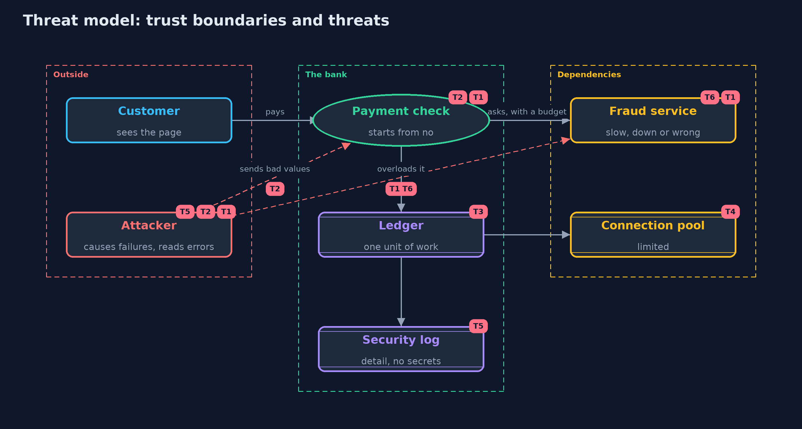

# Threat Model — Failing Closed: Secure Error Handling

A threat model answers four questions: what are we protecting, who or what could harm it, how, and what do we do about it. This one covers this project's own demo system, not a production deployment. Domain: an online bank.

## Scope

An online bank's payment check, its transfers between accounts, its connection pool and its error pages, when a dependency is slow, down or returns a value that cannot be read. It covers
attackers who cause or exploit failures, and attackers who read error pages. It does not cover the fraud model itself, distributed transactions, or the logging pipeline.

## What we protect (assets)

- The bank's money and the correctness of every balance.
- The decision to approve a payment.
- Internal details: host names, versions, code paths.
- Card numbers and other secrets that pass through errors.
- The bank's availability.

## Who and what acts on the system

- Customers paying and transferring money.
- An attacker who overloads a dependency or sends values that break parsing, to make a check fail.
- An attacker who reads error pages for internal details.
- Support staff who look up references in the log.

## Trust boundaries

A trust boundary is a line that data or a request crosses between parts that trust each other differently. Threats cluster where those lines are.

- The bank to its dependencies: every answer may be late, missing or wrong.
- The bank to the customer: what an error page says crosses this line.
- The bank to its log: the detail stays inside, without secrets.

Each dashed box is a trust boundary. A rose tag such as T1 shows where the threat of that number, in the table below, applies.

## Threats, using STRIDE

STRIDE is a checklist of six kinds of threat: **Spoofing** (S), **Tampering** (T), **Repudiation** (R), **Information disclosure** (I), **Denial of service** (D), **Elevation of privilege** (E).

| Id | Kind | Threat | Where it shows up | Control in this project | What is left |
| --- | --- | --- | --- | --- | --- |
| T1 | Elevation of privilege | A dependency failure turns into an approval, because a catch-all swallows the error | `NaiveAuthorizer` | Start from no; only an explicit, successful check approves | A check that answers wrongly but on time is still believed |
| T2 | Tampering | An unreadable value makes the code skip a check | `NaiveAuthorizer`, the limit check | Strict parsing, and an unreadable value is a refusal | Values that parse but are wrong need validation at the source |
| T3 | Tampering | A change fails halfway, and money is lost or created | `Transfers.naive` | Check first, then change both sides, and undo if the second fails | Across systems, an undo can fail too, and needs reconciliation |
| T4 | Denial of service | Errors leak connections until the bank stops | `ConnectionPool.naiveUpdate` | try-with-resources releases on every path | Pool size and timeouts still need monitoring |
| T5 | Information disclosure | Error pages and logs reveal internals and card numbers | `ErrorPages.naive`, `SecurityLog` | A generic page with a reference; the log redacts card numbers | Redaction catches card numbers, not every secret; secrets should not reach messages at all |
| T6 | Denial of service | Failing closed during an outage refuses every customer | `SafeAuthorizer`, `ResilientAuthorizer` | Time budgets, a limited retry, a breaker that refuses fast, and an alert on refusals | Customers are still refused until the dependency is back; that is the chosen cost |

## Assumptions

- The fraud check and the limit are correct when they answer.
- The ledger's undo succeeds; across systems that needs reconciliation.
- In the demo, time runs on a simulated clock, and the card number is a well-known test number.

## Out of scope

- The fraud model's accuracy.
- Distributed transactions and sagas across services.
- Shipping, storing and alerting on logs: the detection-and-response module.

## How the tests check this

- `AuthorizerTest` checks the naive check's two failures, the safe check's refusals on errors, timeouts and bad values, and the references.
- `PartialFailureTest` checks lost money in the naive transfer, all-or-nothing transfers, refusals of bad amounts, and connection leaks.
- `ErrorsAndBreakerTest` checks the safe and raw error pages, card number redaction, the breaker's states, refusals without calls, and the single retry.
- `DemoRunsTest` compares the whole demo with the golden output.

## Where this model goes next

The next module, api-security, applies the same habits to an API: explicit request and response models, budgets for every client, and protection of sessions.
