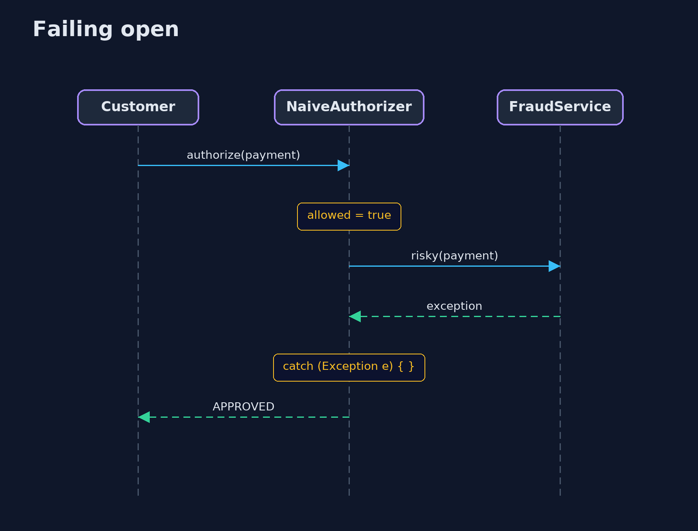
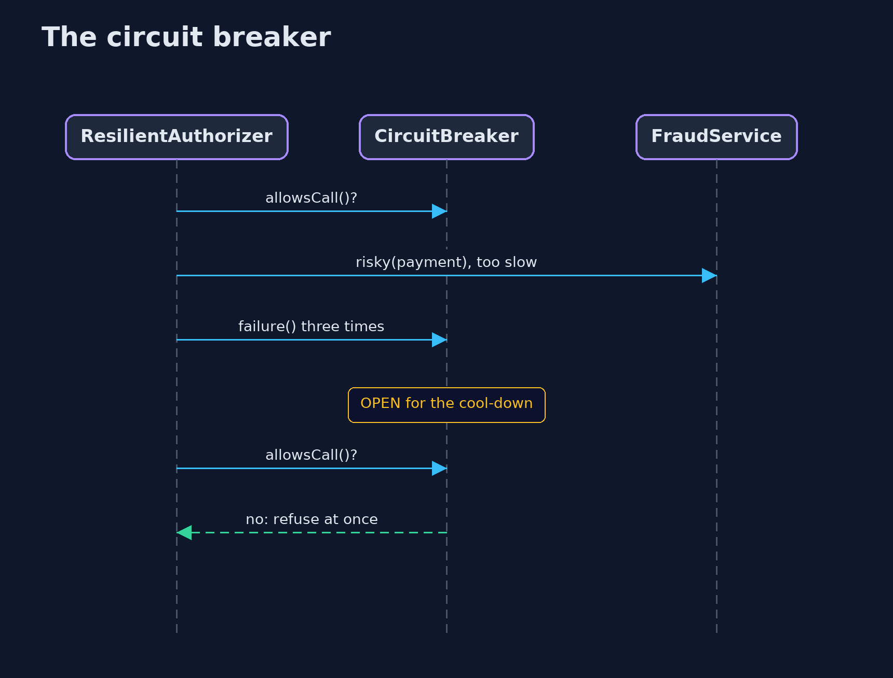

# Failing Closed: Secure Error Handling — UML Sequence Diagrams

## 1. Failing open

The catch-all swallows the error, and the decision was yes from the start.

## 2. The circuit breaker

After three failures, payments are refused at once, without calling the struggling service.

