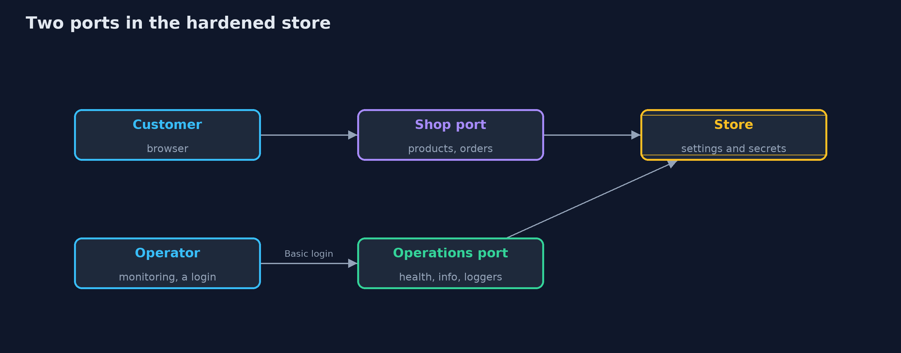
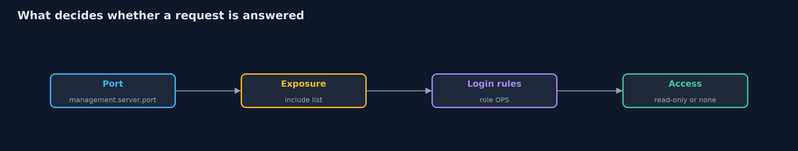
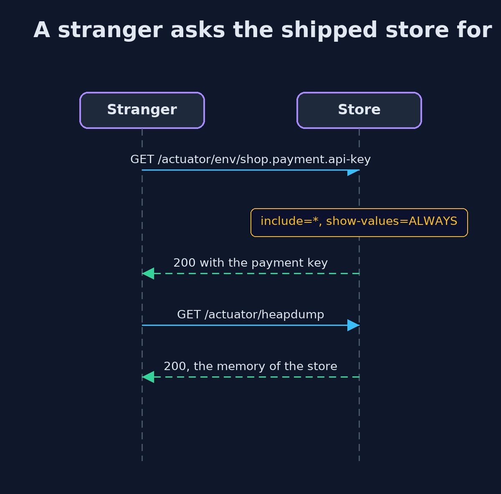

# Security Misconfiguration with Spring Boot Actuator

```
src/main/java/com/jk/explore/security/actuatorspring/
├── ActuatorChecker.java     Tests a running store from outside, as a scanner would, and scores it
├── ActuatorSpringDemo.java  Runs the store story in five numbered acts against real Spring Boot servers on the loopback interface
├── Running.java             A store started on free loopback ports with the given profile
├── ShopController.java      The store's own endpoints
├── StoreApp.java            
├── StoreSecurity.java       Two filter chains: one that lets everything through, as in a store where nobody wrote rules for the actuator, and one with rules
└── Wire.java                A plain HTTP client for the loopback servers
```

**Spring Boot Actuator is the part of a store that was built to be looked into, so a stranger who reaches it can read the payment key, list the unlisted routes, download the heap and stop the store; Spring Boot hides values and keeps the dangerous endpoints off by default, and the rest is the store's job: another port, a short list, login rules, read-only access and a checker that runs on every change.**

The plain [security-misconfiguration](../security-misconfiguration) project builds the settings checker from scratch. This one uses the part of a real Spring Boot store that was made to be looked into: **Spring Boot Actuator 4.1**, in real servers on the loopback address.

What it shows:
- **The setting from a tutorial**, `management.endpoints.web.exposure.include=*`, with values shown, health details on and two switches turned on. A stranger reads the **payment key and the database password** from `/actuator/env`, sees the unlisted refund route in `/actuator/mappings`, downloads a **heap dump** that contains the key, changes a log level and stops the store with `POST /actuator/shutdown`. The checker scores it 0 of 8.
- **What Spring Boot already does.** With no settings the list offers `health` only and shows a status, not components. With `include=*` alone values are masked as `******`, and `heapdump` and `shutdown` stay off until their access is set. But names and routes are still open, and once the dump is allowed it contains the key that the environment page masked.
- **The hardened store.** Operations on their **own loopback port**, an explicit list (`health`, `info`, `loggers`), Spring Security rules (health open, everything else for the `OPS` role), health details only for that role, and `loggers` set to **read-only access**. The checker scores it 8 of 8.
- **Who may read and who may change.** A customer login is not an operator login, and an operator who posts a new log level gets 405.
- **The bill.** One line of `include=*` added "to debug something" costs a check, and the login rules still keep strangers out, which is why the port, the list, the rules and the access levels are four separate settings.

**Maps to:** OWASP Top 10 (2025) A02 Security Misconfiguration · CWE-16 · CWE-200 · CWE-215 (sensitive information in debugging code) · OWASP ASVS 5.0, the configuration chapter · Spring Boot's own production-ready features guide.

## The idea in everyday terms

A shop where the staff-only door has a sign that says "STAFF" and no lock, and behind it hang the safe's combination, the plan of every back room and a camera feed of the stockroom. The sign is a setting. The lock is another one.

## The scenario

An online store on Spring Boot with Actuator for its health checks. The demo starts the real application five times, in different configurations, and talks to it over HTTP the way a scanner would.

## Run

```bash
./gradlew run
```

The demo tells the story in 5 acts, each printing exact numbers that the tests check:

| Act | What it shows |
| --- | --- |
| 1. Expose everything | With the tutorial setting, a stranger reads the payment key and the database password, lists the unlisted refund route, downloads a heap dump containing the key, changes a log level and stops the store; the checker scores 0 of 8. |
| 2. What Spring Boot already does | With no settings only health is listed, with include=* values are masked and the heap dump and shutdown stay off, but names and routes are open and an allowed heap dump contains the key that env masked. |
| 3. Hardened: another port, a short list, rules | Operations sit on their own loopback port with health, info and loggers only; strangers see a status, nothing else is reachable even for an operator, and the checker scores 8 of 8. |
| 4. Who may read, and who may change | Loggers are for operators only, health details too, and the loggers endpoint is read-only: an operator who posts a new level gets 405 and the level stays. |
| 5. The bill | One line of include=* added to the hardened store costs a check, the login rules still keep strangers out, and the checker belongs in CI. |

## Test

```bash
./gradlew test
```

11 tests in `ActuatorSpringTest`, `DemoRunsTest`. Each test starts a real store on free loopback ports and stops it. Nothing is printed that changes between runs.

## What the simulation got right, and what it left out

The stores are real Spring Boot applications on Tomcat, with Actuator and Spring Security 7. The secrets are fixed demo values. Only statuses and booleans are printed, never ports, paths or disk sizes, so the demo prints the same text on every run.

## Technologies and versions

Every version below is pinned in the project's build files and was the latest stable release when the project was built.

| Technology | Version | Used for |
| --- | --- | --- |
| Java | 25 | the language and runtime; a Gradle toolchain finds or downloads the JDK |
| Gradle | 9.8.1 (wrapper) | build and run; nothing to install, the wrapper downloads it |
| org.springframework.boot:spring-boot-starter-webmvc | 4.1.1, set by spring-boot-dependencies | library the code uses |
| org.springframework.boot:spring-boot-starter-security | 4.1.1, set by spring-boot-dependencies | library the code uses |
| org.springframework.boot:spring-boot-starter-actuator | 4.1.1, set by spring-boot-dependencies | library the code uses |
| org.junit.jupiter:junit-jupiter | 6.1.3, set by junit-bom | JUnit 5: the tests (tests only) |
| org.junit.platform:junit-platform-launcher | 6.1.3, set by junit-bom | JUnit platform launcher, which Gradle needs to run the tests (tests only) |
| videokit | repository tool (`tools/videokit`) | the narrated video and animation: Piper `en_US-amy-medium`, speed 0.8, longer pauses (the amy-slow voice) |

## Learning Material

| Document | What it is for |
| --- | --- |
| [Problem statement](docs/problem-statement.md) | the situation and what the project must show |
| [Prerequisites](docs/prerequisites.md) | what you need to know first |
| [Security Misconfiguration with Spring Boot Actuator, explained](docs/security-misconfiguration-with-spring-boot-actuator-explained.md) | the acts in prose |
| [Session guide](docs/session.md) | a one-hour lesson with exercises |
| [Animated walkthrough](docs/animation.html) | the acts step by step, narrated |
| [Threat model](docs/threat-model.md) | what is protected, who could harm it, and how, using STRIDE |
| [Spec](docs/spec.md) | what this project must be true of |
| [Expected output](docs/expected-output.txt) | the golden demo output every test and every port checks against |

### The idea in one picture

Customers reach the shop routes; operators reach health, info and loggers on another loopback port, behind a role.



### Where each piece sits

The security rules differ by profile; the controller and the checker are the same in every store.


### How the data moves

Four separate settings, in the order a request meets them.



### Who calls whom, in order




### Video

`video/security-misconfiguration-with-spring-boot-actuator-explained.mp4` (with `.m4a` audio and `.srt` subtitles) is built by `video/build_video.sh`. Rendered media is not committed.

## What it costs

- **A separate port needs a firewall rule or a network policy,** and the monitoring system must be told where to look.
- **Operators need accounts,** and every account is something to rotate and to remove when someone leaves.
- **A short list means a request to add an endpoint,** and someone must review it, which is slower than typing `*`.
- **Read-only access removes conveniences** such as changing a log level on a running store; a deployment or a restart replaces them.
- **A passing score is not a secure store.** The checker proves its eight checks pass; anything else is still open.

## When this is too much

For a laptop demo, exposing everything is fine, and that is exactly why tutorials do it. For anything reachable from a network, the separate port, the list and the rules are the minimum, and the checker is cheap enough to run on every change.

## Where you have already met this

- `management.endpoints.web.exposure.include=*` in a copied tutorial.
- `/actuator/health` used as a load balancer check, with details switched on.
- A heap dump attached to a support ticket.
- An internal URL that was never meant to be internal, found by a scanner.

## Where this sits

This is the tools version of [security-misconfiguration](../security-misconfiguration), in the [secure-configuration](..) module. It follows the same story, an online store whose shipped settings give too much away, on a real framework.
