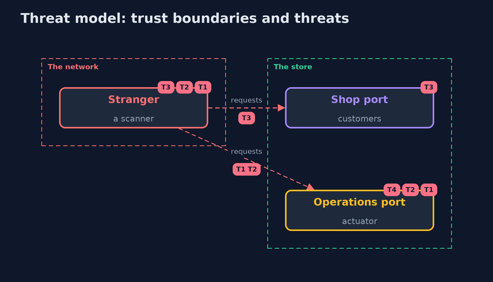

# Threat Model — Security Misconfiguration with Spring Boot Actuator

A threat model answers four questions: what are we protecting, who or what could harm it, how, and what do we do about it. This one covers this project's own demo system, not a production deployment. Domain: an online store.

## Scope

A Spring Boot store with Actuator, on loopback ports. It covers what the actuator endpoints reveal and allow, and the settings that control them. It does not cover the store's business logic or the host.

## What we protect (assets)

- The payment key and the database password.
- The memory of the running store.
- The availability of the store.

## Who and what acts on the system

- A stranger who can reach the store's ports.
- A customer with a login.
- An operator with a login.
- A developer who changes the configuration.

## Trust boundaries

A trust boundary is a line that data or a request crosses between parts that trust each other differently. Threats cluster where those lines are.

- The customers' port to the store.
- The operations port to the store: a role is required for all but health.

Each dashed box is a trust boundary. A rose tag such as T1 shows where the threat of that number, in the table below, applies.

## Threats, using STRIDE

STRIDE is a checklist of six kinds of threat: **Spoofing** (S), **Tampering** (T), **Repudiation** (R), **Information disclosure** (I), **Denial of service** (D), **Elevation of privilege** (E).

| Id | Kind | Threat | Where it shows up | Control in this project | What is left |
| --- | --- | --- | --- | --- | --- |
| T1 | Information disclosure | A stranger reads secrets from the environment, configuration or heap endpoints | `/actuator/env`, `/actuator/configprops`, `/actuator/heapdump` | A short exposure list, masked values, no heap dump, a role for every endpoint but health | A secret in memory of a store that an attacker already controls |
| T2 | Tampering | A stranger changes the store with a write operation | `/actuator/loggers`, `/actuator/shutdown` | Read-only access, shutdown left off, a role for operations | An operator account that is stolen |
| T3 | Information disclosure | A stranger maps the routes and the components behind the store | `/actuator/mappings`, `/actuator/beans`, health details | A short list, health details for the OPS role only, operations on their own port | Routes that can be found by guessing |
| T4 | Elevation of privilege | One setting is loosened and the others are not reviewed | `application-*.properties` | Four separate settings and a checker in the build | A change that no check covers |

## Assumptions

- The operations port is not reachable from the internet.
- Operator passwords are kept and rotated outside this project.

## Out of scope

- Attacks on the host or the network.
- Secrets stored in a vault, which have their own project.

## How the tests check this

- `ActuatorSpringTest` starts a real store per configuration and checks the leaks, the defaults, the hardened ports, roles, read-only access, the cost of `include=*` and that the checker changes nothing.
- `DemoRunsTest` compares the whole demo with the golden output.

## Where this model goes next

The next project in this module, fail-closed-error-handling-with-spring-boot, moves from what the store shows to what it does when something breaks.
