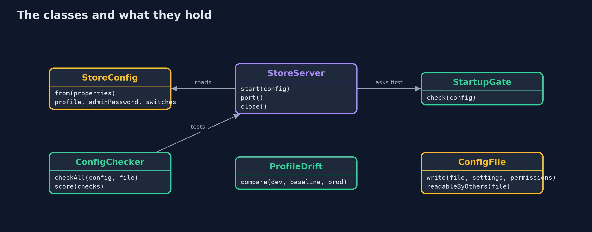
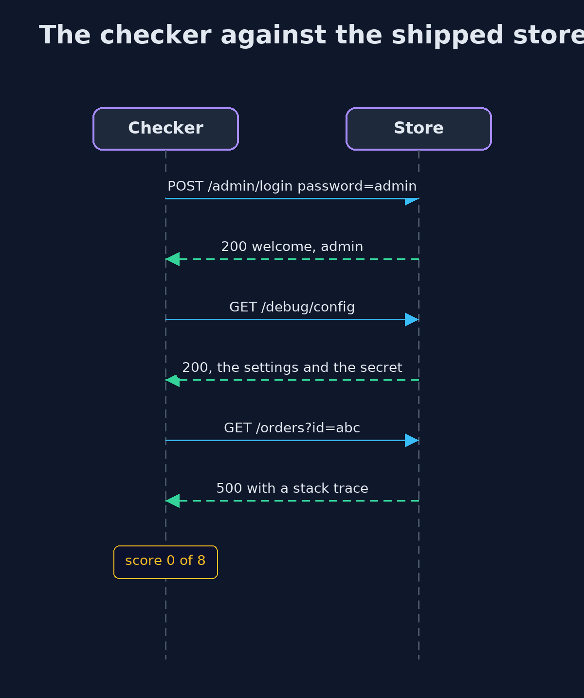

# Security Misconfiguration

```
src/main/java/com/jk/explore/security/misconfig/
├── ConfigChecker.java            Checks a running store from the outside, the way a scanner or an attacker would, and its settings file from the inside
├── ConfigFile.java               The settings file on disk
├── InsecureConfigException.java  Thrown by the startup gate: the store refuses to start with a setting that must never reach production
├── MisconfigDemo.java            Runs the online store story in five numbered acts and prints exact, repeatable results
├── ProfileDrift.java             Compares a production settings file with the hardened baseline and with development
├── Profiles.java                 The settings files the demo uses: what the store ships with, a hardened production profile, and a production profile copied from development
├── Secrets.java                  Password comparison in constant time, and the list of defaults that attackers try first
├── StartupGate.java              Checks run before the store opens its port
├── StoreConfig.java              The store's settings, read from a properties file
└── StoreServer.java              The online store on the loopback interface
```

**Most breaches of this kind need no clever attack: a default password, a debug page, a directory listing or a stack trace is simply left on, so secure defaults, a startup gate and a checker that runs on every change matter as much as the code.**

**Security misconfiguration** is number two in the OWASP Top 10 (2025, A02). It needs no clever attack. A product ships with settings that are comfortable for a developer, such as a
**default admin password**, a **debug page** that prints the configuration, a **directory listing** of the static folder, **detailed error pages** with stack traces, a **version banner** and the
**TRACE** method, and nobody turns them off. Scanners try every one of them within minutes of a server going online. The fixes are not new code but a habit. **Secure defaults**: every
setting stated, every risky one off. A **startup gate** that refuses to start a production store with a default secret. A **drift check** that compares production with the baseline. And a
**checker** that tests the live store from outside, as an attacker would.

The demo starts an online store with its shipped settings, lets a checker find what is wrong, hardens it, catches drift from development, and ends with what hardening costs.

Maps to: OWASP Top 10 2025 A02 (Security Misconfiguration); CWE-16 (Configuration), CWE-1188 (insecure default initialization of a resource), CWE-209 (error messages containing sensitive information), CWE-548 (exposure of information through directory listing); OWASP ASVS 5.0, the configuration chapter.

## The idea in everyday terms

Think of a shop that fits an expensive lock and leaves the spare key hanging in the door, the alarm code written on the wall, and the stockroom door propped open because the
delivery person finds it easier. None of it is a broken lock. Every one of them is a setting someone forgot to change, and a burglar checks those first.

## The scenario

An online store is deployed with the settings it shipped with. The demo checks it from the outside, as an attacker's scanner would, then hardens it, tries to deploy a production profile
that was copied from development, and looks at the smaller leaks: a version banner, the TRACE method and a settings file that other users can read.

## Run

```bash
./gradlew run
```

The demo tells the story in 5 acts, each printing exact numbers that the tests check:

| Act | What it shows |
| --- | --- |
| 1. The store started with its shipped defaults | The default admin password works, the debug page shows the secret, the static folder lists a backup file, errors show stack traces, and the checker scores the store 0 of 8. |
| 2. Secure defaults, and a gate at startup | The hardened profile passes all 8 checks, and the startup gate refuses to start a production store whose admin password is a default or empty. |
| 3. Drift: development settings that reach production | A production file copied from development still has the debug page and detailed errors on and a test setting present; the drift check fails the deployment, and the gate would refuse to start it. |
| 4. Banners, methods and file permissions | The shipped store names its product and version and echoes requests to TRACE; the hardened one names nothing and refuses TRACE; a settings file with rw-r--r-- is readable by other users, rw------- is not. |
| 5. The bill: a baseline that must be checked again and again | A new feature adds a setting the baseline has never seen, which is flagged for review; checks belong in CI, at startup and against the live store; a passing score means only that the checks pass. |

## Test

```bash
./gradlew test
```

16 tests in `DemoRunsTest`, `GateAndDriftTest`, `StoreAndCheckerTest`. The store runs on a random loopback port that is never printed, settings files get explicit permissions, and the production secret is a fixed demo value, so the golden output is the same on every run.

## What the simulation got right, and what it left out

The store is a real HTTP server on the loopback interface of the machine running the demo, on a random port that is never printed. Its settings are properties files written to a temporary
folder, with explicit POSIX permissions, so the output is the same on every run. The production secret is a fixed demo value and is never printed.

## Technologies and versions

Every version below is pinned in the project's build files and was the latest stable release when the project was built.

| Technology | Version | Used for |
| --- | --- | --- |
| Java | 25 | the language and runtime; a Gradle toolchain finds or downloads the JDK |
| Gradle | 9.8.1 (wrapper) | build and run; nothing to install, the wrapper downloads it |
| org.junit.jupiter:junit-jupiter | 6.1.3, set by junit-bom | JUnit 5: the tests (tests only) |
| org.junit.platform:junit-platform-launcher | 6.1.3, set by junit-bom | JUnit platform launcher, which Gradle needs to run the tests (tests only) |
| videokit | repository tool (`tools/videokit`) | the narrated video and animation: Piper `en_US-amy-medium`, speed 0.8, longer pauses (the amy-slow voice) |

## Learning Material

| Document | What it is for |
| --- | --- |
| [Problem statement](docs/problem-statement.md) | the situation and what the project must show |
| [Prerequisites](docs/prerequisites.md) | what you need to know first |
| [Security Misconfiguration, explained](docs/security-misconfiguration-explained.md) | the acts in prose |
| [Session guide](docs/session.md) | a one-hour lesson with exercises |
| [Animated walkthrough](docs/animation.html) | the acts step by step, narrated |
| [Threat model](docs/threat-model.md) | what is protected, who could harm it, and how, using STRIDE |
| [Spec](docs/spec.md) | what this project must be true of |
| [Expected output](docs/expected-output.txt) | the golden demo output every test and every port checks against |

### The idea in one picture

The gate checks the settings before the port opens; the checker tests the running store from outside.


### Where each piece sits

StoreConfig is read from properties; StoreServer behaves as the settings say; the checker, the gate and the drift check judge them.



### How the data moves

Each switch is useful to a developer and to an attacker in the same way.


### Who calls whom, in order




### Video

`video/security-misconfiguration-explained.mp4` (with `.m4a` audio and `.srt` subtitles) is built by `video/build_video.sh`. Rendered media is not committed.

## What it costs

- **Hardening is a baseline, not a one-off.** Every new feature adds settings, and every setting has an insecure value, so the baseline and its checks grow with the store.
- **A gate can stop a deployment at the worst time.** A store that refuses to start is safer than one that starts insecure, but it needs a clear message and someone on call who can fix the setting.
- **Developers lose conveniences.** No debug page, no stack traces in the browser, no directory listing: logs and local profiles have to replace them.
- **A passing score is not a secure store.** The checker proves its eight checks pass. Anything it does not check is still open.

## When this is too much

For a laptop demo, the shipped settings are fine, and that is exactly why they ship. For anything reachable from a network, the hardened profile, the startup gate and the drift check are
the minimum, and running the checker against the live store on a schedule is cheap insurance.

## Where you have already met this

- Routers, cameras and databases that ship with `admin`/`admin` and are found by scanners within minutes.
- Spring Boot's actuator, Tomcat's manager and other admin consoles left reachable.
- Error pages that show a stack trace with class names and versions.
- Benchmarks such as the CIS Benchmarks, which are long lists of exactly these settings.

## Where this sits

This project is the first in the intermediate track's **secure-configuration** module ([secure-configuration](..)). It builds on the beginner projects
[http-basics-and-headers](../../../beginner/networking/http-basics-and-headers) and [patching-and-dependency-hygiene](../../../beginner/safe-habits/patching-and-dependency-hygiene).
